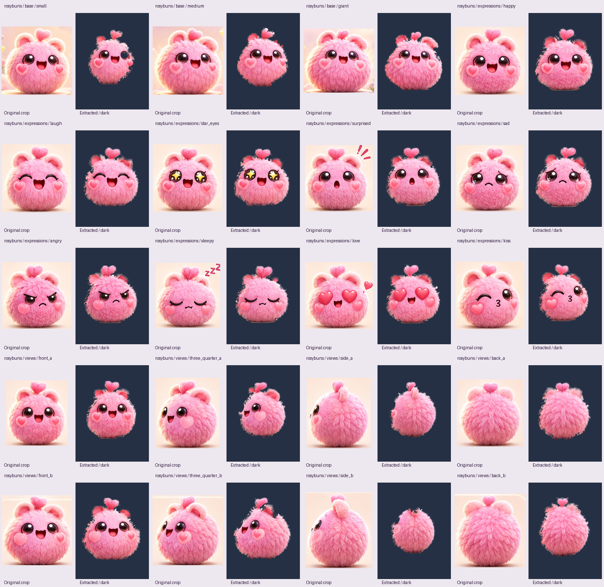

# Fluffy Bubble Shooter — original asset library

Private recovery archive for the user's approved Rosybuns visual design. Artwork was copied unchanged; nothing was generated, redrawn, recolored, or re-extracted for this upload.

## Available files

- `references/locked/rosybuns/`: original ChatGPT upload and the local source used by the recovered extraction set. Their encoded file hashes differ, but all decoded RGBA pixels are identical (1536 × 1024).
- `assets/characters/rosybuns/`: recovered local draft set: 3 base sizes, 9 expressions, and 8 views; 20 PNG exports, 20 lossless WebP exports, 20 native PNGs, source crops, masks, and original partial metadata. Its internal paths are relative to this directory and are preserved.
- `manifest.json`: actual file inventory, dimensions, SHA-256 hashes, recovery status, and missing deliverables.
- `PROVENANCE.md`: origin and limits of this recovery.
- `qa/README.md`: review findings.

## QA preview

## Recovery limitations

The earlier ChatGPT `Rosybuns_Asset_Pack_v1.zip` and its renamed copies were not accessible here. This repository is NOT a verified copy of that ZIP. It contains a separately recovered local draft set and the original uploaded board. The earlier claimed evolution crop, collection portrait and TypeScript asset map were not recovered. The evolution artwork remains visible in the untouched board. No sprites for the other five families are included.

These extractions are **drafts requiring review**, not approved production assets: ear/tuft/fur regions are visibly missing in some views, and edges can retain background contamination. The locked board remains the source of truth. Do not redesign faces, fur, colors, silhouettes or proportions; do not substitute newly generated artwork.

## Download

Sign into the owning GitHub account, then use **Code → Download ZIP** or clone this private repository. The repository ZIP is a new recovery archive, not the inaccessible earlier ZIP.

No open-source license is granted by this repository. Preserve the user's original artwork and provenance.
