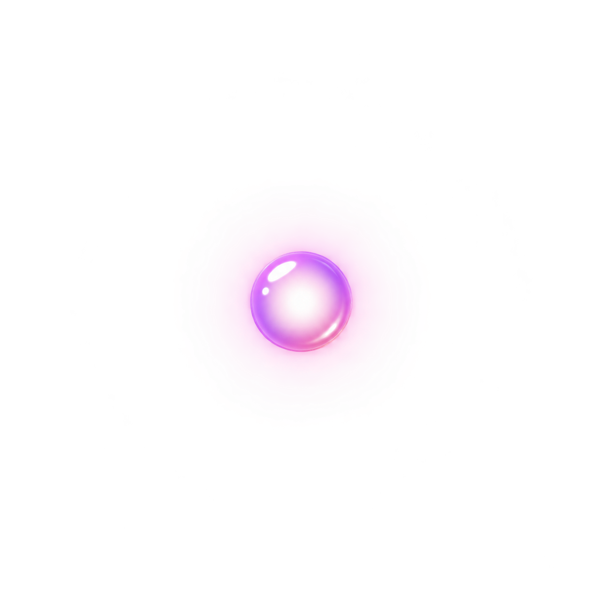
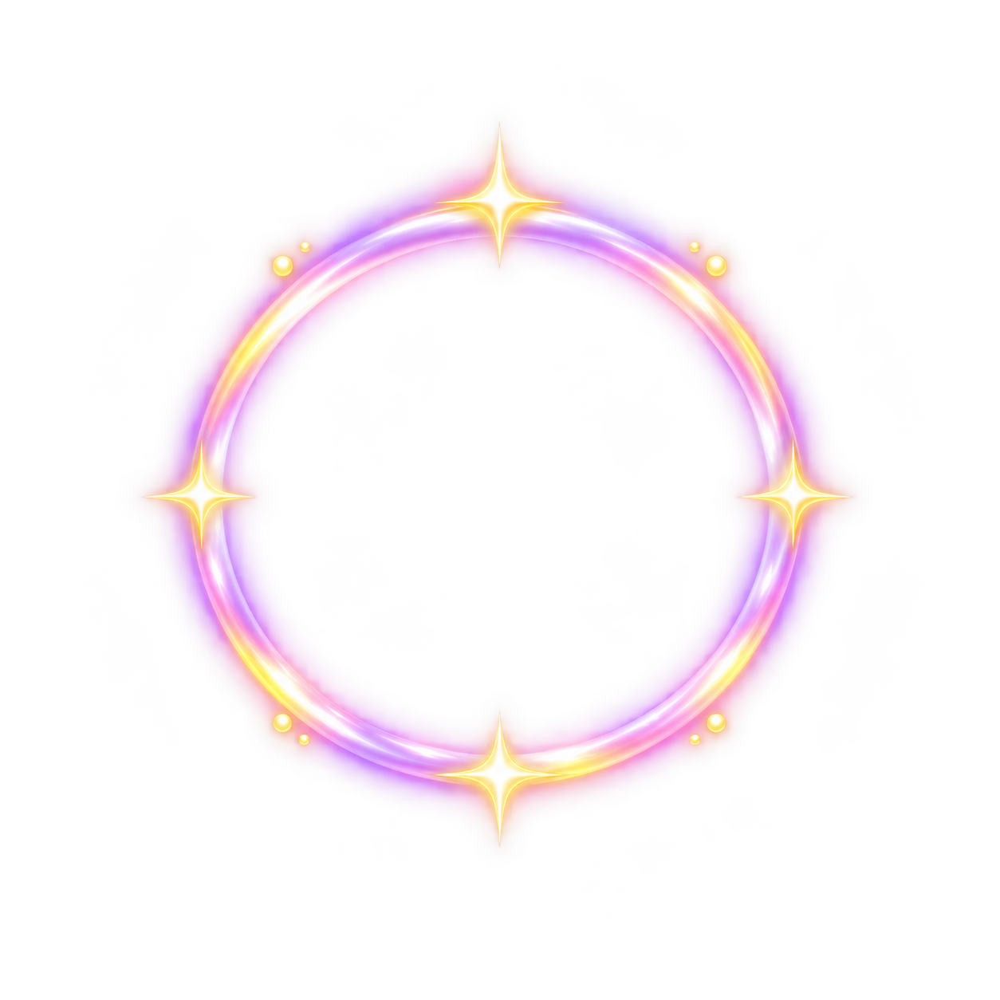
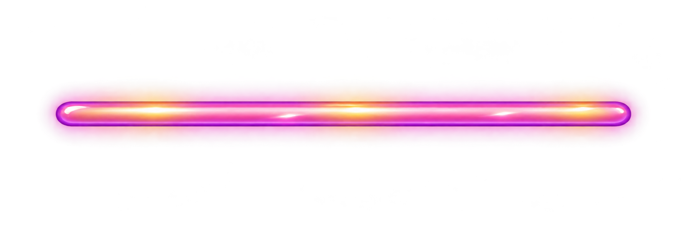
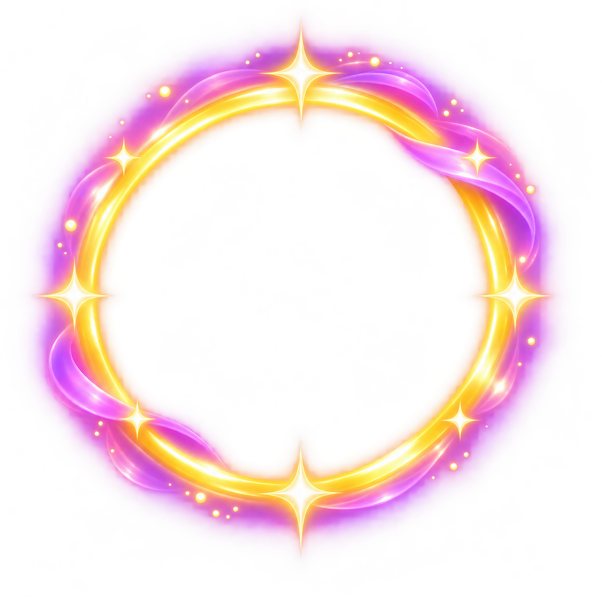
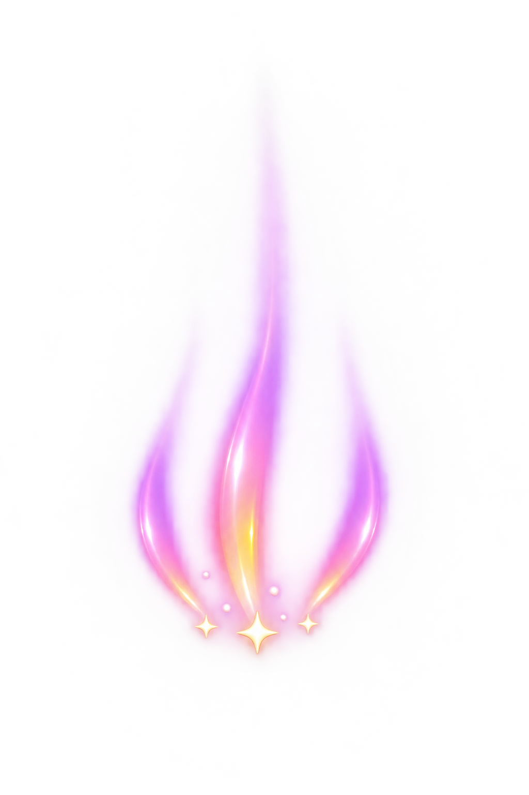
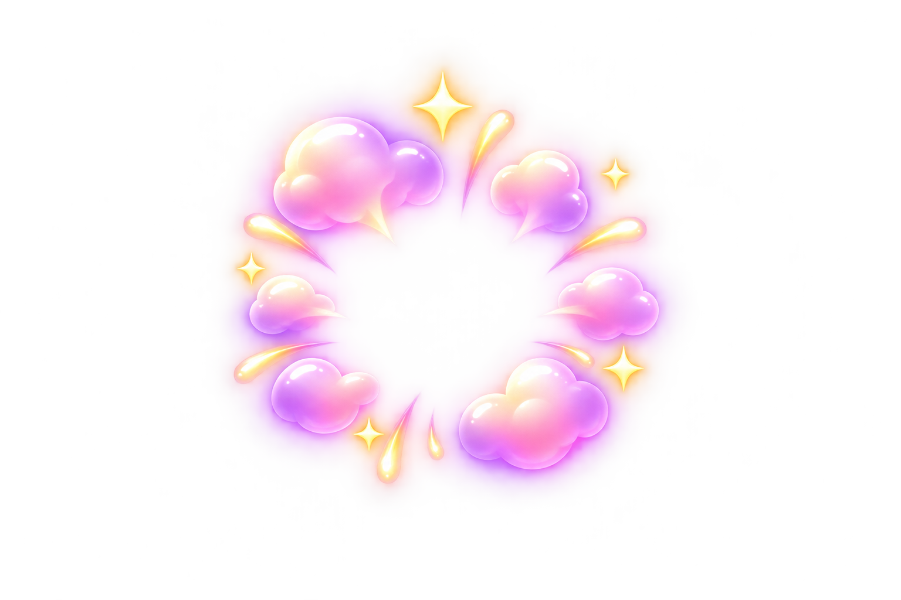
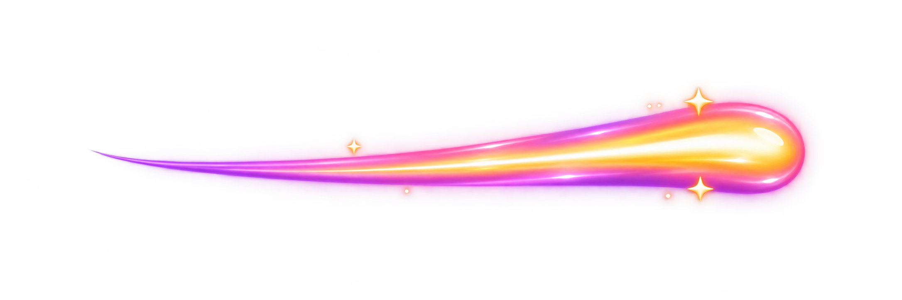
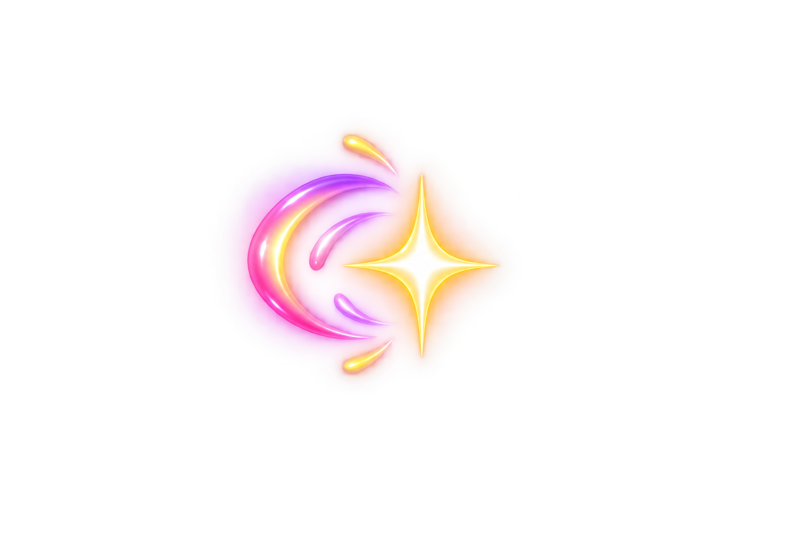

# Puff Trails Stage 2 — art review v1

Eight individual transparent PNG masters generated with the built-in image generator. Exact prompts and source paths are in generation.json; dimensions and SHA-256 hashes are in manifest.json. Generated pixels and alpha are unmodified.

Open preview.html for light/dark comparison and individual downloads. Reference copies of the original logo, six locked character masters, Baloo 2 and Quicksand fonts are unchanged and include font licenses. No characters or logos were regenerated. No existing repository assets were modified.

## Use
- Aim dot: repeat on engine-calculated straight and reflected trajectory segments.
- Projectile trail: layer behind the unchanged projectile sprite, aligned to velocity.
- Wall rebound: anchor glint at contact and mirror for the other wall.
- Attachment pulse: feedback after legal circle-contact placement, not a hex-grid marker.
- Match pop: ordinary three-creature match feedback.
- Evolution halo: four-plus special feedback; family-specific powers remain separate.
- Falling trail: place behind downward-moving detached character sprites.
- Danger boundary: display at configured boundary; logical loss checks occur after resolution, preserving victory priority.

Static art candidates, not animated sprite sheets. Tune pivots, opacity, scaling and timing in-engine. Evolution halo has tight outer-glow padding and needs atlas-packing review. Art approval and device readability checks remain pending. The supplied overview board informed asset scope only; actual brand sparkle and magic-trail PNGs guided rendering. Existing gameplay rules are unchanged.

<!-- asset-gallery:start -->
## Individual asset previews

Every unique master is shown below, including animation frames and explicitly documented aliases. Click an image to open its PNG. Resolution exports repeat the same artwork.

### Effects

| Aim Dot | Attachment Pulse | Danger Boundary |
| --- | --- | --- |
|  |  |  |

| Evolution Halo | Falling Trail | Match Pop |
| --- | --- | --- |
|  |  |  |

| Projectile Trail | Wall Rebound |
| --- | --- |
|  |  |

<!-- asset-gallery:end -->
