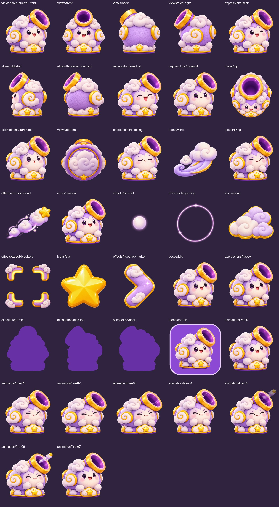
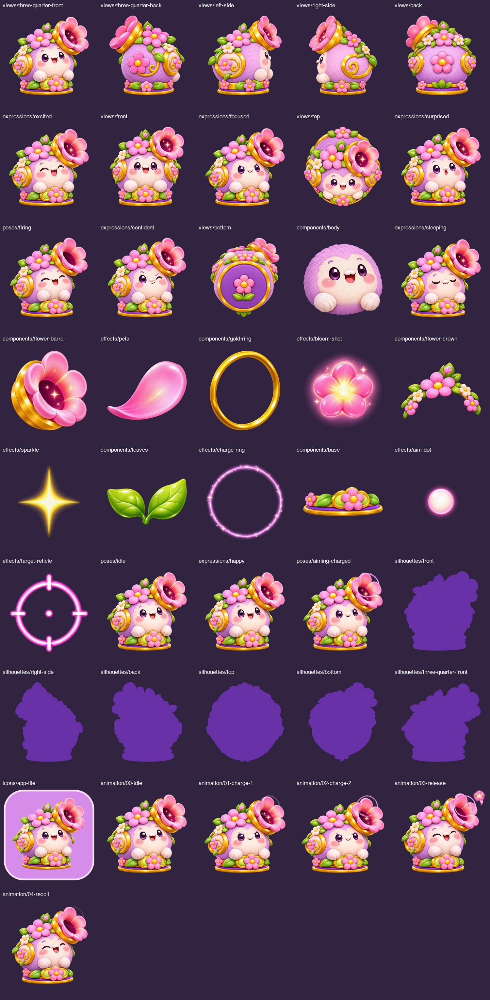
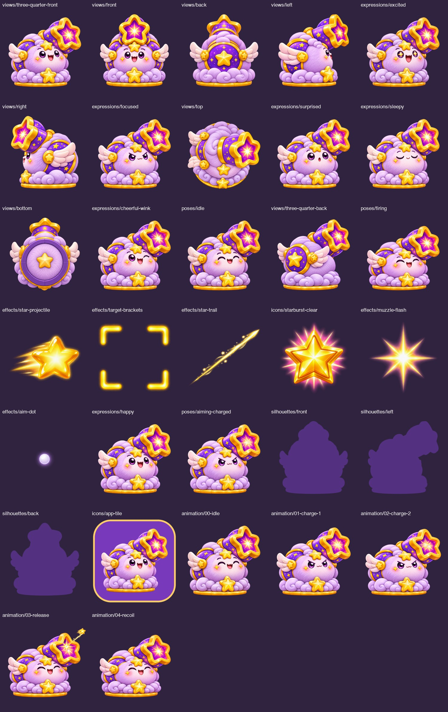
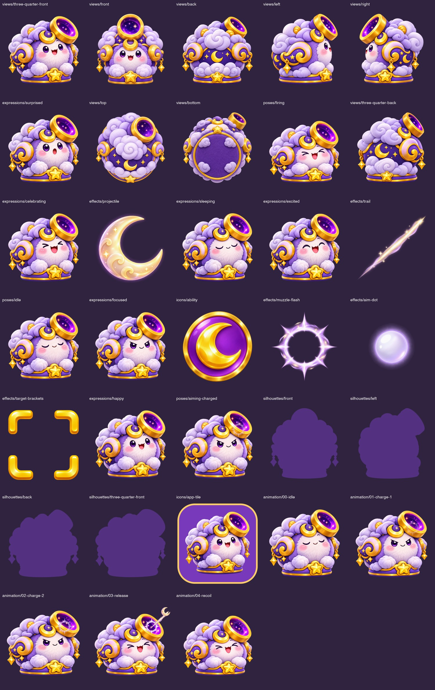
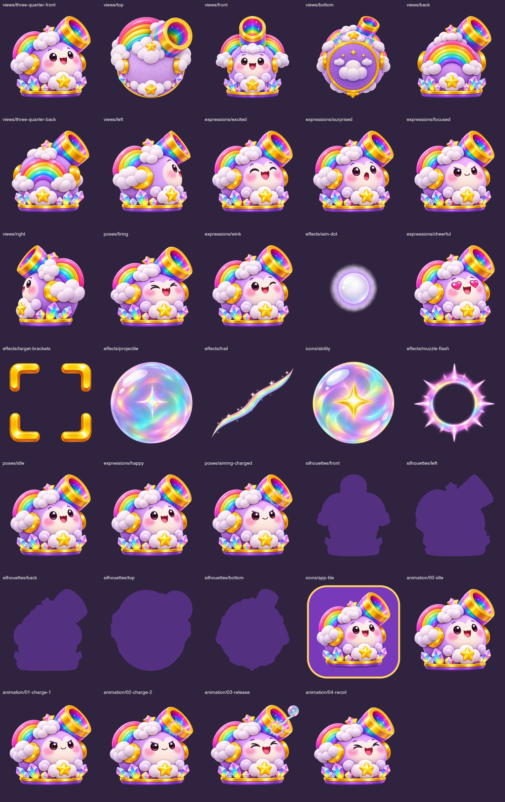

# Stage 04 — Cannons

Original collection board and detailed Cloud Sling board are preserved byte-for-byte in `references/`. `reference-manifest.json` records their provenance and checksums. Individual Cloud Sling assets are in `cloud-sling/`. Existing locked characters and earlier stages remain unchanged.

<!-- asset-gallery:start -->
## Cannon previews

Open a cannon gallery to see every individual master, grouped by type.

### Cloud Sling

[Every individual asset](cloud-sling/README.md)

### Bloom Launcher

[Every individual asset](bloom-launcher/README.md)

### Starburst Cannon

[Every individual asset](starburst-cannon/README.md)

### Moonlight Cannon

[Every individual asset](moonlight-cannon/README.md)

### Rainbow Launcher

[Every individual asset](rainbow-launcher/README.md)

<!-- asset-gallery:end -->
