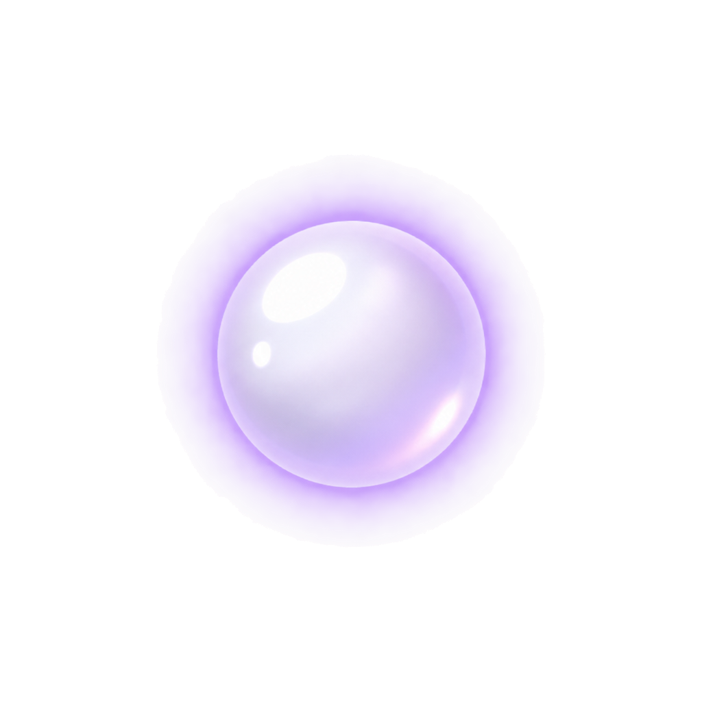
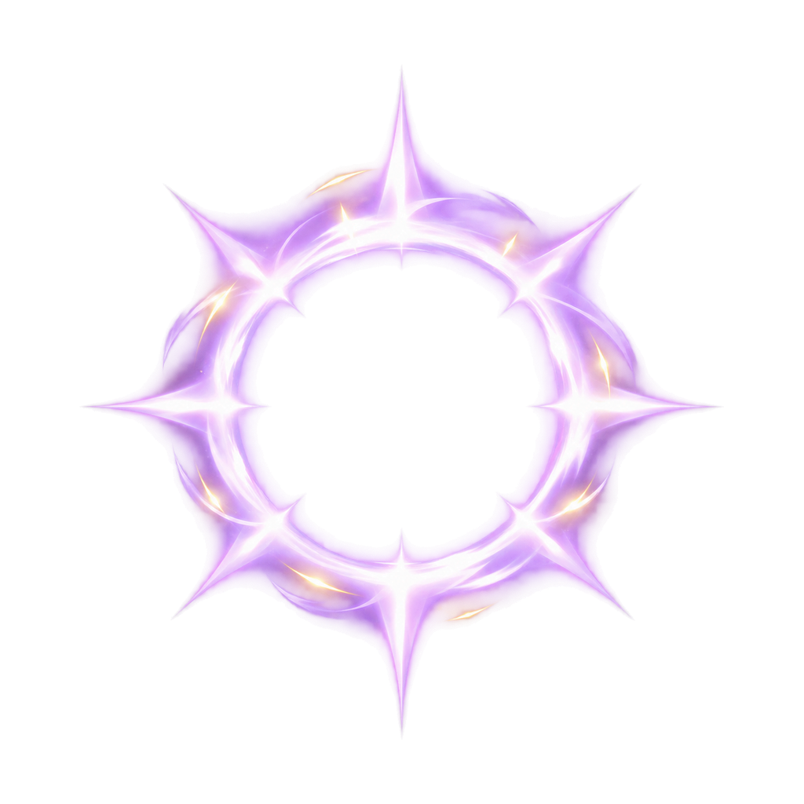
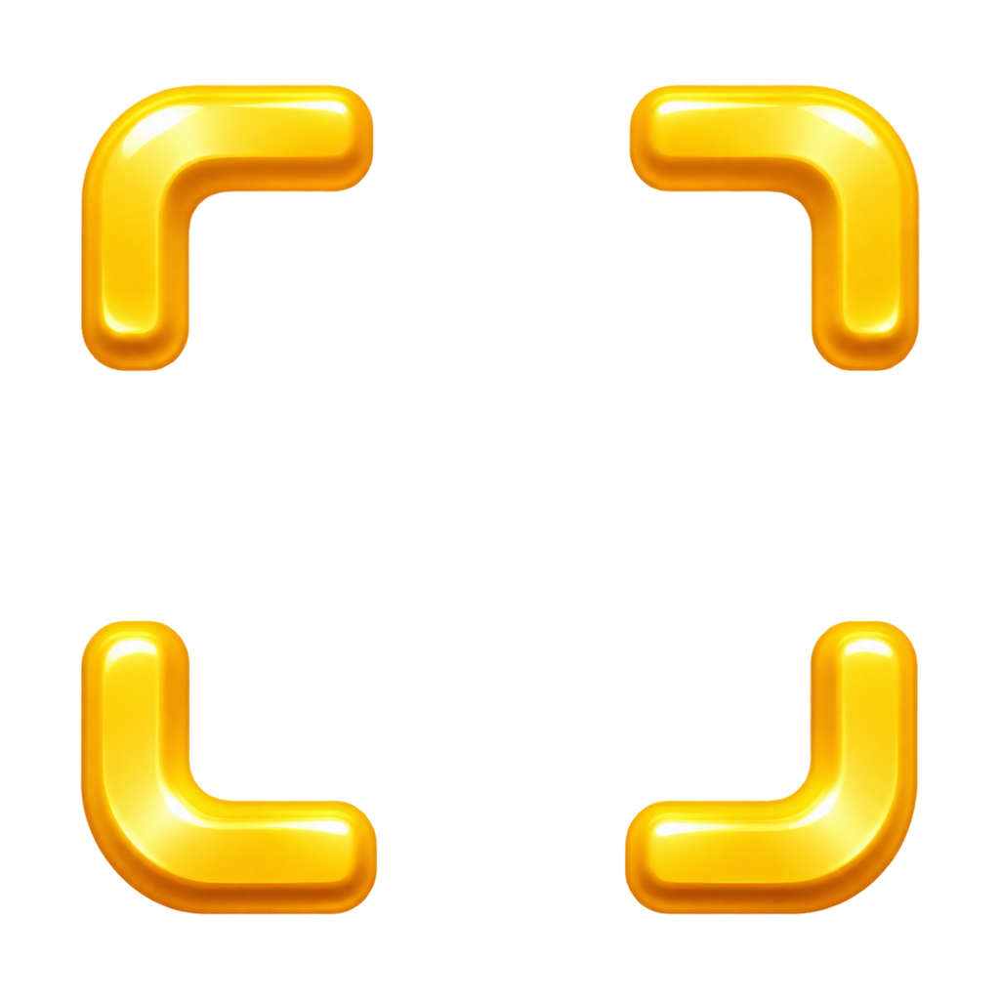
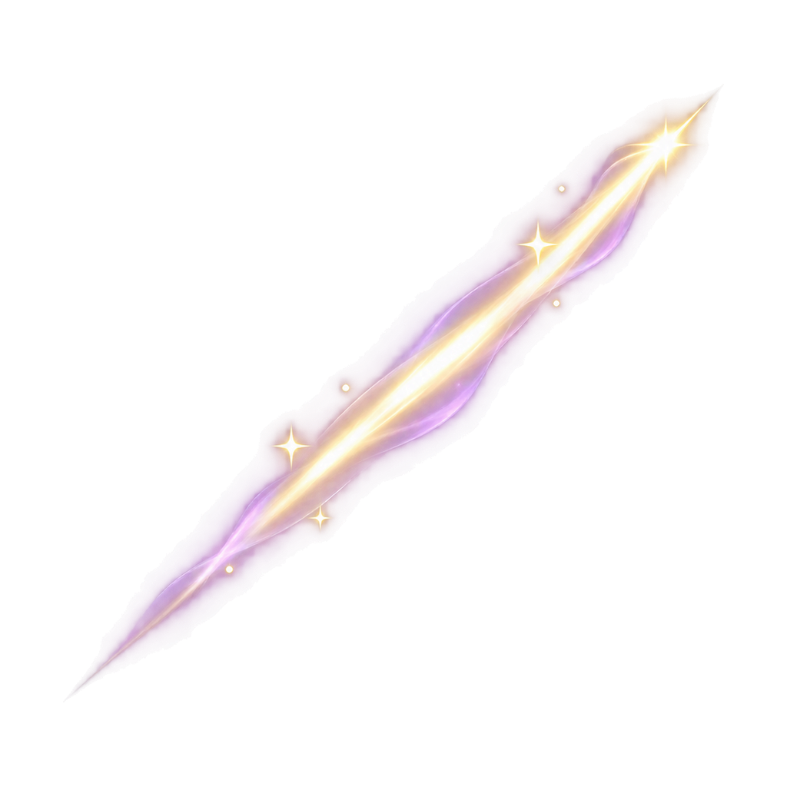
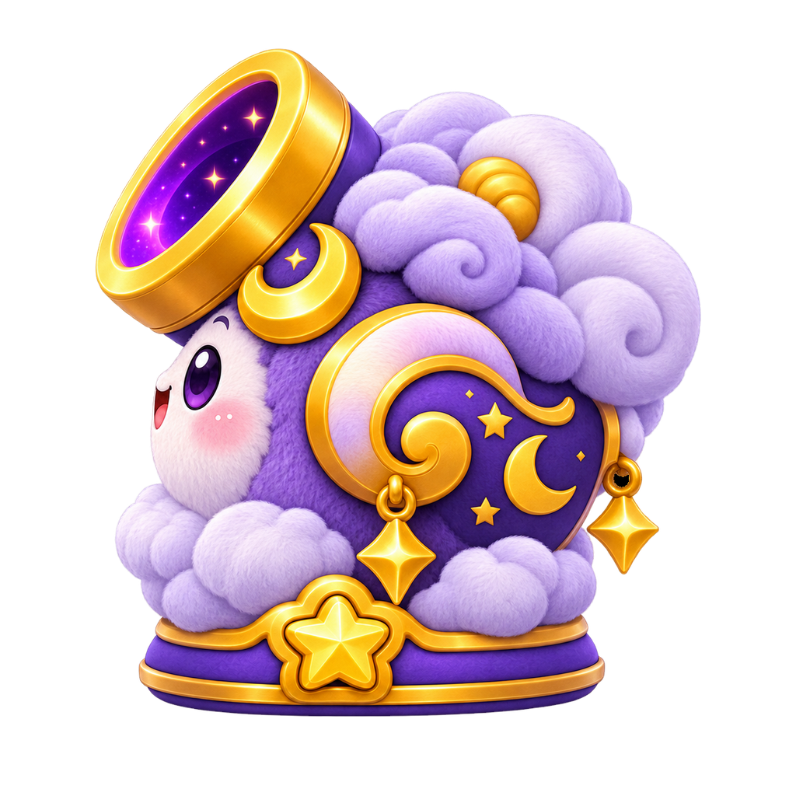

# Moonlight Cannon · v1

Individual board-derived renders generated using the supplied original board and a shared three-quarter-front master. Original PNG preserved byte-for-byte in `references/`. These are newly generated renders, not pixel-exact extractions or a rigged 3D model.

## Contents

Eight views, six full-cannon expressions, idle/firing/charged-aim poses, five isolated effects (projectile, trail, muzzle halo, aim dot, target brackets), an ability icon and composed app tile, board-matched silhouettes, and five composite firing frames. All masters are 1024 square. Every master includes 64/128/256/512 PNG and lossless WebP exports. Manifest records aliases and generated/composite origins explicitly. Source-board texture close-ups remain in the reference board, not misrepresented as seamless texture maps.

## Integration

Straight alpha/source-over blending. Cannon baseline y=922 on a 1024 canvas; center-bottom anchor [0.5,0.9]. Art fits inside an 860px envelope. Consult individual alpha bounds for placement. Effects use centered anchors. Compute aim-dot placement from real projectile physics; brackets do not grant targeting validity or automatic hits. Existing locked characters should supply all target portraits; board thumbnails are not new creature assets.

Moon Pause temporarily suspends eligible authored hazards. It does not bypass the danger line or shot exhaustion. Active powers require player action after charging. This pack changes no gameplay rules, numeric tuning, unlocks, currencies or collision behavior.

Five animation frames use deterministic squash/recoil and effect compositing, not independently drawn continuous animation. Timings are illustrative. Review muzzle placement and transitions in-engine. Generated views can have small geometry differences; check continuity before turntable use.

## QA and provenance

`preview.html` and `preview.jpg` show the set. `manifest.json` records actual file hashes, dimensions, origins and alpha bounds. `generation.json` retains prompts and cleanup details. Technical checks cover decoding, transparent alpha, dimensions and lossless PNG/WebP pixel equivalence. Stray pixels are removed and enclosed solid-body alpha filled; glow transparency remains. No claim of engine-tested production lock. Earlier cannons and locked character files remain unchanged.

<!-- asset-gallery:start -->
## Individual asset previews

Every unique master is shown below, including animation frames and explicitly documented aliases. Click an image to open its PNG. Resolution exports repeat the same artwork.

### Animation

| 00 Idle | 01 Charge 1 | 02 Charge 2 |
| --- | --- | --- |
|  |  |  |

| 03 Release | 04 Recoil |
| --- | --- |
|  |  |

### Effects

| Aim Dot | Muzzle Flash | Projectile |
| --- | --- | --- |
|  |  |  |

| Target Brackets | Trail |
| --- | --- |
|  |  |

### Expressions

| Celebrating | Excited | Focused |
| --- | --- | --- |
|  |  |  |

| Happy | Sleeping | Surprised |
| --- | --- | --- |
|  |  |  |

### Icons

| Ability | App Tile |
| --- | --- |
|  |  |

### Poses

| Aiming Charged | Firing | Idle |
| --- | --- | --- |
|  |  |  |

### Silhouettes

| Back | Front | Left |
| --- | --- | --- |
|  |  |  |

| Three Quarter Front |
| --- |
|  |

### Views

| Back | Bottom | Front |
| --- | --- | --- |
|  |  |  |

| Left | Right | Three Quarter Back |
| --- | --- | --- |
|  |  |  |

| Three Quarter Front | Top |
| --- | --- |
|  |  |

<!-- asset-gallery:end -->
