# Cloudberry Meadows · World 1 · v1

117 individual modules and variants reconstructed from the supplied Cloudberry Meadows board. The original PNG is preserved unchanged in [references](references/cloudberry-meadows-original-board.png). All individual master previews appear below; click any preview to open its PNG.

## Files and use

- **111 transparent modules:** islands, cottage angles, terrain, gates, bridges, paths, waterfalls, trees, shrubs, crystals, rocks, foliage, props, clouds, water, sparkles, flowers and collectibles.
- **6 opaque plates:** the hero scene and five background variations. These are flattened scenes, not separated parallax layers.
- Transparent PNG masters use a 1024 × 1024 canvas with an artwork envelope up to 860 pixels. Background masters retain generated aspect ratio, up to 1536 pixels on the longest side.
- Every master has 256- and 512-pixel maximum-edge PNG and lossless WebP exports in `gameplay/`. These exports repeat the same artwork.
- `manifest.json` records file checksums, dimensions, source crop coordinates, alpha bounds and suggested anchors. `generation.json` records prompts and source provenance. Open `preview.html` locally for a searchable gallery or browse the category sheets in `previews/`.

Use straight alpha/source-over blending. Module anchors are the bottom center of visible artwork; background anchors are centered. Each module is normalized independently; relative world scale must be set in the level editor. These suggested anchors do not define collision shapes, walkable surfaces, grid spacing or sorting order.

## Integration status

These are newly generated static 2D renders faithful to the reference, not pixel-exact extractions, 3D models or a finished playable level. Separate angle variants may differ in geometry or details. Terrain edges have not been proven seamless; check scale, tile joins, depth sorting and angle consistency in the game. Waterfalls and glints are static images, not animation sequences. No collision masks, level layouts, difficulty settings, rules or character redesigns are included.

Technical checks cover asset completeness, valid decoding, transparent margins, matching PNG/WebP pixels, source integrity and file hashes. Visual contact-sheet review does not replace in-engine QA. Small isolated alpha specks and faint distant background residue were removed; internal openings and translucent edges were preserved. Existing locked characters, cannons and other stage artwork are unchanged.

## Individual asset previews

### Scenes

| Hero Island |
| --- |
| [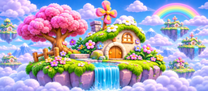](masters/scenes/hero-island.png) |

### Islands

| Waterfall Settlement | Wide Meadow | Rocky Meadow |
| --- | --- | --- |
| [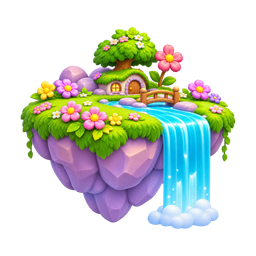](masters/islands/waterfall-settlement.png) | [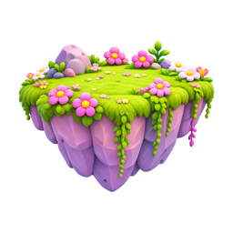](masters/islands/wide-meadow.png) | [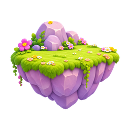](masters/islands/rocky-meadow.png) |

| Small Meadow | Tree Meadow | Boulder Meadow |
| --- | --- | --- |
| [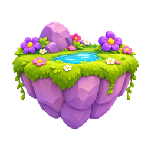](masters/islands/small-meadow.png) | [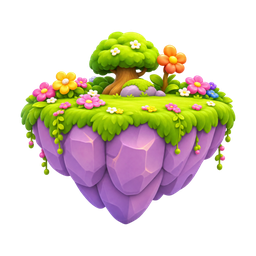](masters/islands/tree-meadow.png) | [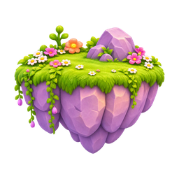](masters/islands/boulder-meadow.png) |

| Vine Meadow | Overhead Meadow |
| --- | --- |
| [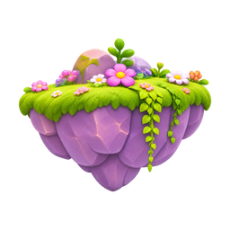](masters/islands/vine-meadow.png) | [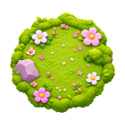](masters/islands/overhead-meadow.png) |

### Cottages

| Front Left | Front | Left Side |
| --- | --- | --- |
| [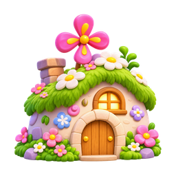](masters/cottages/front-left.png) | [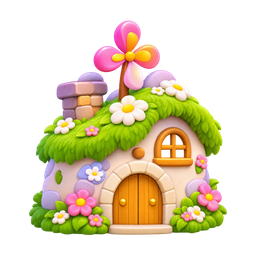](masters/cottages/front.png) | [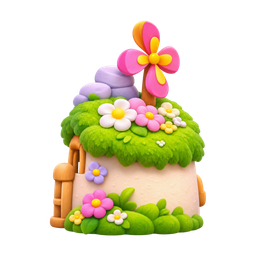](masters/cottages/left-side.png) |

| Back | Right Front | Overhead |
| --- | --- | --- |
| [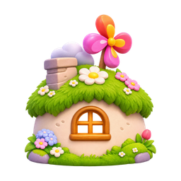](masters/cottages/back.png) | [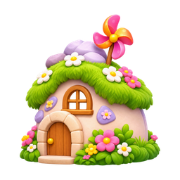](masters/cottages/right-front.png) | [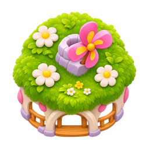](masters/cottages/overhead.png) |

### Terrain

| Flower Grass Block | Daisy Grass Block | Snow Block |
| --- | --- | --- |
| [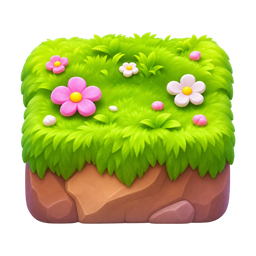](masters/terrain/flower-grass-block.png) | [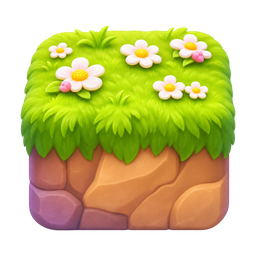](masters/terrain/daisy-grass-block.png) | [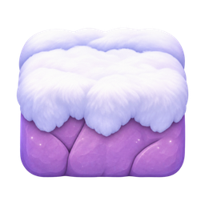](masters/terrain/snow-block.png) |

| Sand Block | Paved Stone Block | Pink Flower Block |
| --- | --- | --- |
| [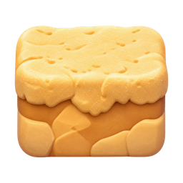](masters/terrain/sand-block.png) | [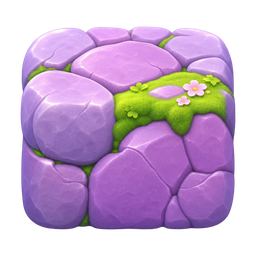](masters/terrain/paved-stone-block.png) | [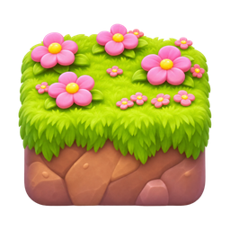](masters/terrain/pink-flower-block.png) |

| Grass Cliff Block | Grass Ledge | Two Step Stairs |
| --- | --- | --- |
| [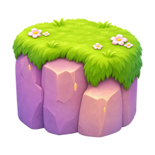](masters/terrain/grass-cliff-block.png) | [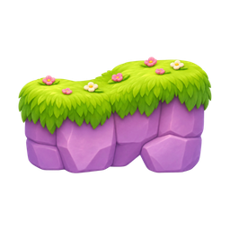](masters/terrain/grass-ledge.png) | [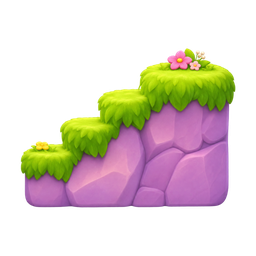](masters/terrain/two-step-stairs.png) |

| Three Step Stairs | Vine Arch | Moss Boulder Large |
| --- | --- | --- |
| [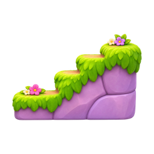](masters/terrain/three-step-stairs.png) | [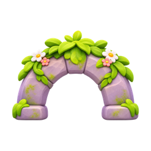](masters/terrain/vine-arch.png) | [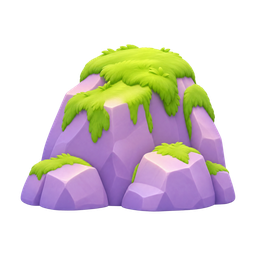](masters/terrain/moss-boulder-large.png) |

| Flower Boulder Large | Moss Pillar Large |
| --- | --- |
| [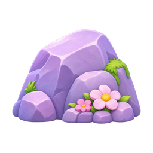](masters/terrain/flower-boulder-large.png) | [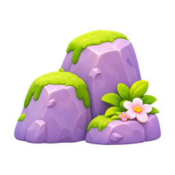](masters/terrain/moss-pillar-large.png) |

### Gates

| Star Front Left | Star Front | Star Side |
| --- | --- | --- |
| [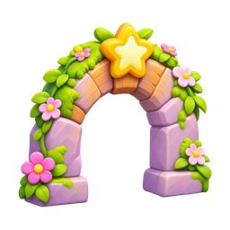](masters/gates/star-front-left.png) | [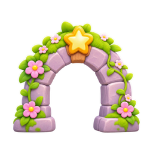](masters/gates/star-front.png) | [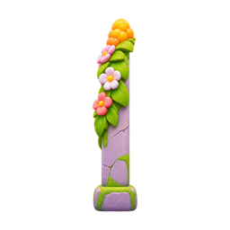](masters/gates/star-side.png) |

| Star Rear | Star Front Right |
| --- | --- |
| [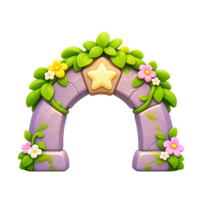](masters/gates/star-rear.png) | [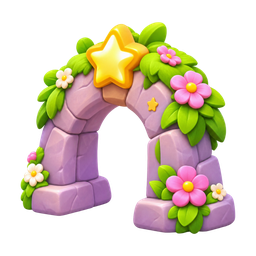](masters/gates/star-front-right.png) |

### Bridges

| Arched Rope | Arched Wood | Straight |
| --- | --- | --- |
|  |  |  |

| Arched Right |
| --- |
|  |

### Paths

| Stepping Cluster | Stepping Pair A | Stepping Pair B |
| --- | --- | --- |
| [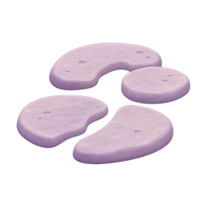](masters/paths/stepping-cluster.png) | [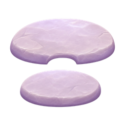](masters/paths/stepping-pair-a.png) | [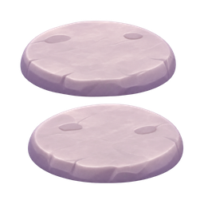](masters/paths/stepping-pair-b.png) |

| Winding Sand | Round Clearing |
| --- | --- |
| [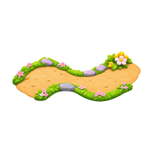](masters/paths/winding-sand.png) | [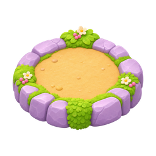](masters/paths/round-clearing.png) |

### Waterfalls

| Single Wide | Single Tall | Two Tier |
| --- | --- | --- |
| [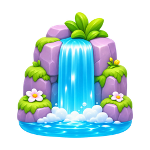](masters/waterfalls/single-wide.png) | [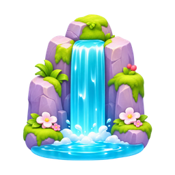](masters/waterfalls/single-tall.png) | [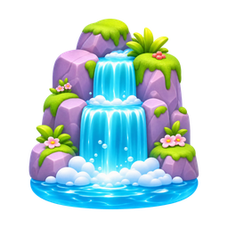](masters/waterfalls/two-tier.png) |

| Three Tier |
| --- |
| [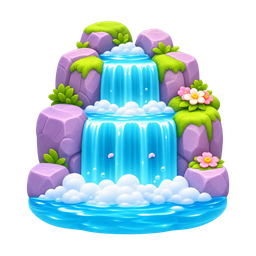](masters/waterfalls/three-tier.png) |

### Trees

| Pink Large | Pink Sapling A | Pink Medium |
| --- | --- | --- |
| [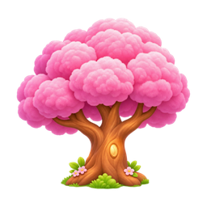](masters/trees/pink-large.png) | [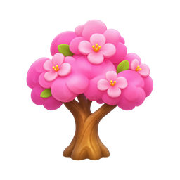](masters/trees/pink-sapling-a.png) | [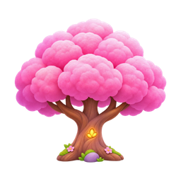](masters/trees/pink-medium.png) |

| Pink Sapling B | Purple | Purple Sapling |
| --- | --- | --- |
| [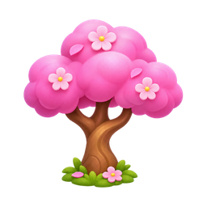](masters/trees/pink-sapling-b.png) | [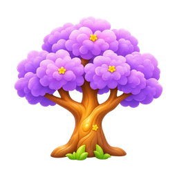](masters/trees/purple.png) | [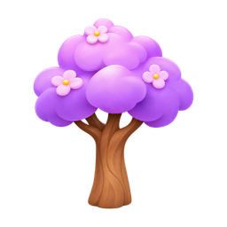](masters/trees/purple-sapling.png) |

| White Pink | Pale Pink Sapling | Berry |
| --- | --- | --- |
| [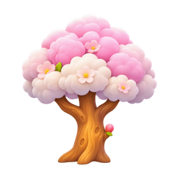](masters/trees/white-pink.png) |  |  |

| Golden | Berry Sapling |
| --- | --- |
|  |  |

### Shrubs

| White Daisies A | White Daisies B | Pink Flowers |
| --- | --- | --- |
|  |  |  |

| Blueberries | Leafy | Peach Berries |
| --- | --- | --- |
|  |  |  |

### Crystals

| Blue Large | Purple Cluster | Blue Small |
| --- | --- | --- |
|  |  |  |

| Pink Single | Purple Single |
| --- | --- |
|  |  |

### Rocks

| Moss Round | Tall Angular | Angular Cluster |
| --- | --- | --- |
|  |  |  |

| Small Purple | Low Moss | Flower Round |
| --- | --- | --- |
|  |  |  |

| Moss Angular | Flat Moss | Broad Moss |
| --- | --- | --- |
|  |  |  |

| Tiny Moss | Dome Moss |
| --- | --- |
|  |  |

### Foliage

| Pink Flower Bush | Short Grass | Purple Flower Bush |
| --- | --- | --- |
|  |  |  |

| Broad Grass | Thin Grass | Fern Tall |
| --- | --- | --- |
|  |  |  |

| Fern Small |
| --- |
|  |

### Props

| Fence | Purple Mushrooms | Orange Mushroom |
| --- | --- | --- |
|  |  |  |

| Pink Mushroom | Stump Small | Stump Large |
| --- | --- | --- |
|  |  |  |

### Clouds

| Puffy A | Small Flat | Long Low |
| --- | --- | --- |
|  |  |  |

| Puffy B | Puffy C |
| --- | --- |
|  |  |

### Water

| Pond | Splash | Curtain |
| --- | --- | --- |
|  |  |  |

### Particles

| Sparkle Gold | Sparkle Pink | Sparkle Lilac |
| --- | --- | --- |
|  |  |  |

### Flowers

| Pink | Coral | Purple |
| --- | --- | --- |
|  |  |  |

| Yellow |
| --- |
|  |

### Collectibles

| Leaf Pair | Blueberries | Pink Berries |
| --- | --- | --- |
|  |  |  |

| Leaf Single |
| --- |
|  |

### Backgrounds

| Cloud Mountains A | Cloud Mountains B | Distant Islands |
| --- | --- | --- |
|  |  |  |

| Rainbow Sky | Cloud Sky |
| --- | --- |
|  |  |

