# Honeydrop Gardens · World 2 · v1

128 individual modules and variants reconstructed from the supplied Honeydrop Gardens board. The original PNG is preserved unchanged in [references](references/honeydrop-gardens-original-board.png). All individual master previews appear below; click any preview to open its PNG.

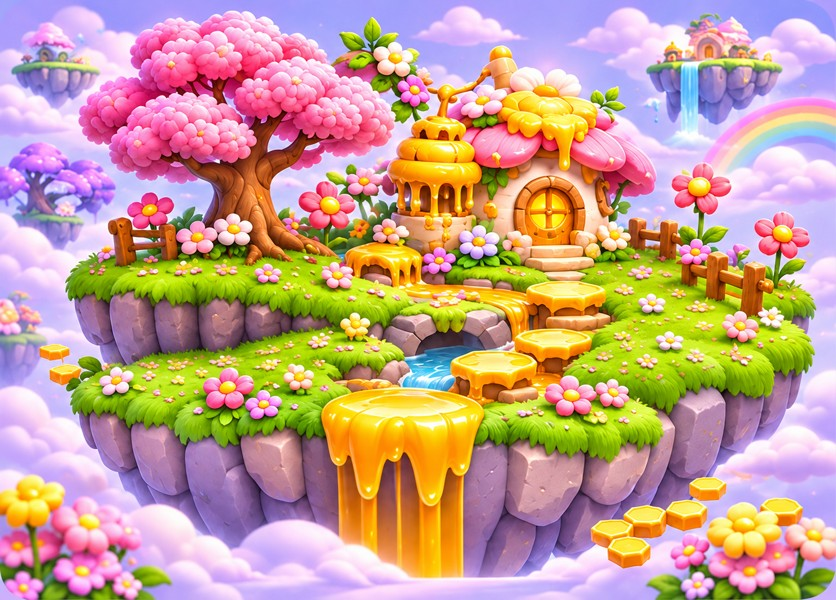

## Files and use

- **125 transparent modules:** flower cottages, honey huts, tree views, terrain, honey platforms, water tiles, falls, bridges, gates, props, rocks, shrubs, grasses, flowers, petals, clouds, rainbow, bees, effects and collectibles.
- **3 opaque plates:** the hero scene and two background variations. These are flattened scenes, not separated parallax layers.
- Transparent PNG masters use a 1024 × 1024 canvas with an artwork envelope up to 860 pixels. Background masters retain generated aspect ratio, up to 1536 pixels on the longest side.
- Every master has 256- and 512-pixel maximum-edge PNG and lossless WebP exports in `gameplay/`. These exports repeat the same artwork.
- `manifest.json` records file checksums, dimensions, source crop coordinates, alpha bounds and suggested anchors. `generation.json` records prompts and source provenance. Open `preview.html` locally for a searchable gallery or browse the category sheets in `previews/`.

Use straight alpha/source-over blending. Solid scenery anchors are at the bottom center of visible artwork. Backgrounds, overhead views, clouds, rainbow, petals, bees, effects and collectibles use centered anchors. Each module is normalized independently; relative world scale must be set in the level editor. These suggested anchors do not define collision shapes, walkable surfaces, grid spacing or sorting order.

## Integration status

These are newly generated static 2D renders faithful to the reference, not pixel-exact extractions, 3D models or a finished playable level. Separate angle variants may differ in geometry or details. Terrain edges have not been proven seamless; check scale, tile joins, depth sorting and angle consistency in the game. Falls, bees, petal effects and glints are static images, not animation sequences. The dotted bee trail is a decorative overlay, not a flight-path specification. The hero landscape intentionally omits the foreground creatures so existing locked characters can be placed separately; no family character redesign is included. No collision masks, level layouts, difficulty settings, rules or character redesigns are included.

Technical checks cover asset completeness, valid decoding, transparent margins, matching PNG/WebP pixels, source integrity and file hashes. Visual contact-sheet review does not replace in-engine QA. Small isolated alpha specks and faint distant background residue were removed; internal openings and translucent edges were preserved. Existing locked characters, cannons and other stage artwork are unchanged.

## Individual asset previews

### Scenes

| Hero Garden |
| --- |
|  |

### Flower Cottages

| Front Left | Front Right | Side |
| --- | --- | --- |
| [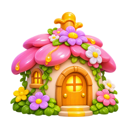](masters/flower-cottages/front-left.png) | [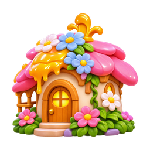](masters/flower-cottages/front-right.png) | [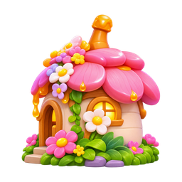](masters/flower-cottages/side.png) |

| Back | Rear Three Quarter | Overhead |
| --- | --- | --- |
| [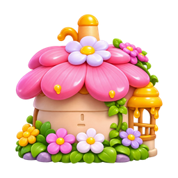](masters/flower-cottages/back.png) | [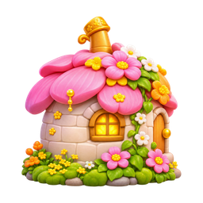](masters/flower-cottages/rear-three-quarter.png) | [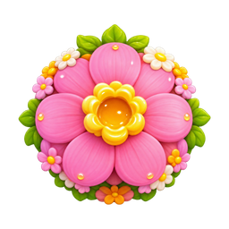](masters/flower-cottages/overhead.png) |

### Honey Huts

| Front | Three Quarter | Side |
| --- | --- | --- |
| [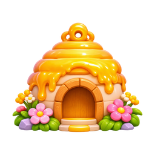](masters/honey-huts/front.png) | [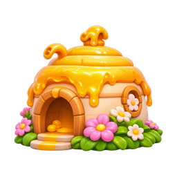](masters/honey-huts/three-quarter.png) | [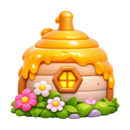](masters/honey-huts/side.png) |

| Back | Rear Three Quarter | Overhead |
| --- | --- | --- |
| [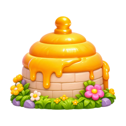](masters/honey-huts/back.png) | [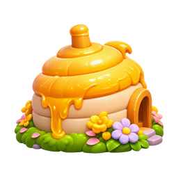](masters/honey-huts/rear-three-quarter.png) | [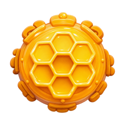](masters/honey-huts/overhead.png) |

### Blossom Trees

| View 01 | View 02 | View 03 |
| --- | --- | --- |
| [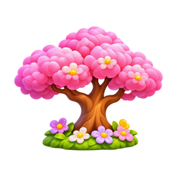](masters/blossom-trees/view-01.png) | [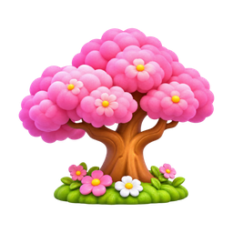](masters/blossom-trees/view-02.png) | [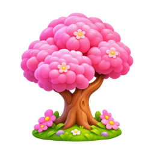](masters/blossom-trees/view-03.png) |

| View 04 | View 05 | Overhead |
| --- | --- | --- |
| [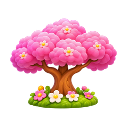](masters/blossom-trees/view-04.png) | [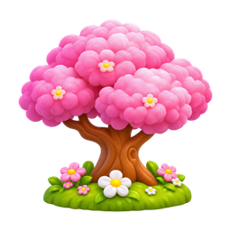](masters/blossom-trees/view-05.png) | [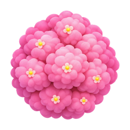](masters/blossom-trees/overhead.png) |

### Wisteria Trees

| View 01 | View 02 | View 03 |
| --- | --- | --- |
| [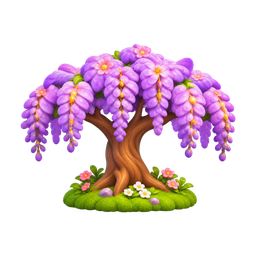](masters/wisteria-trees/view-01.png) | [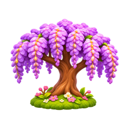](masters/wisteria-trees/view-02.png) | [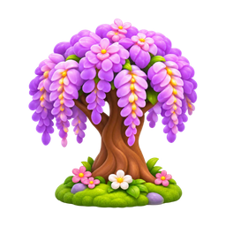](masters/wisteria-trees/view-03.png) |

| View 04 | View 05 | Overhead |
| --- | --- | --- |
| [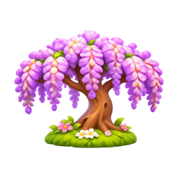](masters/wisteria-trees/view-04.png) | [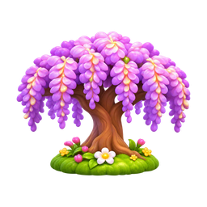](masters/wisteria-trees/view-05.png) | [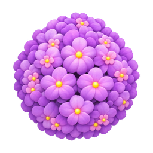](masters/wisteria-trees/overhead.png) |

### Terrain

| Flower Grass A | Flower Grass B | Daisy Grass |
| --- | --- | --- |
| [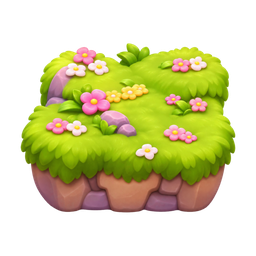](masters/terrain/flower-grass-a.png) | [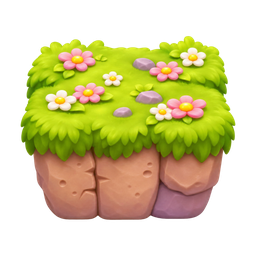](masters/terrain/flower-grass-b.png) | [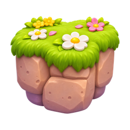](masters/terrain/daisy-grass.png) |

| Small Flower Grass | Wide Flower Grass | Low Flower Grass |
| --- | --- | --- |
| [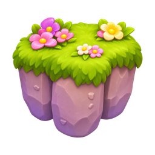](masters/terrain/small-flower-grass.png) | [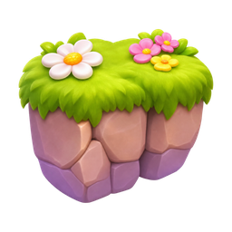](masters/terrain/wide-flower-grass.png) | [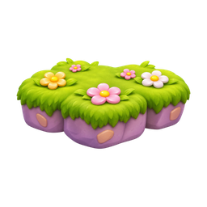](masters/terrain/low-flower-grass.png) |

| Large Flower Island | Bare Round Stone | Moss Round Stone |
| --- | --- | --- |
| [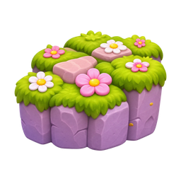](masters/terrain/large-flower-island.png) | [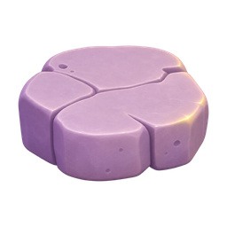](masters/terrain/bare-round-stone.png) | [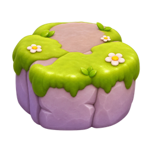](masters/terrain/moss-round-stone.png) |

| Small Moss Stone | Bare Wide Stone | Wide Moss Stone |
| --- | --- | --- |
| [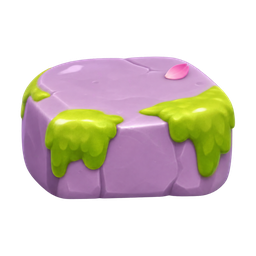](masters/terrain/small-moss-stone.png) | [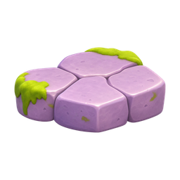](masters/terrain/bare-wide-stone.png) | [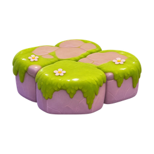](masters/terrain/wide-moss-stone.png) |

| Large Moss Platform |
| --- |
| [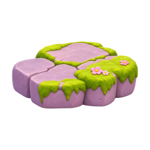](masters/terrain/large-moss-platform.png) |

### Honey Platforms

| Cluster Wide | Cluster Small | Large Hexagon |
| --- | --- | --- |
| [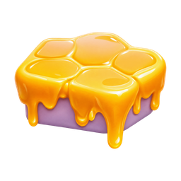](masters/honey-platforms/cluster-wide.png) | [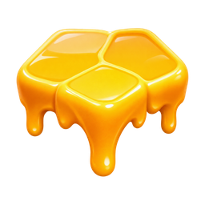](masters/honey-platforms/cluster-small.png) | [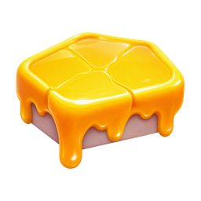](masters/honey-platforms/large-hexagon.png) |

| Honeycomb Cluster | Single Hexagon |
| --- | --- |
| [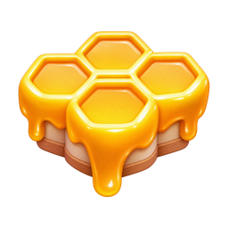](masters/honey-platforms/honeycomb-cluster.png) | [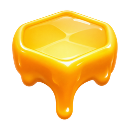](masters/honey-platforms/single-hexagon.png) |

### Water Tiles

| Pool A | Pool B |
| --- | --- |
| [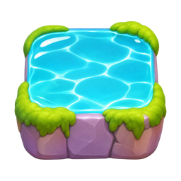](masters/water-tiles/pool-a.png) | [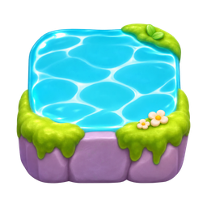](masters/water-tiles/pool-b.png) |

### Falls

| Water Tall | Water Wide | Honey Wide |
| --- | --- | --- |
| [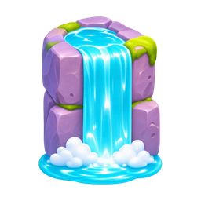](masters/falls/water-tall.png) | [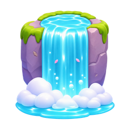](masters/falls/water-wide.png) | [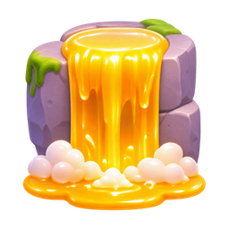](masters/falls/honey-wide.png) |

| Honey Small |
| --- |
| [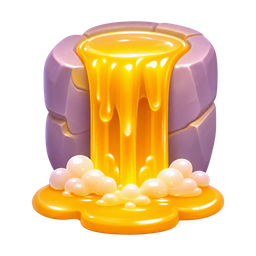](masters/falls/honey-small.png) |

### Bridges

| Wood Straight | Honey Arch | Honeycomb Arch |
| --- | --- | --- |
| [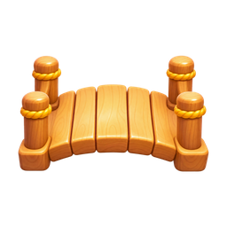](masters/bridges/wood-straight.png) |  |  |

### Gates

| Flower Vine | Lantern Vine | Honey Arch |
| --- | --- | --- |
|  |  |  |

| Honeycomb Arch |
| --- |
|  |

### Props

| Direction Sign | Honey Jar Large | Honey Jar Small |
| --- | --- | --- |
|  |  |  |

| Honey Dipper | Honeycomb Blocks | Hanging Hive |
| --- | --- | --- |
|  |  |  |

| Banner High | Honey Stump | Banner Low |
| --- | --- | --- |
|  |  |  |

### Rocks

| Flower Boulder A | Flower Boulder B | Small Moss A |
| --- | --- | --- |
|  |  |  |

| Small Moss B |
| --- |
|  |

### Shrubs

| Leafy | Pink Blossom | Purple Blossom |
| --- | --- | --- |
|  |  |  |

| White Pink | White Daisies | Pink Yellow |
| --- | --- | --- |
|  |  |  |

### Grasses

| Tall Blades | Broad Blades | Small A |
| --- | --- | --- |
|  |  |  |

| Small B | Small C | Small D |
| --- | --- | --- |
|  |  |  |

### Flowers

| Lavender Sprig | White Daisy | Pink Daisy |
| --- | --- | --- |
|  |  |  |

| Golden Flower | Pink Tulip | White Tulip |
| --- | --- | --- |
|  |  |  |

| Coral Daisy |
| --- |
|  |

### Petals

| Flower Bud | Pink Small | Pink Folded |
| --- | --- | --- |
|  |  |  |

| Pink Curved | Pink Flat | Pink Rounded |
| --- | --- | --- |
|  |  |  |

| Pink Wide | Purple | Pink Pale |
| --- | --- | --- |
|  |  |  |

| Gold Petal Cluster |
| --- |
|  |

### Backgrounds

| Sunset Gardens | Floating Gardens |
| --- | --- |
|  |  |

### Clouds

| White High | Lilac High | White Low |
| --- | --- | --- |
|  |  |  |

| Lilac Low | Tiny Left | Tiny Middle |
| --- | --- | --- |
|  |  |  |

| Tiny Right | Pink Small | Flower Cloud |
| --- | --- | --- |
|  |  |  |

### Sky

| Rainbow |
| --- |
|  |

### Particles

| Sparkle Tall | Sparkle Small | Sparkle Low |
| --- | --- | --- |
|  |  |  |

| Sparkle Honey |
| --- |
|  |

### Effects

| Petals Upper | Petals Lower | Bee Trail |
| --- | --- | --- |
|  |  |  |

### Bees

| Three Quarter | Front | Side |
| --- | --- | --- |
|  |  |  |

### Collectibles

| Amber Crystal | Honeycomb | Honey Drop Small |
| --- | --- | --- |
|  |  |  |

| Honey Drop Tiny | Honey Drop Large |
| --- | --- |
|  |  |

### Bouquets

| Pink Large | Mixed Small | Coral Small |
| --- | --- | --- |
|  |  |  |

