# Moonmallow Forest · World 3 · v1

82 individual modules and variants reconstructed from the supplied Moonmallow Forest board. The original PNG is preserved unchanged in [references](references/moonmallow-forest-original-board.png). All individual master previews appear below; click any preview to open its PNG.

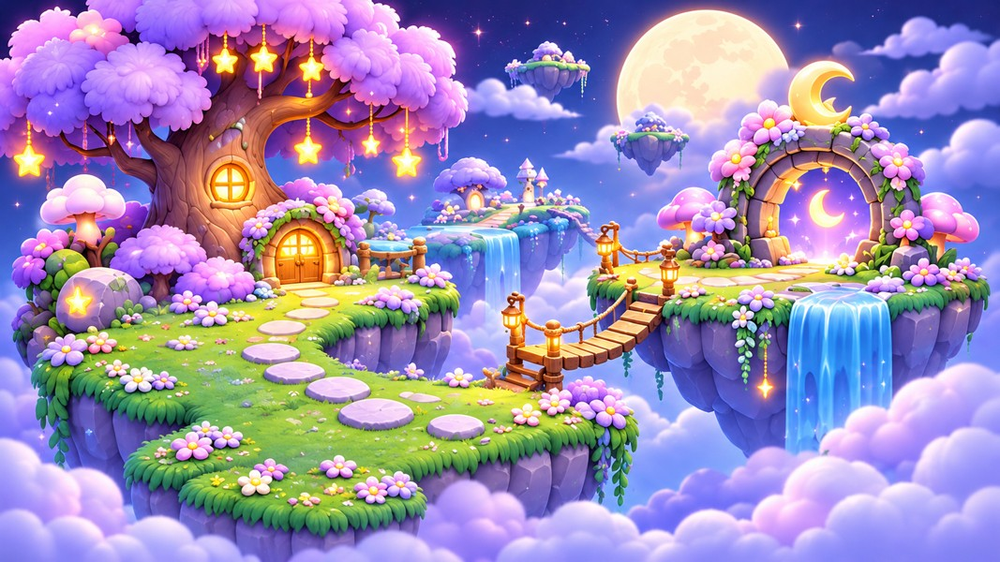

## Files and use

- **77 transparent modules:** floating islands, terrain, cliffs, star trees, mushroom views, portals, arch pieces, bridges, props, crystals, rocks, collectibles, clouds, plants and foreground decorations.
- **5 opaque plates:** the hero scene and four background variations. These are flattened scenes, not separated parallax layers.
- Transparent PNG masters use a 1024 × 1024 canvas with an artwork envelope up to 860 pixels. Background masters retain generated aspect ratio, up to 1536 pixels on the longest side.
- Every master has 256- and 512-pixel maximum-edge PNG and lossless WebP exports in `gameplay/`. These exports repeat the same artwork.
- `manifest.json` records file checksums, dimensions, source crop coordinates, alpha bounds and suggested anchors. `generation.json` records prompts and source provenance. Open `preview.html` locally for a searchable gallery or browse the category sheets in `previews/`.

Use straight alpha/source-over blending. Solid scenery anchors are at the bottom center of visible artwork. Backgrounds, overhead views, clouds, crystals and collectibles use centered anchors. Hanging foreground vines use the top center of their visible bounds. Each module is normalized independently; relative world scale must be set in the level editor. These suggested anchors do not define collision shapes, walkable surfaces, grid spacing or sorting order.

## Integration status

These are newly generated static 2D renders faithful to the reference, not pixel-exact extractions, 3D models or a finished playable level. Separate angle variants may differ in geometry or details. Terrain edges have not been proven seamless; check scale, tile joins, depth sorting and angle consistency in the game. Waterfalls, portal glow, hanging stars and lanterns are static images, not animation sequences. Active portals include their illuminated doorway; the empty arch keeps a transparent opening. Portal art does not implement teleportation or any gameplay behavior. The hero landscape intentionally omits the foreground creatures so existing locked characters can be placed separately; no family character redesign is included. No collision masks, level layouts, difficulty settings, rules or character redesigns are included.

Technical checks cover asset completeness, valid decoding, transparent margins, matching PNG/WebP pixels, source integrity and file hashes. Visual contact-sheet review does not replace in-engine QA. Small isolated alpha specks and faint distant background residue were removed; internal openings and translucent edges were preserved. Existing locked characters, cannons and other stage artwork are unchanged.

## Individual asset previews

### Scenes

| Hero Forest |
| --- |
|  |

### Islands

| Large Flower Meadow | Small Vine Meadow | Star Pillar |
| --- | --- | --- |
| [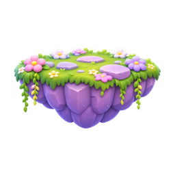](masters/islands/large-flower-meadow.png) | [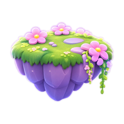](masters/islands/small-vine-meadow.png) | [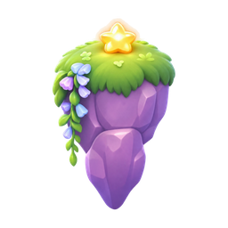](masters/islands/star-pillar.png) |

| Wide Path Meadow | Tiny Stone | Tiny Grass |
| --- | --- | --- |
| [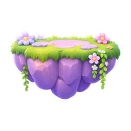](masters/islands/wide-path-meadow.png) | [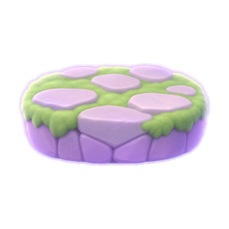](masters/islands/tiny-stone.png) | [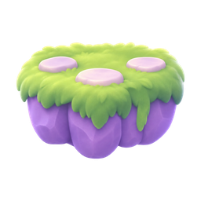](masters/islands/tiny-grass.png) |

### Terrain

| Flower Grass Tile | Stepping Grass Tile | Cracked Stone A |
| --- | --- | --- |
| [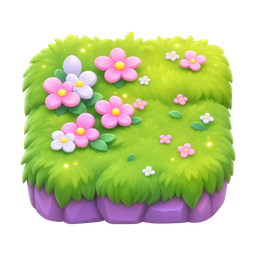](masters/terrain/flower-grass-tile.png) | [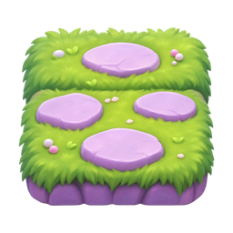](masters/terrain/stepping-grass-tile.png) | [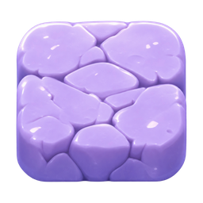](masters/terrain/cracked-stone-a.png) |

| Cracked Stone B | Rocky Block | Vine Meadow Platform |
| --- | --- | --- |
| [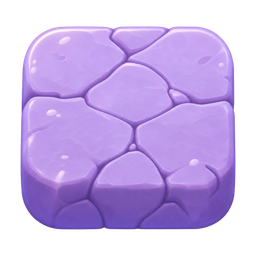](masters/terrain/cracked-stone-b.png) | [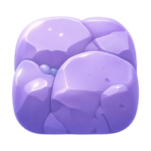](masters/terrain/rocky-block.png) | [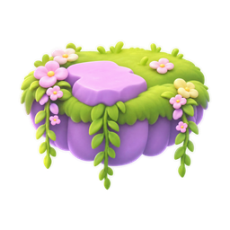](masters/terrain/vine-meadow-platform.png) |

| Plain Meadow Platform |
| --- |
| [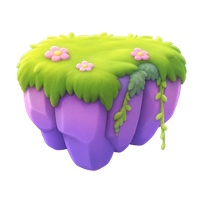](masters/terrain/plain-meadow-platform.png) |

### Cliffs

| Plain | Pink Vine | Flower Vine |
| --- | --- | --- |
| [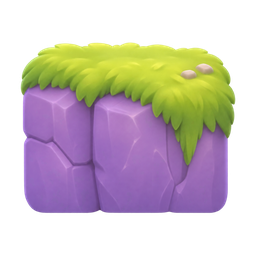](masters/cliffs/plain.png) | [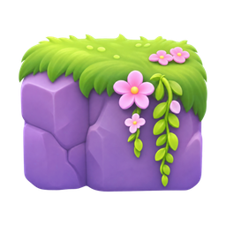](masters/cliffs/pink-vine.png) | [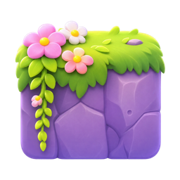](masters/cliffs/flower-vine.png) |

| Long Vine | Waterfall Open | Flower Corner |
| --- | --- | --- |
| [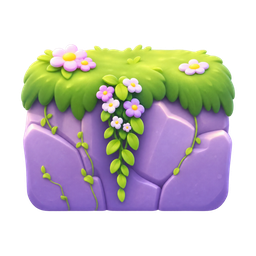](masters/cliffs/long-vine.png) | [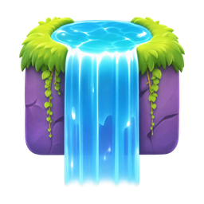](masters/cliffs/waterfall-open.png) | [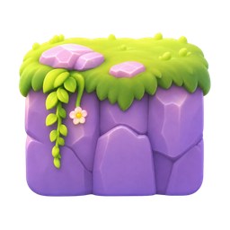](masters/cliffs/flower-corner.png) |

| Waterfall Pool |
| --- |
| [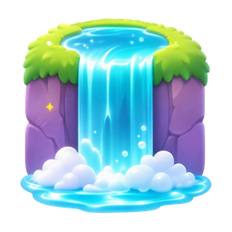](masters/cliffs/waterfall-pool.png) |

### Star Trees

| Front Wide | Front Small | Side Left |
| --- | --- | --- |
| [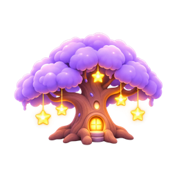](masters/star-trees/front-wide.png) |  | [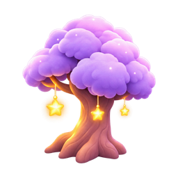](masters/star-trees/side-left.png) |

| Back | Side Right | Overhead |
| --- | --- | --- |
| [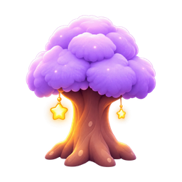](masters/star-trees/back.png) | [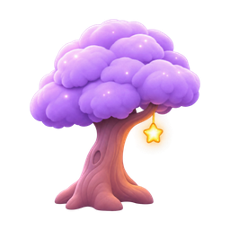](masters/star-trees/side-right.png) |  |

### Mushrooms

| Purple Pair Front | Purple Pair Angle | Purple Side |
| --- | --- | --- |
| [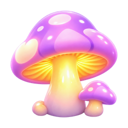](masters/mushrooms/purple-pair-front.png) |  | [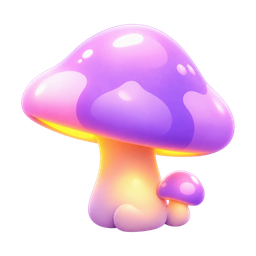](masters/mushrooms/purple-side.png) |

| Purple Back | Purple Overhead | Cyan A |
| --- | --- | --- |
|  | [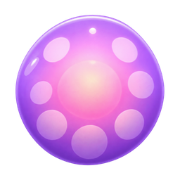](masters/mushrooms/purple-overhead.png) |  |

| Cyan B | Star Cluster |
| --- | --- |
|  | [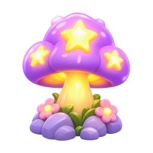](masters/mushrooms/star-cluster.png) |

### Portals

| Active Front | Active Angle | Empty Arch |
| --- | --- | --- |
|  | [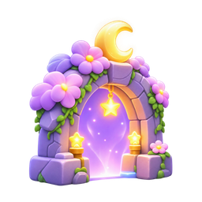](masters/portals/active-angle.png) | [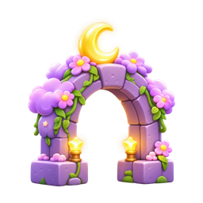](masters/portals/empty-arch.png) |

| Side |
| --- |
| [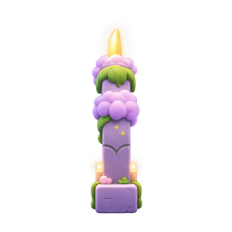](masters/portals/side.png) |

### Arch Pieces

| Flower Crown | Plain Curve |
| --- | --- |
| [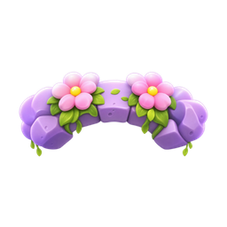](masters/arch-pieces/flower-crown.png) | [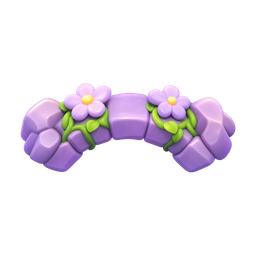](masters/arch-pieces/plain-curve.png) |

### Bridges

| Curved Suspension | Straight Rope | Arched |
| --- | --- | --- |
| [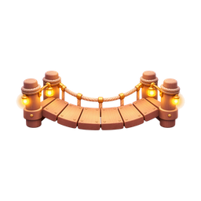](masters/bridges/curved-suspension.png) |  | [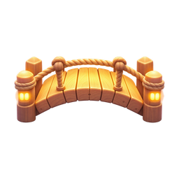](masters/bridges/arched.png) |

| Front Deck |
| --- |
|  |

### Props

| Arrow Sign | Wood Fence | Lantern Post |
| --- | --- | --- |
| [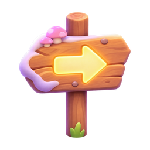](masters/props/arrow-sign.png) | [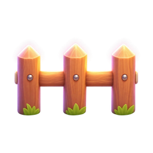](masters/props/wood-fence.png) |  |

| Lantern | Moss Cave | Stump |
| --- | --- | --- |
| [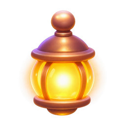](masters/props/lantern.png) | [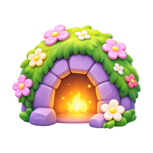](masters/props/moss-cave.png) | [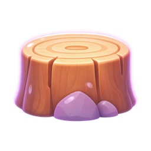](masters/props/stump.png) |

### Crystals

| Purple Cluster |
| --- |
|  |

### Rocks

| Crescent Shrine | Star Boulder | Low Boulder |
| --- | --- | --- |
|  | [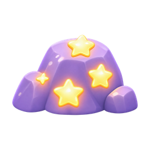](masters/rocks/star-boulder.png) | [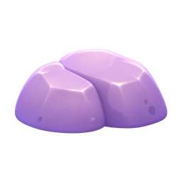](masters/rocks/low-boulder.png) |

| Tall Cluster | Grass Cluster | Flower Cluster |
| --- | --- | --- |
| [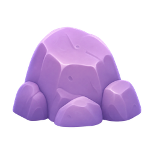](masters/rocks/tall-cluster.png) | [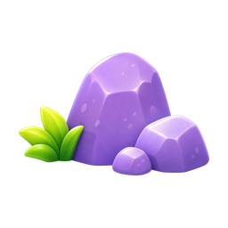](masters/rocks/grass-cluster.png) | [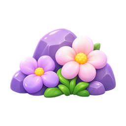](masters/rocks/flower-cluster.png) |

### Collectibles

| Gold Star | Crescent Moon | Bubble |
| --- | --- | --- |
|  |  | [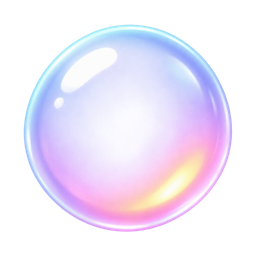](masters/collectibles/bubble.png) |

| Star Flower | Pink Flower | Clover Round |
| --- | --- | --- |
|  | [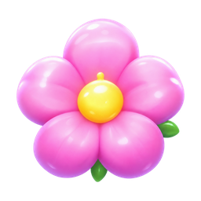](masters/collectibles/pink-flower.png) |  |

| Clover Pointed | Purple Sprig |
| --- | --- |
|  |  |

### Clouds

| White Small | White Wide | Pink Small |
| --- | --- | --- |
|  |  |  |

### Plants

| Leaf Sprig A | Leaf Sprig B | Star Garden |
| --- | --- | --- |
| [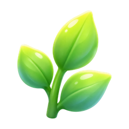](masters/plants/leaf-sprig-a.png) | [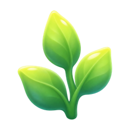](masters/plants/leaf-sprig-b.png) |  |

### Backgrounds

| Full Moon Clouds | Floating Island Sky | Distant Forest |
| --- | --- | --- |
|  |  |  |

| Mountain Clouds |
| --- |
|  |

### Foregrounds

| Hanging Vines A | Rock Garden A | Floral Arch |
| --- | --- | --- |
|  |  |  |

| Rock Garden B | Hanging Vines B | Mushroom Garden |
| --- | --- | --- |
|  |  |  |

