# Adventure map & level progression · Stage 6 · v1

81 individual surfaces, modules, states, compositions and examples, with 324 PNG/WebP exports. The [original board](references/original-adventure-map-board.png) is preserved unchanged. Its printed Stage 5 label differs from the requested Stage 6; this pack is separate from the existing Stage 6 obstacles folder.

## Context preserved

The locked character artwork and existing worlds, cannons, rewards and fonts are reused. Source paths and hashes are recorded; no previous artwork or GDD is overwritten. Skydoodles uses the `skybubs` storage alias. The board's alternate mascots are not used.

The board illustrates 30 levels per world; the GDD currently proposes 25 per world, and neither schedule is locked. These assets therefore contain no permanent level ranges, target counts, star totals or level numbers. Numbers, world names and localized text belong in runtime text. The board's duplicated 2-star label is resolved into distinct 1-, 2- and 3-star node variants. Stars are progress records, not a new spendable currency. Gem art is a visual reward example, not approval of a premium-gem economy.

## Files and integration

- New individual sprites use 1024-square transparent canvases. Existing masters retain their original size and bytes. Map layouts are assembled at 2048×1536 and 1280×2560 from smaller source modules; they are not newly generated native 2K sprites.
- `gameplay` has 256/512 maximum-edge PNG and lossless WebP versions. Use straight alpha/source-over blending; suggested anchors are center-based.
- `nodes` provides blank locked, unlocked, current and completed surfaces, plus a lock-badge variant and 1/2/3-star completed variants. Render level numbers as accessible text.
- `worlds` and `cards` contain all four worlds, assembled from approved scenery. `gateways` reuses approved architecture; Cloudberry's floral gateway uses the established flower-vine gate. Glow states are art only.
- `ui` contains blank cards, panels, plaque, ribbon and play-button surfaces. These are raster surfaces, not validated nine-slice controls. Layouts must be tested at target device sizes.
- `maps` contains illustrative landscape and portrait layouts with four sample nodes per world. They are not authored level graphs, playable screens, final progression schedules or responsive UI implementations.
- `examples` contains flattened world-selection, level-preview, world-complete and world-unlocked layouts. Their text is for demonstration only; reusable assets remain separate and unlabeled.
- `animation` includes portal, unlock, star-scale and chest key poses. These do not implement smooth animation, timing, rewards or state transitions. Existing closed chest and newly generated open chest need transition review in-engine.

`states.json` provides asset mappings without assigning gameplay rules. `generation.json` contains built-in image generation prompts and all reused source hashes. `manifest.json` records file hashes and provenance. Open `preview.html` for the individual gallery.

Export checks cover decoding, transparency, source integrity and pixel-identical PNG/WebP output. Visual review does not replace device QA, accessibility tests or engine validation. Transparent edge cleanup removes tiny specks and distant stone-path haze; it does not repaint locked artwork.

## Every individual preview

### Nodes

| current | completed | locked |
| --- | --- | --- |
|  | [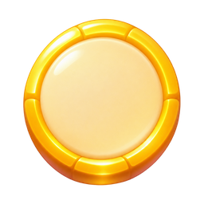](masters/nodes/completed.png) | [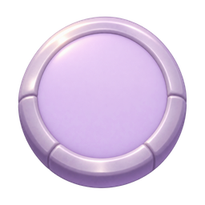](masters/nodes/locked.png) |

| unlocked | completed-1-stars | completed-2-stars |
| --- | --- | --- |
|  |  |  |

| completed-3-stars | locked-badge |
| --- | --- |
|  |  |

### Rewards

| floral-frame | chest-open | star |
| --- | --- | --- |
|  |  |  |

| star-empty | gift | coin |
| --- | --- | --- |
|  |  |  |

| gem | booster | chest-closed |
| --- | --- | --- |
| [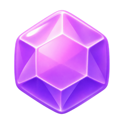](masters/rewards/gem.png) | [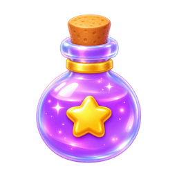](masters/rewards/booster.png) |  |

| new-cannon | character-discovery |
| --- | --- |
|  |  |

### Paths

| grass-curve | stone-curve | wood-bridge |
| --- | --- | --- |
| [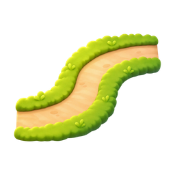](masters/paths/grass-curve.png) | [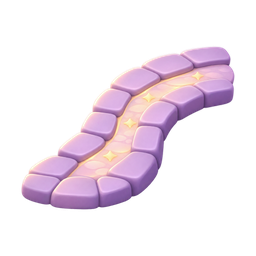](masters/paths/stone-curve.png) | [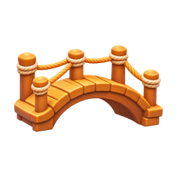](masters/paths/wood-bridge.png) |

| rope-bridge | stone-platform | star-platform |
| --- | --- | --- |
| [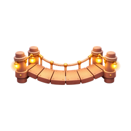](masters/paths/rope-bridge.png) | [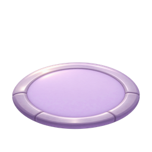](masters/paths/stone-platform.png) |  |

### Icons

| lock | check | play |
| --- | --- | --- |
|  |  |  |

| world-leaf | world-honey | world-moon |
| --- | --- | --- |
|  | [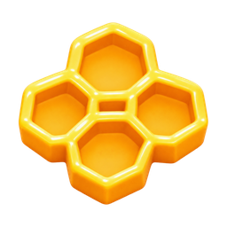](masters/icons/world-honey.png) |  |

### Ui

| celebration-banner | level-panel | world-sign |
| --- | --- | --- |
|  |  | [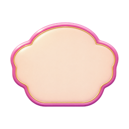](masters/ui/world-sign.png) |

| world-card | play-button | play-button-icon |
| --- | --- | --- |
| [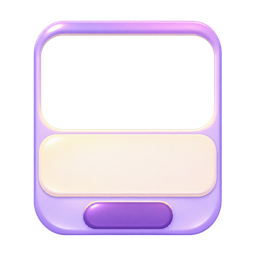](masters/ui/world-card.png) |  |  |

### Props

| direction-sign | banner-a | banner-b |
| --- | --- | --- |
| [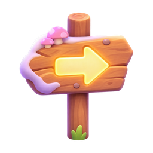](masters/props/direction-sign.png) |  | [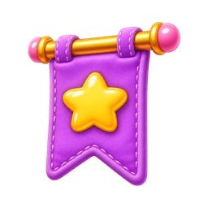](masters/props/banner-b.png) |

| lantern |
| --- |
| [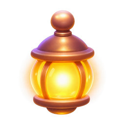](masters/props/lantern.png) |

### Effects

| star-trail | sparkles |
| --- | --- |
|  |  |

### Transitions

| portal-idle | portal-charge | portal-activate |
| --- | --- | --- |
|  | [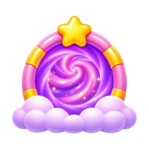](masters/transitions/portal-charge.png) |  |

### Backgrounds

| cloud-sky |
| --- |
|  |

### Gateways

| cloudberry-base | cloudberry-active | honeydrop-base |
| --- | --- | --- |
| [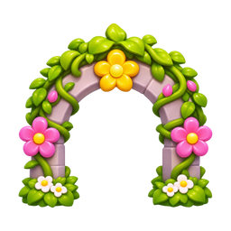](masters/gateways/cloudberry-base.png) | [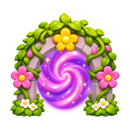](masters/gateways/cloudberry-active.png) | [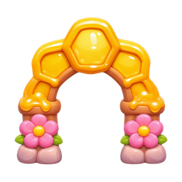](masters/gateways/honeydrop-base.png) |

| honeydrop-active | moonmallow-base | moonmallow-active |
| --- | --- | --- |
| [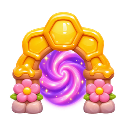](masters/gateways/honeydrop-active.png) | [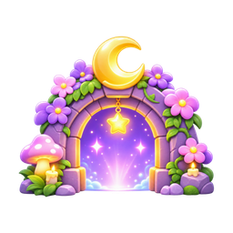](masters/gateways/moonmallow-base.png) |  |

| sugarstar-base | sugarstar-active |
| --- | --- |
| [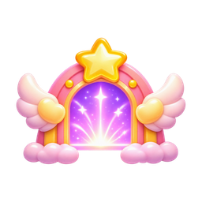](masters/gateways/sugarstar-base.png) |  |

### Worlds

| cloudberry | honeydrop | moonmallow |
| --- | --- | --- |
| [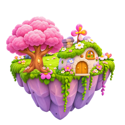](masters/worlds/cloudberry.png) | [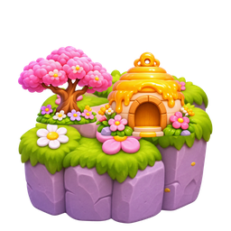](masters/worlds/honeydrop.png) | [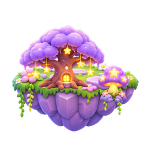](masters/worlds/moonmallow.png) |

| sugarstar |
| --- |
| [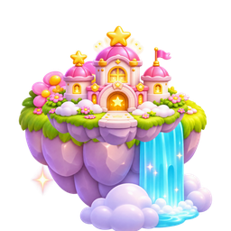](masters/worlds/sugarstar.png) |

### Cards

| cloudberry | honeydrop | moonmallow |
| --- | --- | --- |
| [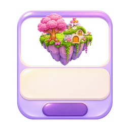](masters/cards/cloudberry.png) | [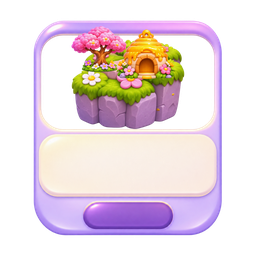](masters/cards/honeydrop.png) | [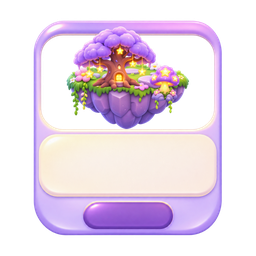](masters/cards/moonmallow.png) |

| sugarstar |
| --- |
| [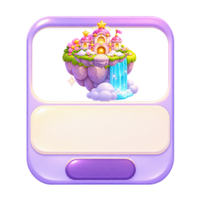](masters/cards/sugarstar.png) |

### Animation

| portal-idle | portal-charge | portal-activate |
| --- | --- | --- |
| [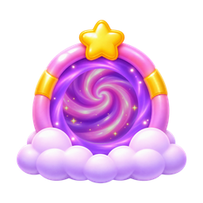](masters/animation/portal-idle.png) |  |  |

| unlock-locked | unlock-ready | unlock-selected |
| --- | --- | --- |
|  | [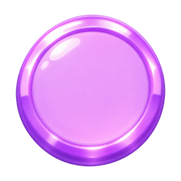](masters/animation/unlock-ready.png) |  |

| chest-closed | chest-open | star-small |
| --- | --- | --- |
|  |  |  |

| star-medium | star-full | chest-reward |
| --- | --- | --- |
|  |  |  |

### Maps

| landscape | portrait |
| --- | --- |
| [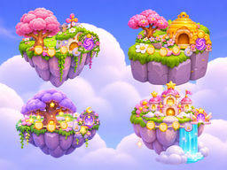](masters/maps/landscape.png) | [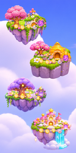](masters/maps/portrait.png) |

### Examples

| world-selection | level-preview | world-complete |
| --- | --- | --- |
| [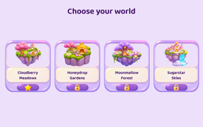](masters/examples/world-selection.png) | [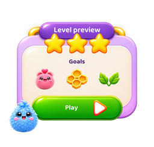](masters/examples/level-preview.png) | [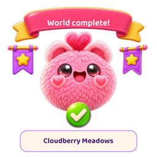](masters/examples/world-complete.png) |

| world-unlocked |
| --- |
| [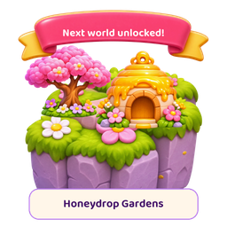](masters/examples/world-unlocked.png) |

