# Obstacles & mission objects · v1

108 individual assets, layers, state variants and reusable keyframes. The original board is preserved [unchanged](references/original-stage-05-board.png). Its Stage 05 label is retained; this repository uses Stage 06 because Stage 05 already contains worlds and levels.

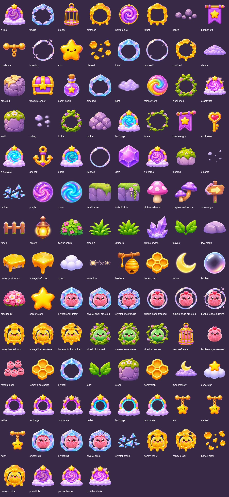

## Use

PNG masters and 256/512 PNG plus lossless WebP exports. Newly generated masters use a 1024-square canvas; reused masters retain their original dimensions. No native 2048 renders are claimed. Use straight alpha/source-over blending and center anchors. Shell, bubble, honey and vine layers have transparent centers for existing character sprites. The `composites` and mission previews use the exact locked Rosybuns, Leaflings or Chirpyfluffs artwork, resized and layered without repainting. Original character files are untouched. Asset provenance records the source path, checksum and placement.

The board's alternate character appearances are deliberately excluded. Repeated world props and brand stars reuse existing artwork. Generic collectible stars are objects, not a new character family. Category icons reuse matching objects where possible.

## States and integration

`animation` contains the board's 4 crystal, 4 honey and 3 portal keyframes. These are reusable still poses, not a validated seamless animation. Moving-anchor frames keep the hanger and pendant connected while illustrating three positions; movement timing belongs to the game. Portal A/B artwork and charge states do not implement teleportation. `states.json` records state assets without assigning hit points, timing, rewards or economy rules. Existing GDD and locked designs remain unchanged.

All generated artwork is an interpretation of the reference, not pixel-exact extraction. Check state transitions, collider sizes, masking and visual scale in the engine. Angles and outlines can vary between generated states. No claim of in-engine production approval is made. Tiny stray alpha pixels are cleaned; glows and internal openings are retained.

`generation.json` contains the built-in image generation prompts and source hashes. `manifest.json` lists every file and asset; `qa.json` records export verification. `preview.html` is an offline gallery. The individual previews below link to full PNG masters.

## Every individual asset

### Magic Portal

| a-idle | a-activate | b-charge |
| --- | --- | --- |
| [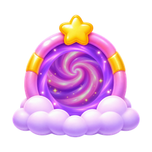](masters/magic-portal/a-idle.png) |  | [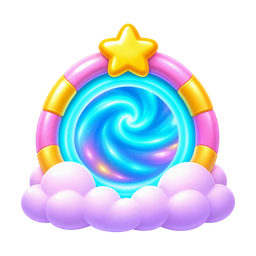](masters/magic-portal/b-charge.png) |

| b-activate | b-idle | a-charge |
| --- | --- | --- |
|  | [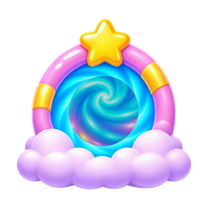](masters/magic-portal/b-idle.png) |  |

### Crystal Shell

| fragile | intact | cracked |
| --- | --- | --- |
| [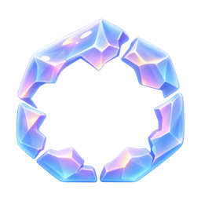](masters/crystal-shell/fragile.png) | [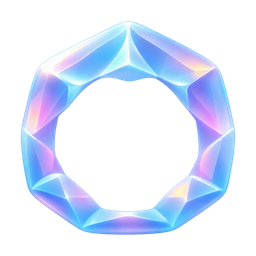](masters/crystal-shell/intact.png) | [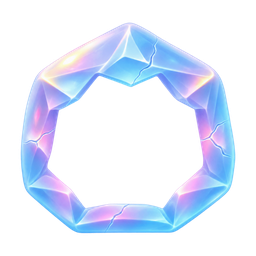](masters/crystal-shell/cracked.png) |

| broken |
| --- |
|  |

### Rescue Cage

| empty |
| --- |
| [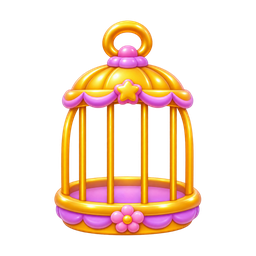](masters/rescue-cage/empty.png) |

### Honey Block

| softened | intact | cleared |
| --- | --- | --- |
| [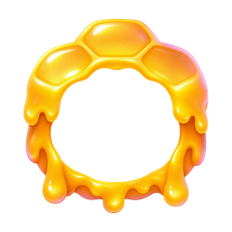](masters/honey-block/softened.png) | [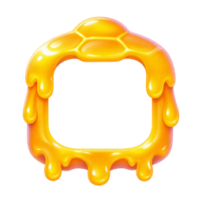](masters/honey-block/intact.png) |  |

| cracked |
| --- |
| [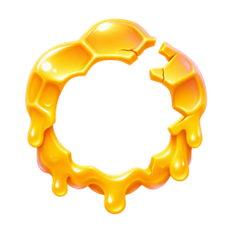](masters/honey-block/cracked.png) |

### Icons

| portal-spiral | anchor | honeycomb |
| --- | --- | --- |
| [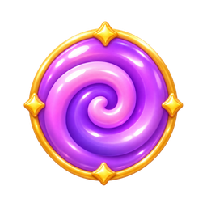](masters/icons/portal-spiral.png) |  |  |

| moon | bubble | crystal |
| --- | --- | --- |
|  | [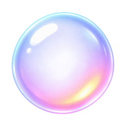](masters/icons/bubble.png) |  |

| leaf | stone |
| --- | --- |
| [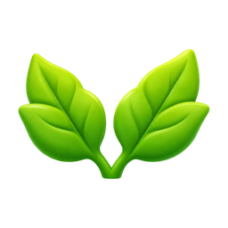](masters/icons/leaf.png) |  |

### Stone Crate

| debris | cracked | solid |
| --- | --- | --- |
| [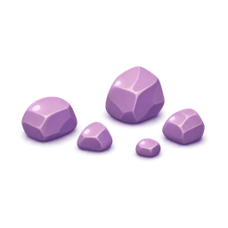](masters/stone-crate/debris.png) | [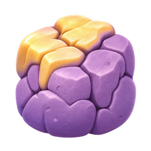](masters/stone-crate/cracked.png) | [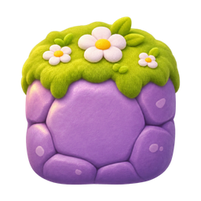](masters/stone-crate/solid.png) |

| broken |
| --- |
| [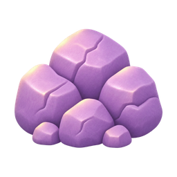](masters/stone-crate/broken.png) |

### Props

| banner-left | banner-right | turf-block-a |
| --- | --- | --- |
|  | [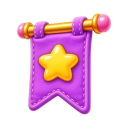](masters/props/banner-right.png) | [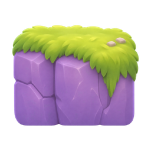](masters/props/turf-block-a.png) |

| turf-block-b | pink-mushroom | purple-mushrooms |
| --- | --- | --- |
| [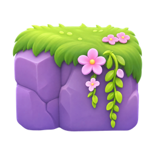](masters/props/turf-block-b.png) | [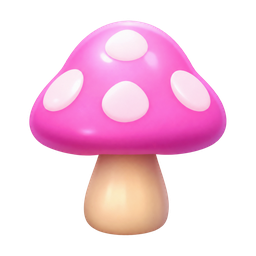](masters/props/pink-mushroom.png) | [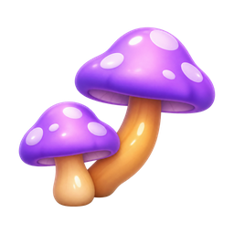](masters/props/purple-mushrooms.png) |

| arrow-sign | fence | lantern |
| --- | --- | --- |
| [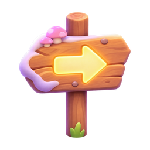](masters/props/arrow-sign.png) | [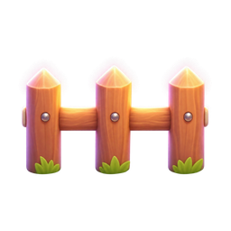](masters/props/fence.png) | [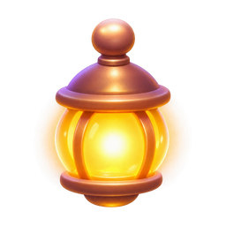](masters/props/lantern.png) |

| flower-shrub | grass-a | grass-b |
| --- | --- | --- |
| [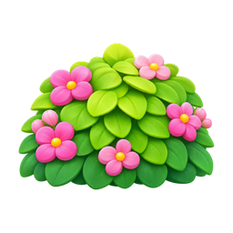](masters/props/flower-shrub.png) | [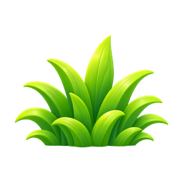](masters/props/grass-a.png) | [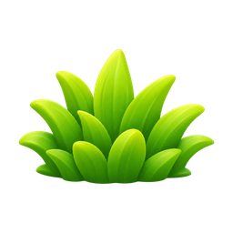](masters/props/grass-b.png) |

| purple-crystal | leaves | low-rocks |
| --- | --- | --- |
| [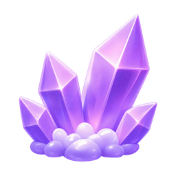](masters/props/purple-crystal.png) |  | [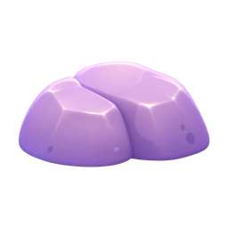](masters/props/low-rocks.png) |

| honey-platform-a | honey-platform-b | cloud |
| --- | --- | --- |
| [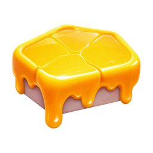](masters/props/honey-platform-a.png) | [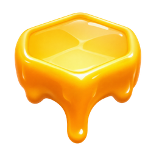](masters/props/honey-platform-b.png) | [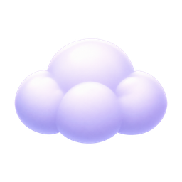](masters/props/cloud.png) |

| star-glow | beehive |
| --- | --- |
|  | [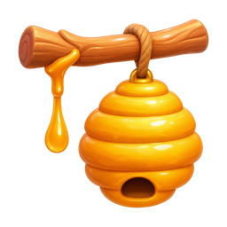](masters/props/beehive.png) |

### Moving Anchor

| hardware | left | center |
| --- | --- | --- |
| [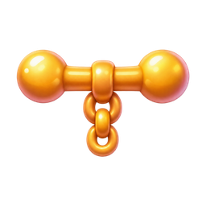](masters/moving-anchor/hardware.png) | [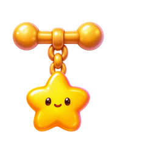](masters/moving-anchor/left.png) | [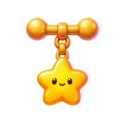](masters/moving-anchor/center.png) |

| right |
| --- |
| [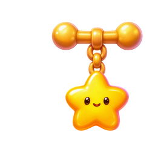](masters/moving-anchor/right.png) |

### Bubble Cage

| bursting | cracked | trapped |
| --- | --- | --- |
| [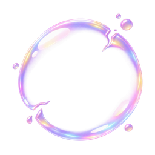](masters/bubble-cage/bursting.png) | [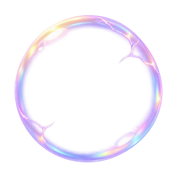](masters/bubble-cage/cracked.png) | [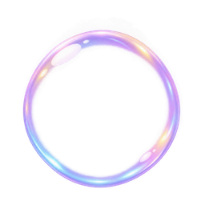](masters/bubble-cage/trapped.png) |

### Collectibles

| star | treasure-chest | boost-bottle |
| --- | --- | --- |
|  |  | [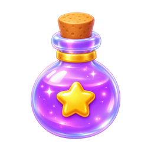](masters/collectibles/boost-bottle.png) |

| rainbow-orb | world-key | gem |
| --- | --- | --- |
| [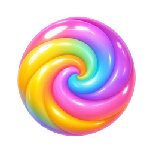](masters/collectibles/rainbow-orb.png) |  | [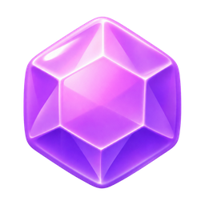](masters/collectibles/gem.png) |

### Moon Fog

| dense | light | fading |
| --- | --- | --- |
| [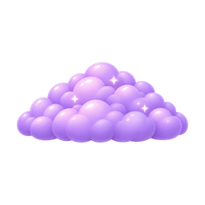](masters/moon-fog/dense.png) | [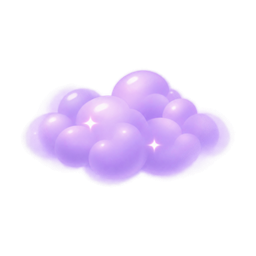](masters/moon-fog/light.png) | [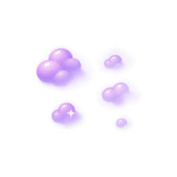](masters/moon-fog/fading.png) |

| cleared |
| --- |
| [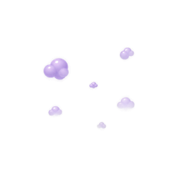](masters/moon-fog/cleared.png) |

### Vine Lock

| weakened | locked | loose |
| --- | --- | --- |
| [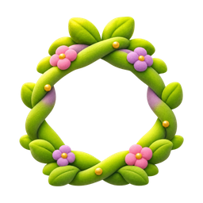](masters/vine-lock/weakened.png) |  |  |

| cleared |
| --- |
|  |

### Portal Interiors

| purple | cyan |
| --- | --- |
|  |  |

### World Badges

| cloudberry | honeydrop | moonmallow |
| --- | --- | --- |
|  |  |  |

| sugarstar |
| --- |
|  |

### Missions

| collect-stars | rescue-friends | match-clear |
| --- | --- | --- |
|  |  |  |

| remove-obstacles |
| --- |
|  |

### Composites

| crystal-shell-intact | crystal-shell-cracked | crystal-shell-fragile |
| --- | --- | --- |
|  |  |  |

| bubble-cage-trapped | bubble-cage-cracked | bubble-cage-bursting |
| --- | --- | --- |
|  |  |  |

| honey-block-intact | honey-block-softened | honey-block-cracked |
| --- | --- | --- |
|  |  |  |

| vine-lock-locked | vine-lock-weakened | vine-lock-loose |
| --- | --- | --- |
|  |  |  |

| bubble-cage-released |
| --- |
|  |

### Portal Frames

| a-idle | a-charge | a-activate |
| --- | --- | --- |
|  |  |  |

| b-idle | b-charge | b-activate |
| --- | --- | --- |
|  |  |  |

### Animation

| crystal-idle | crystal-hit | crystal-crack |
| --- | --- | --- |
|  |  |  |

| crystal-break | honey-intact | honey-crack |
| --- | --- | --- |
|  |  |  |

| honey-clear | honey-shake | portal-idle |
| --- | --- | --- |
|  |  |  |

| portal-charge | portal-activate |
| --- | --- |
|  |  |

