# Power-ups & boosters · Stage 6 · v1

113 individual assets, layers, state variants and compositions; 492 PNG/WebP exports. All ten concepts from the supplied [original board](references/original-power-up-showcase.png) are included. The original PNG is unchanged.

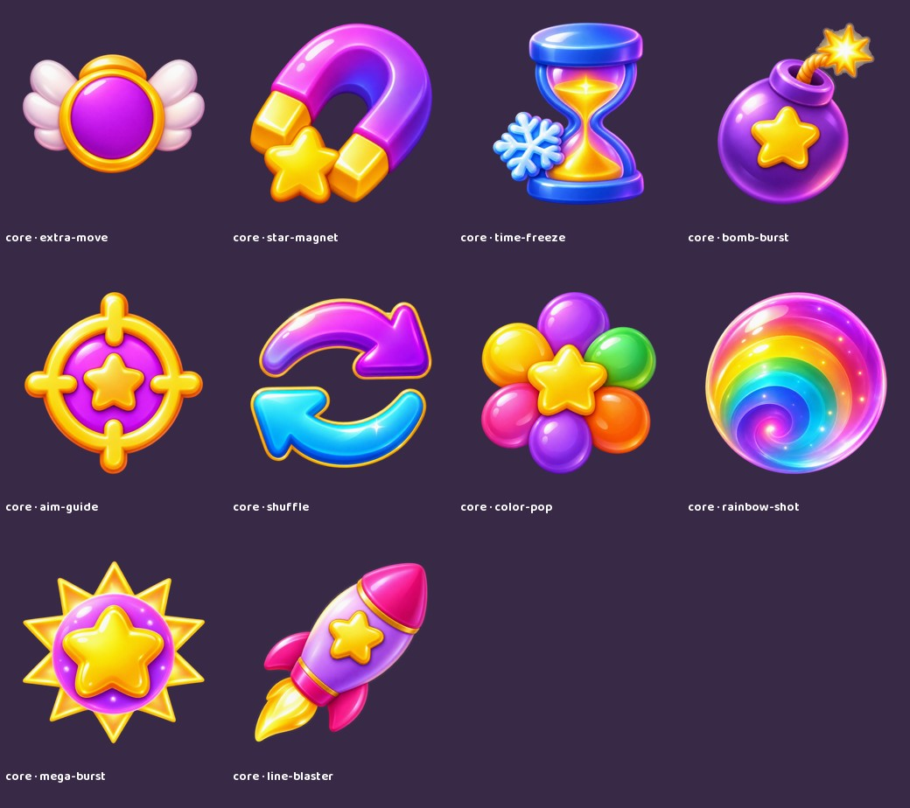

## Existing context preserved

The ten names are visual concept IDs: Rainbow Shot, Bomb Burst, Line Blaster, Color Pop, Shuffle, Extra Move, Aim Guide, Star Magnet, Time Freeze and Mega Burst. Their artwork does not approve new mechanics or replace the GDD's reviewable roster. The locked hybrid architecture remains: optional inventory boosters, automatic earned family powers and manually activated charged cannon powers are separate systems. Main-path progression must remain achievable without paid boosters or ads.

The board's +5, inventory counts and x3/x10/x30/x50 pack quantities are not baked into the reusable art. Render those through runtime text after balancing. No prices, grants, unlocks, effect radii, inventory rules, time-freeze durations or shot bonuses are defined here. A puff-filled chest is a decorative illustration, not approval of randomized paid rewards.

Approved characters, cannon and reused assets remain unchanged. Gameplay examples use the actual locked sprites and existing Cloud Sling cannon; alternate mascots from the board are excluded. Rosybuns, Skydoodles, Mossmops, Sunpuffs, Plumplets and Peachpeeps map to the existing storage aliases documented in the GDD.

## Files and integration

- New individual art uses 1024-square transparent PNG masters. Reused masters retain their original dimensions and exact file bytes. The hotbar and action examples are larger assembled compositions, not native 2K renders.
- Every asset has 256/512 PNG and lossless WebP exports. The ten core icons additionally have 64/128 exports for small UI review.
- Each booster has idle, selected, charging, activated and effect key poses. The first four states use the same core at the same size and center; effects are separate reusable layers. Some effects are deliberately shared.
- `ui` contains empty hotbar, slot, badge, ribbons, meters and flags, plus a blank-count assembled hotbar. Add accessible localized text separately. These raster surfaces are not validated nine-slice components.
- `packs` and `collectibles` include the gift, bottle, blue sack, closed/open chest, purple crate, brown sack and composed reward chests. Quantities are runtime data.
- `examples` contains two flattened action illustrations, not a collision simulation, playable screen or approved targeting preview.
- Use straight alpha/source-over blending and center anchors. `states.json` maps key poses and effects without assigning timing or activation rules. These still poses do not constitute a smooth 60-FPS loop; transitions and reduced-motion behavior require engine work. Animation callbacks must never grant rewards or apply effects twice.

`generation.json` records built-in image generation prompts, source checksums and cleanup. `manifest.json` lists every file and asset. `qa.json` records export checks. `preview.html` is an offline gallery. Technical export QA and visual review do not replace in-engine, balancing, accessibility or device testing.

## Every individual preview

### Effects

| bubble-particles | flower-explosion | purple-vortex |
| --- | --- | --- |
|  |  | [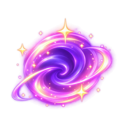](masters/effects/purple-vortex.png) |

| charge-ring | pink-sparkles | gold-sparkles |
| --- | --- | --- |
|  | [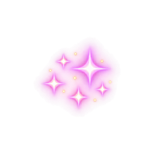](masters/effects/pink-sparkles.png) |  |

| rainbow-trail | gold-glint | cloud-puff |
| --- | --- | --- |
|  | [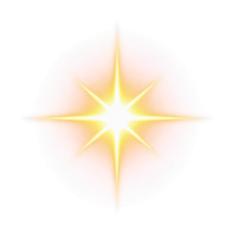](masters/effects/gold-glint.png) |  |

| star-comet | aim-dot | aim-trajectory |
| --- | --- | --- |
| [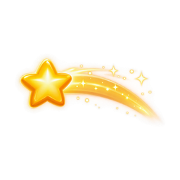](masters/effects/star-comet.png) | [](masters/effects/aim-dot.png) | [](masters/effects/aim-trajectory.png) |

| star-attraction | freeze-field | mega-explosion |
| --- | --- | --- |
|  | [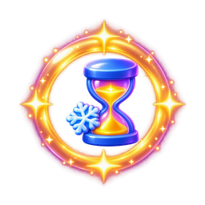](masters/effects/freeze-field.png) |  |

### Ui

| ribbon | slot | flags |
| --- | --- | --- |
| [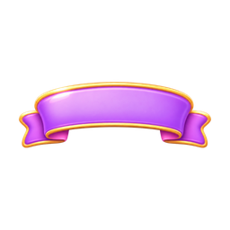](masters/ui/ribbon.png) | [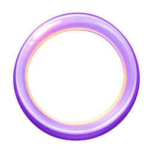](masters/ui/slot.png) |  |

| gold-meter | count-badge | purple-meter |
| --- | --- | --- |
|  | [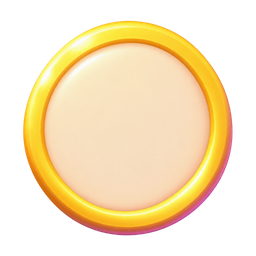](masters/ui/count-badge.png) | [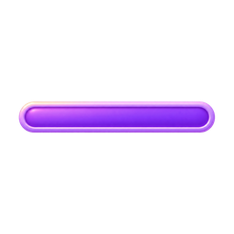](masters/ui/purple-meter.png) |

| hotbar | three-star-ribbon | meter-half |
| --- | --- | --- |
| [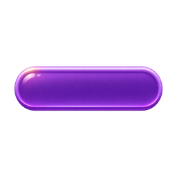](masters/ui/hotbar.png) |  | [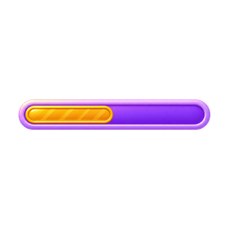](masters/ui/meter-half.png) |

| hotbar-assembled |
| --- |
|  |

### Core

| extra-move | star-magnet | time-freeze |
| --- | --- | --- |
| [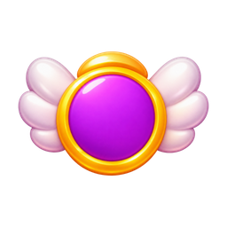](masters/core/extra-move.png) | [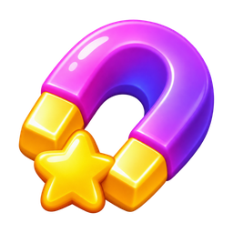](masters/core/star-magnet.png) | [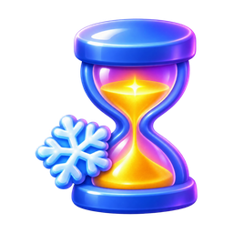](masters/core/time-freeze.png) |

| bomb-burst | aim-guide | shuffle |
| --- | --- | --- |
| [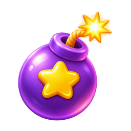](masters/core/bomb-burst.png) |  | [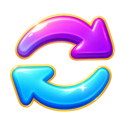](masters/core/shuffle.png) |

| color-pop | rainbow-shot | mega-burst |
| --- | --- | --- |
| [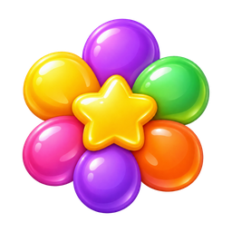](masters/core/color-pop.png) | [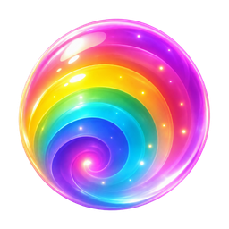](masters/core/rainbow-shot.png) | [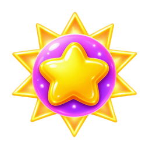](masters/core/mega-burst.png) |

| line-blaster |
| --- |
| [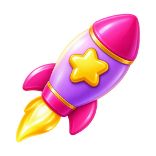](masters/core/line-blaster.png) |

### Collectibles

| blue-booster-bag | purple-booster-crate | gift |
| --- | --- | --- |
| [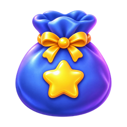](masters/collectibles/blue-booster-bag.png) | [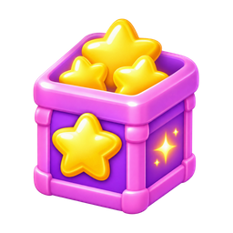](masters/collectibles/purple-booster-crate.png) |  |

| booster-bottle | chest-closed |
| --- | --- |
|  |  |

### Icons

| plus | ticket | energy |
| --- | --- | --- |
| [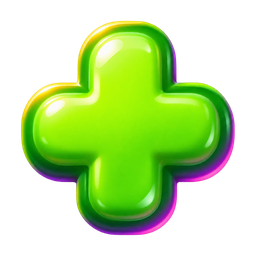](masters/icons/plus.png) | [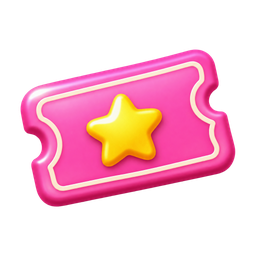](masters/icons/ticket.png) | [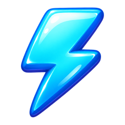](masters/icons/energy.png) |

| star | gem | cloud |
| --- | --- | --- |
|  | [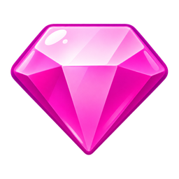](masters/icons/gem.png) | [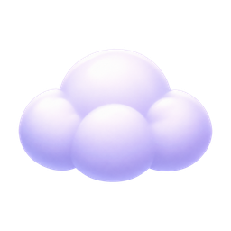](masters/icons/cloud.png) |

### Packs

| brown-booster-bag | chest-open | bottle |
| --- | --- | --- |
| [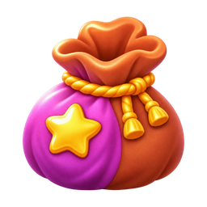](masters/packs/brown-booster-bag.png) | [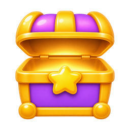](masters/packs/chest-open.png) | [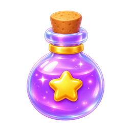](masters/packs/bottle.png) |

| star-chest | puff-chest |
| --- | --- |
| [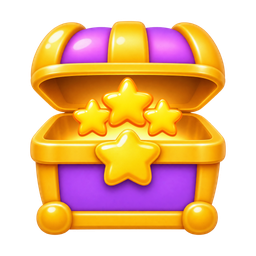](masters/packs/star-chest.png) | [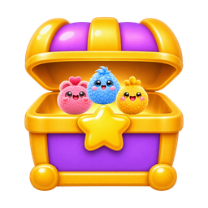](masters/packs/puff-chest.png) |

### States · Rainbow Shot

| idle | selected | charging |
| --- | --- | --- |
| [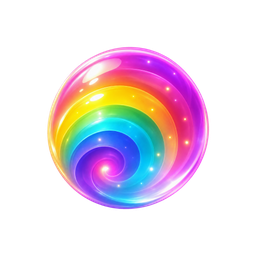](masters/states/rainbow-shot/idle.png) | [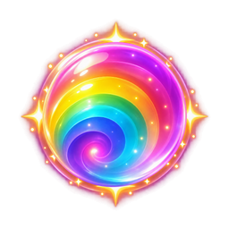](masters/states/rainbow-shot/selected.png) | [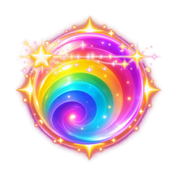](masters/states/rainbow-shot/charging.png) |

| activated | effect |
| --- | --- |
| [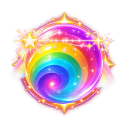](masters/states/rainbow-shot/activated.png) | [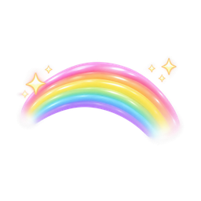](masters/states/rainbow-shot/effect.png) |

### States · Bomb Burst

| idle | selected | charging |
| --- | --- | --- |
| [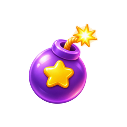](masters/states/bomb-burst/idle.png) | [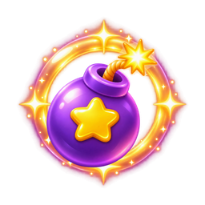](masters/states/bomb-burst/selected.png) | [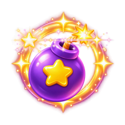](masters/states/bomb-burst/charging.png) |

| activated | effect |
| --- | --- |
| [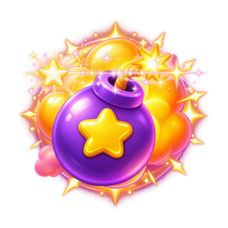](masters/states/bomb-burst/activated.png) | [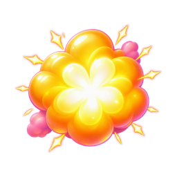](masters/states/bomb-burst/effect.png) |

### States · Line Blaster

| idle | selected | charging |
| --- | --- | --- |
| [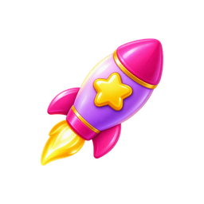](masters/states/line-blaster/idle.png) | [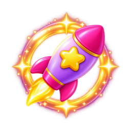](masters/states/line-blaster/selected.png) | [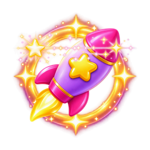](masters/states/line-blaster/charging.png) |

| activated | effect |
| --- | --- |
| [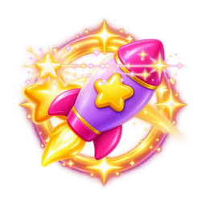](masters/states/line-blaster/activated.png) |  |

### States · Color Pop

| idle | selected | charging |
| --- | --- | --- |
| [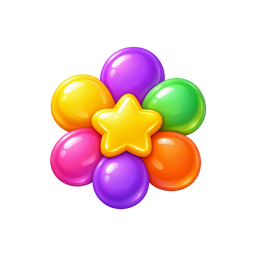](masters/states/color-pop/idle.png) |  |  |

| activated | effect |
| --- | --- |
|  |  |

### States · Shuffle

| idle | selected | charging |
| --- | --- | --- |
|  |  |  |

| activated | effect |
| --- | --- |
|  |  |

### States · Extra Move

| idle | selected | charging |
| --- | --- | --- |
|  |  |  |

| activated | effect |
| --- | --- |
|  |  |

### States · Aim Guide

| idle | selected | charging |
| --- | --- | --- |
|  |  |  |

| activated | effect |
| --- | --- |
|  |  |

### States · Star Magnet

| idle | selected | charging |
| --- | --- | --- |
|  |  |  |

| activated | effect |
| --- | --- |
|  |  |

### States · Time Freeze

| idle | selected | charging |
| --- | --- | --- |
|  |  |  |

| activated | effect |
| --- | --- |
|  |  |

### States · Mega Burst

| idle | selected | charging |
| --- | --- | --- |
|  |  |  |

| activated | effect |
| --- | --- |
|  |  |

### Ui Icons

| rainbow-shot | bomb-burst | line-blaster |
| --- | --- | --- |
|  |  |  |

| color-pop | shuffle | extra-move |
| --- | --- | --- |
|  |  |  |

| aim-guide | star-magnet | time-freeze |
| --- | --- | --- |
|  |  |  |

| mega-burst |
| --- |
|  |

### Examples

| rainbow-shot-action | bomb-burst-action |
| --- | --- |
|  |  |

