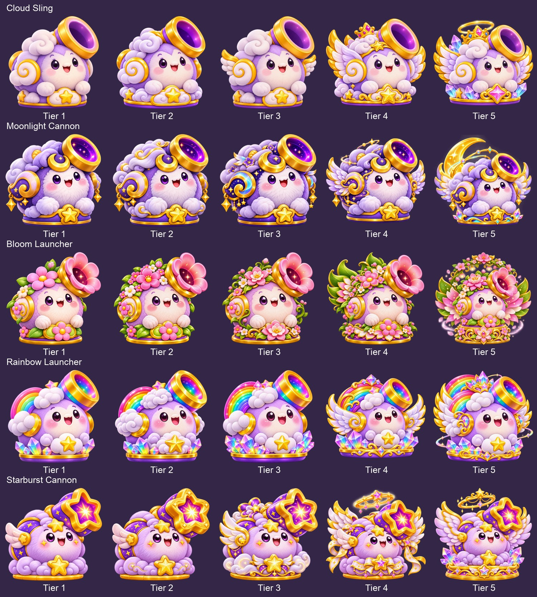

# Cannon upgrade collection · Five families × five visual tiers

Original Tier 1 view files are copied byte-for-byte. New tiers preserve original cannon identity while adding reference-driven ornaments. Existing locked artwork is unchanged. These are AI-generated visual interpretations, not a 3D model or engine-validated upgrade system.

| Cannon | Individual gallery | Masters | Exports |
|---|---|---:|---:|
| Cloud Sling | [All tiers, views and states](cloud-sling/README.md) | 83 | 498 |
| Moonlight Cannon | [All tiers, views and states](moonlight-cannon/README.md) | 83 | 498 |
| Bloom Launcher | [All tiers, views and states](bloom-launcher/README.md) | 83 | 498 |
| Rainbow Launcher | [All tiers, views and states](rainbow-launcher/README.md) | 83 | 498 |
| Starburst Cannon | [All tiers, views and states](starburst-cannon/README.md) | 83 | 498 |

Starburst keeps the locked star-shaped muzzle; the conflicting round-barrel board is supplementary only. Bloom upgrades use its collection-board row because no separate Bloom evolution board was supplied. Original boards, prompts, source hashes, manifests and QA notes are included in each family folder. Costs, damage, physics and hitboxes are unchanged.
