# Booster Inventory · Economy v1

55 individual masters and 330 PNG/lossless WebP exports.

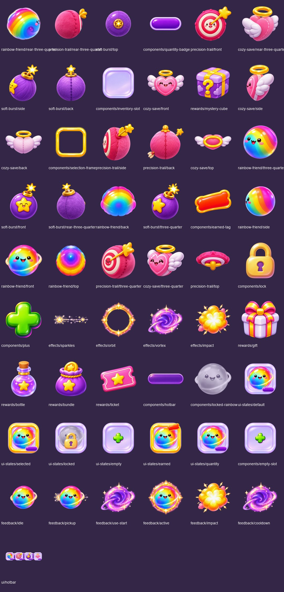

These four inventory concepts do not replace the previous ten booster concepts or locked characters. Quantities, activation rules and grants remain runtime data.

Original boards are preserved byte-for-byte in `references/`. Duplicate source filenames are retained. New art is AI reconstruction of the supplied board, not pixel-perfect extraction or native 2K art. Existing masters are copied unchanged; derived compositions are identified in the manifest. Locked character files are untouched. Transparent masters use a 1024 canvas; reusable masters retain original sizes. Exports are 128/256/512 pixels. Animation artwork is key poses, not a timed or engine-tested animation. UI counts/text are runtime labels. Design tokens and material close-ups remain in the original board as reference.

## Every individual asset

### rainbow-friend

| Asset | Preview |
|---|---|
| [rainbow-friend/rear-three-quarter](masters/rainbow-friend/rear-three-quarter.png) | 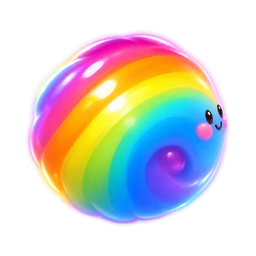 |
| [rainbow-friend/three-quarter](masters/rainbow-friend/three-quarter.png) | 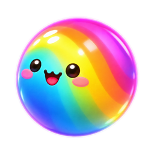 |
| [rainbow-friend/back](masters/rainbow-friend/back.png) | 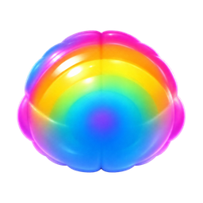 |
| [rainbow-friend/side](masters/rainbow-friend/side.png) | 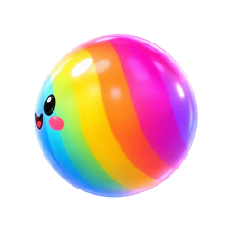 |
| [rainbow-friend/front](masters/rainbow-friend/front.png) |  |
| [rainbow-friend/top](masters/rainbow-friend/top.png) | 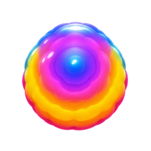 |

### precision-trail

| Asset | Preview |
|---|---|
| [precision-trail/rear-three-quarter](masters/precision-trail/rear-three-quarter.png) | 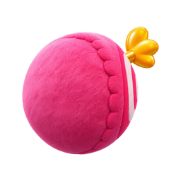 |
| [precision-trail/front](masters/precision-trail/front.png) |  |
| [precision-trail/side](masters/precision-trail/side.png) | 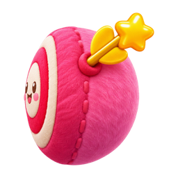 |
| [precision-trail/back](masters/precision-trail/back.png) | 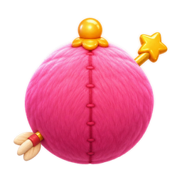 |
| [precision-trail/three-quarter](masters/precision-trail/three-quarter.png) | 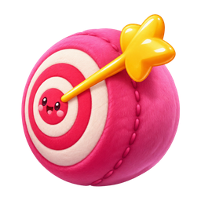 |
| [precision-trail/top](masters/precision-trail/top.png) | 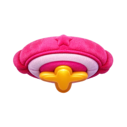 |

### soft-burst

| Asset | Preview |
|---|---|
| [soft-burst/top](masters/soft-burst/top.png) | 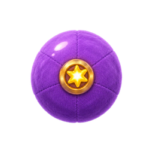 |
| [soft-burst/side](masters/soft-burst/side.png) | 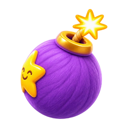 |
| [soft-burst/back](masters/soft-burst/back.png) | 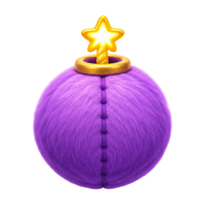 |
| [soft-burst/front](masters/soft-burst/front.png) |  |
| [soft-burst/rear-three-quarter](masters/soft-burst/rear-three-quarter.png) | 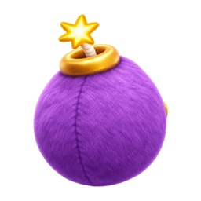 |
| [soft-burst/three-quarter](masters/soft-burst/three-quarter.png) | 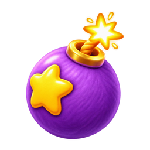 |

### components

| Asset | Preview |
|---|---|
| [components/quantity-badge](masters/components/quantity-badge.png) | 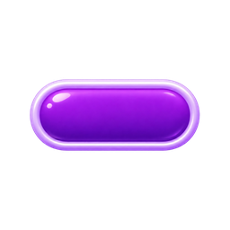 |
| [components/inventory-slot](masters/components/inventory-slot.png) | 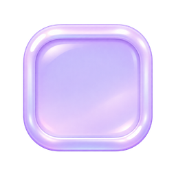 |
| [components/selection-frame](masters/components/selection-frame.png) |  |
| [components/earned-tag](masters/components/earned-tag.png) | 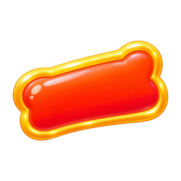 |
| [components/lock](masters/components/lock.png) |  |
| [components/plus](masters/components/plus.png) | 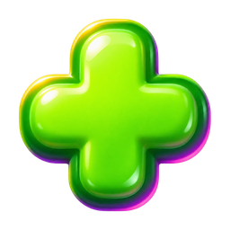 |
| [components/hotbar](masters/components/hotbar.png) | 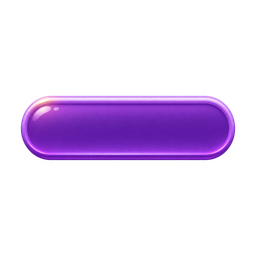 |
| [components/locked-rainbow](masters/components/locked-rainbow.png) | 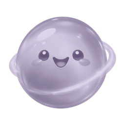 |
| [components/empty-slot](masters/components/empty-slot.png) | 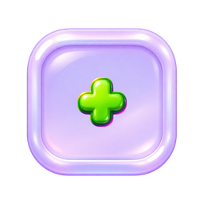 |

### cozy-save

| Asset | Preview |
|---|---|
| [cozy-save/rear-three-quarter](masters/cozy-save/rear-three-quarter.png) | 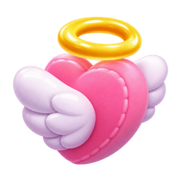 |
| [cozy-save/front](masters/cozy-save/front.png) |  |
| [cozy-save/side](masters/cozy-save/side.png) | 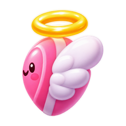 |
| [cozy-save/back](masters/cozy-save/back.png) | 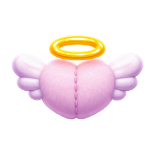 |
| [cozy-save/top](masters/cozy-save/top.png) | 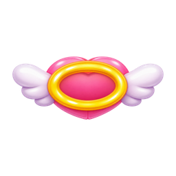 |
| [cozy-save/three-quarter](masters/cozy-save/three-quarter.png) |  |

### rewards

| Asset | Preview |
|---|---|
| [rewards/mystery-cube](masters/rewards/mystery-cube.png) |  |
| [rewards/gift](masters/rewards/gift.png) |  |
| [rewards/bottle](masters/rewards/bottle.png) | 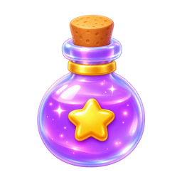 |
| [rewards/bundle](masters/rewards/bundle.png) | 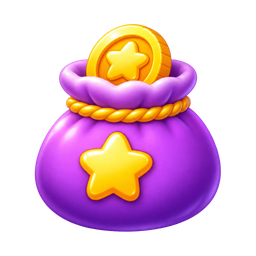 |
| [rewards/ticket](masters/rewards/ticket.png) |  |

### effects

| Asset | Preview |
|---|---|
| [effects/sparkles](masters/effects/sparkles.png) |  |
| [effects/orbit](masters/effects/orbit.png) |  |
| [effects/vortex](masters/effects/vortex.png) |  |
| [effects/impact](masters/effects/impact.png) |  |

### ui-states

| Asset | Preview |
|---|---|
| [ui-states/default](masters/ui-states/default.png) |  |
| [ui-states/selected](masters/ui-states/selected.png) | 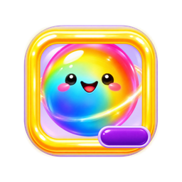 |
| [ui-states/locked](masters/ui-states/locked.png) |  |
| [ui-states/empty](masters/ui-states/empty.png) |  |
| [ui-states/earned](masters/ui-states/earned.png) | 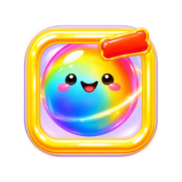 |
| [ui-states/quantity](masters/ui-states/quantity.png) | 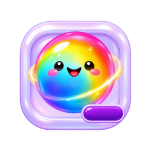 |

### feedback

| Asset | Preview |
|---|---|
| [feedback/idle](masters/feedback/idle.png) | 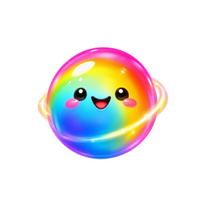 |
| [feedback/pickup](masters/feedback/pickup.png) | 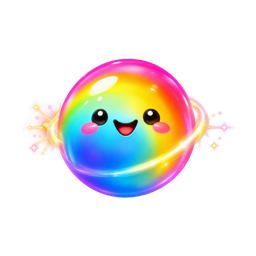 |
| [feedback/use-start](masters/feedback/use-start.png) |  |
| [feedback/active](masters/feedback/active.png) | 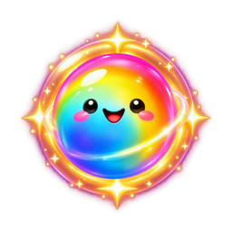 |
| [feedback/impact](masters/feedback/impact.png) |  |
| [feedback/cooldown](masters/feedback/cooldown.png) | 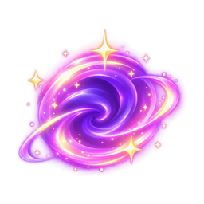 |

### ui

| Asset | Preview |
|---|---|
| [ui/hotbar](masters/ui/hotbar.png) |  |

