# Cannon Energy · Economy v1

42 individual masters and 252 PNG/lossless WebP exports.

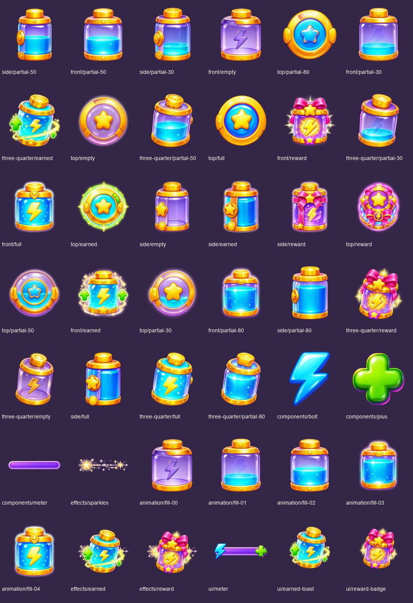

Cannon energy is earned, attempt-scoped and never purchasable or a retry gate. Fill percentages label visual states only. Reward artwork does not approve a new resource grant.

Original boards are preserved byte-for-byte in `references/`. Duplicate source filenames are retained. New art is AI reconstruction of the supplied board, not pixel-perfect extraction or native 2K art. Existing masters are copied unchanged; derived compositions are identified in the manifest. Locked character files are untouched. Transparent masters use a 1024 canvas; reusable masters retain original sizes. Exports are 128/256/512 pixels. Animation artwork is key poses, not a timed or engine-tested animation. UI counts/text are runtime labels. Design tokens and material close-ups remain in the original board as reference.

## Every individual asset

### side

| Asset | Preview |
|---|---|
| [side/partial-50](masters/side/partial-50.png) | 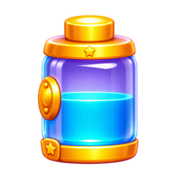 |
| [side/partial-30](masters/side/partial-30.png) | 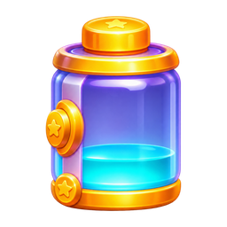 |
| [side/empty](masters/side/empty.png) | 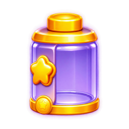 |
| [side/earned](masters/side/earned.png) | 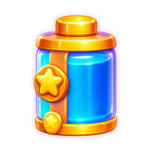 |
| [side/reward](masters/side/reward.png) | 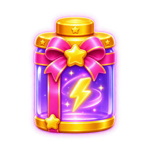 |
| [side/partial-80](masters/side/partial-80.png) | 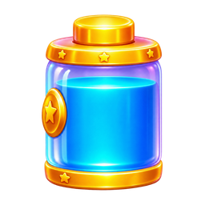 |
| [side/full](masters/side/full.png) | 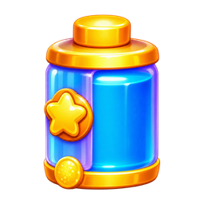 |

### front

| Asset | Preview |
|---|---|
| [front/partial-50](masters/front/partial-50.png) |  |
| [front/empty](masters/front/empty.png) | 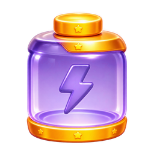 |
| [front/partial-30](masters/front/partial-30.png) | 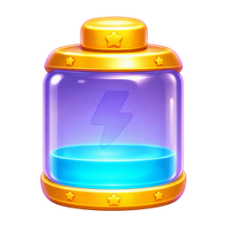 |
| [front/reward](masters/front/reward.png) | 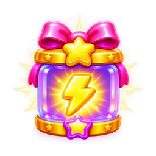 |
| [front/full](masters/front/full.png) | 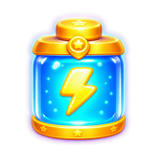 |
| [front/earned](masters/front/earned.png) | 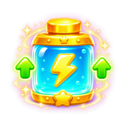 |
| [front/partial-80](masters/front/partial-80.png) |  |

### top

| Asset | Preview |
|---|---|
| [top/partial-80](masters/top/partial-80.png) |  |
| [top/empty](masters/top/empty.png) |  |
| [top/full](masters/top/full.png) |  |
| [top/earned](masters/top/earned.png) |  |
| [top/reward](masters/top/reward.png) | 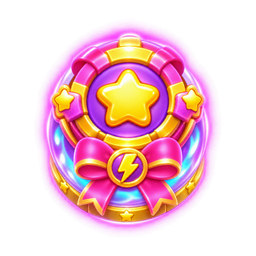 |
| [top/partial-50](masters/top/partial-50.png) |  |
| [top/partial-30](masters/top/partial-30.png) |  |

### three-quarter

| Asset | Preview |
|---|---|
| [three-quarter/earned](masters/three-quarter/earned.png) | 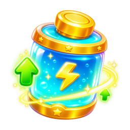 |
| [three-quarter/partial-50](masters/three-quarter/partial-50.png) | 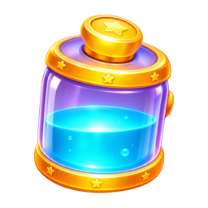 |
| [three-quarter/partial-30](masters/three-quarter/partial-30.png) | 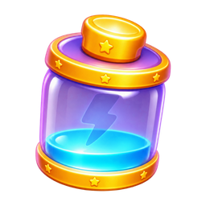 |
| [three-quarter/reward](masters/three-quarter/reward.png) | 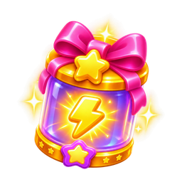 |
| [three-quarter/empty](masters/three-quarter/empty.png) | 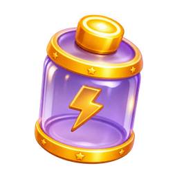 |
| [three-quarter/full](masters/three-quarter/full.png) | 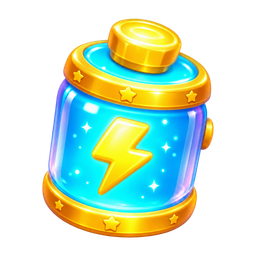 |
| [three-quarter/partial-80](masters/three-quarter/partial-80.png) | 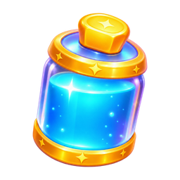 |

### components

| Asset | Preview |
|---|---|
| [components/bolt](masters/components/bolt.png) |  |
| [components/plus](masters/components/plus.png) | 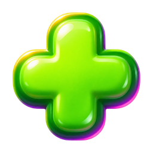 |
| [components/meter](masters/components/meter.png) | 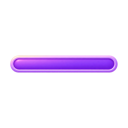 |

### effects

| Asset | Preview |
|---|---|
| [effects/sparkles](masters/effects/sparkles.png) |  |
| [effects/earned](masters/effects/earned.png) | 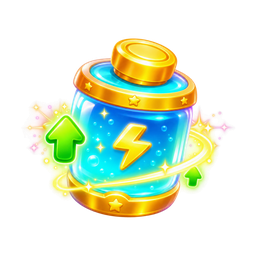 |
| [effects/reward](masters/effects/reward.png) | 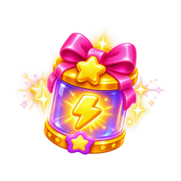 |

### animation

| Asset | Preview |
|---|---|
| [animation/fill-00](masters/animation/fill-00.png) |  |
| [animation/fill-01](masters/animation/fill-01.png) |  |
| [animation/fill-02](masters/animation/fill-02.png) | 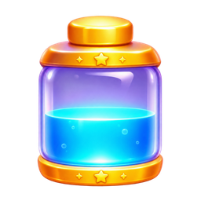 |
| [animation/fill-03](masters/animation/fill-03.png) | 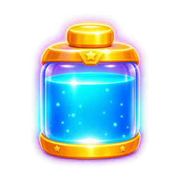 |
| [animation/fill-04](masters/animation/fill-04.png) |  |

### ui

| Asset | Preview |
|---|---|
| [ui/meter](masters/ui/meter.png) | 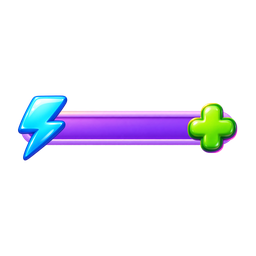 |
| [ui/earned-toast](masters/ui/earned-toast.png) | 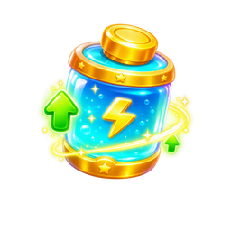 |
| [ui/reward-badge](masters/ui/reward-badge.png) | 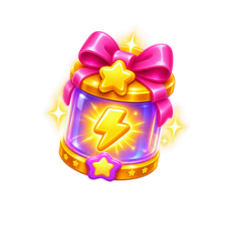 |

