# Coins · Economy v1

36 individual masters and 216 PNG/lossless WebP exports.

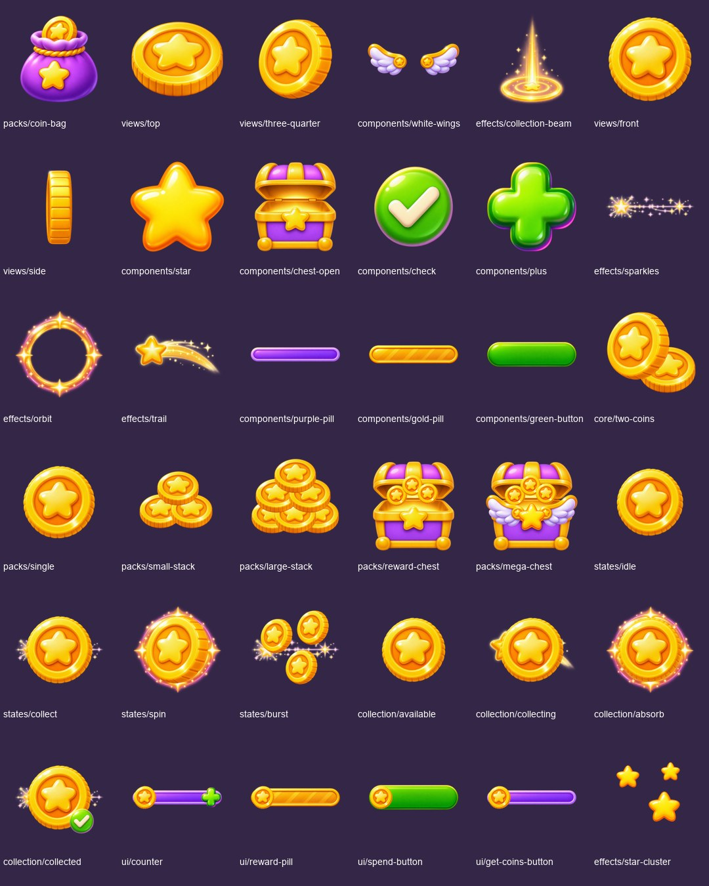

Coin amounts, prices and grant rules are runtime data. This star-emblem coin is an additive board-specific asset; the existing paw-emblem brand coin is unchanged.

Original boards are preserved byte-for-byte in `references/`. Duplicate source filenames are retained. New art is AI reconstruction of the supplied board, not pixel-perfect extraction or native 2K art. Existing masters are copied unchanged; derived compositions are identified in the manifest. Locked character files are untouched. Transparent masters use a 1024 canvas; reusable masters retain original sizes. Exports are 128/256/512 pixels. Animation artwork is key poses, not a timed or engine-tested animation. UI counts/text are runtime labels. Design tokens and material close-ups remain in the original board as reference.

## Every individual asset

### packs

| Asset | Preview |
|---|---|
| [packs/coin-bag](masters/packs/coin-bag.png) | 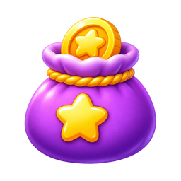 |
| [packs/single](masters/packs/single.png) |  |
| [packs/small-stack](masters/packs/small-stack.png) |  |
| [packs/large-stack](masters/packs/large-stack.png) |  |
| [packs/reward-chest](masters/packs/reward-chest.png) | 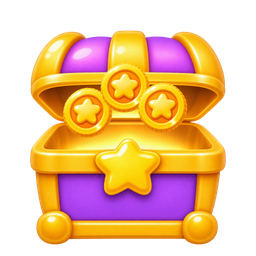 |
| [packs/mega-chest](masters/packs/mega-chest.png) | 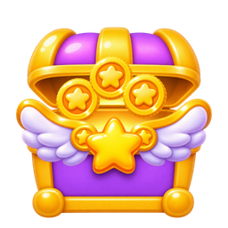 |

### views

| Asset | Preview |
|---|---|
| [views/top](masters/views/top.png) |  |
| [views/three-quarter](masters/views/three-quarter.png) |  |
| [views/front](masters/views/front.png) |  |
| [views/side](masters/views/side.png) | 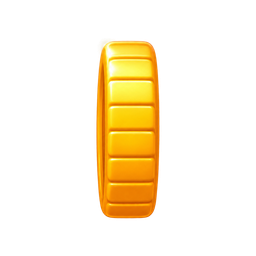 |

### components

| Asset | Preview |
|---|---|
| [components/white-wings](masters/components/white-wings.png) | 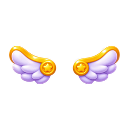 |
| [components/star](masters/components/star.png) |  |
| [components/chest-open](masters/components/chest-open.png) | 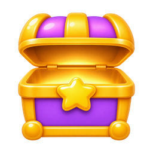 |
| [components/check](masters/components/check.png) |  |
| [components/plus](masters/components/plus.png) | 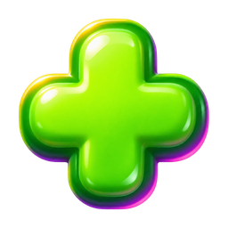 |
| [components/purple-pill](masters/components/purple-pill.png) | 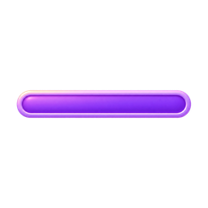 |
| [components/gold-pill](masters/components/gold-pill.png) |  |
| [components/green-button](masters/components/green-button.png) | 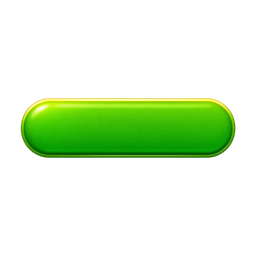 |

### effects

| Asset | Preview |
|---|---|
| [effects/collection-beam](masters/effects/collection-beam.png) | 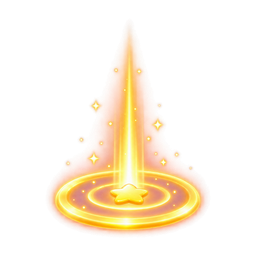 |
| [effects/sparkles](masters/effects/sparkles.png) |  |
| [effects/orbit](masters/effects/orbit.png) |  |
| [effects/trail](masters/effects/trail.png) | 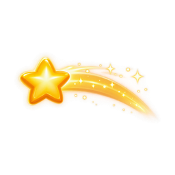 |
| [effects/star-cluster](masters/effects/star-cluster.png) |  |

### core

| Asset | Preview |
|---|---|
| [core/two-coins](masters/core/two-coins.png) |  |

### states

| Asset | Preview |
|---|---|
| [states/idle](masters/states/idle.png) |  |
| [states/collect](masters/states/collect.png) |  |
| [states/spin](masters/states/spin.png) |  |
| [states/burst](masters/states/burst.png) | 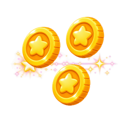 |

### collection

| Asset | Preview |
|---|---|
| [collection/available](masters/collection/available.png) |  |
| [collection/collecting](masters/collection/collecting.png) |  |
| [collection/absorb](masters/collection/absorb.png) |  |
| [collection/collected](masters/collection/collected.png) |  |

### ui

| Asset | Preview |
|---|---|
| [ui/counter](masters/ui/counter.png) | 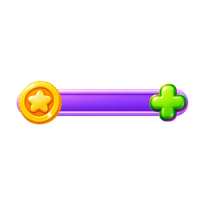 |
| [ui/reward-pill](masters/ui/reward-pill.png) |  |
| [ui/spend-button](masters/ui/spend-button.png) |  |
| [ui/get-coins-button](masters/ui/get-coins-button.png) |  |

