# Stars · Economy v1

29 individual masters and 174 PNG/lossless WebP exports.

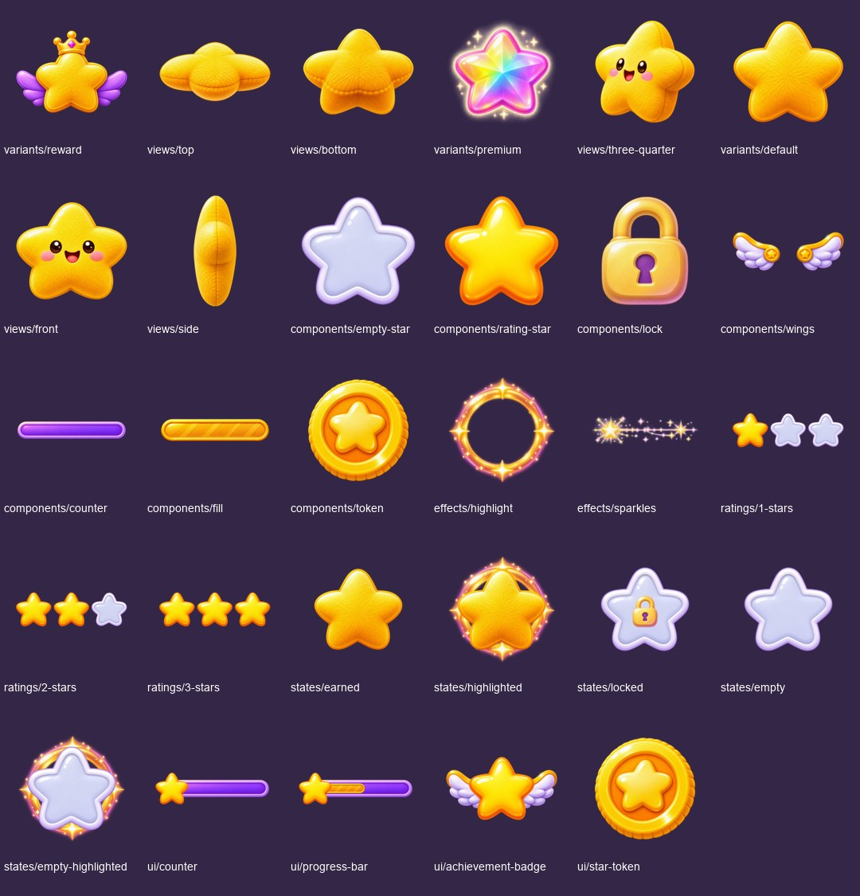

Progression stars are non-spendable high-water records. Ratings, progress totals and level labels are runtime data. The smiling collectible star is not a replacement for any locked family character.

Original boards are preserved byte-for-byte in `references/`. Duplicate source filenames are retained. New art is AI reconstruction of the supplied board, not pixel-perfect extraction or native 2K art. Existing masters are copied unchanged; derived compositions are identified in the manifest. Locked character files are untouched. Transparent masters use a 1024 canvas; reusable masters retain original sizes. Exports are 128/256/512 pixels. Animation artwork is key poses, not a timed or engine-tested animation. UI counts/text are runtime labels. Design tokens and material close-ups remain in the original board as reference.

## Every individual asset

### variants

| Asset | Preview |
|---|---|
| [variants/reward](masters/variants/reward.png) | 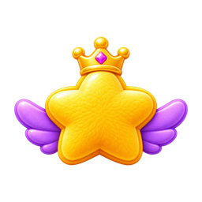 |
| [variants/premium](masters/variants/premium.png) | 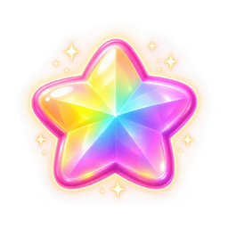 |
| [variants/default](masters/variants/default.png) |  |

### views

| Asset | Preview |
|---|---|
| [views/top](masters/views/top.png) | 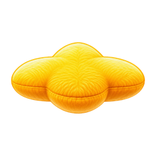 |
| [views/bottom](masters/views/bottom.png) | 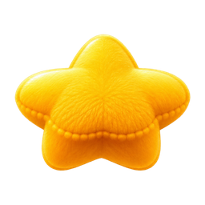 |
| [views/three-quarter](masters/views/three-quarter.png) | 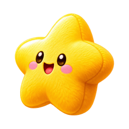 |
| [views/front](masters/views/front.png) | 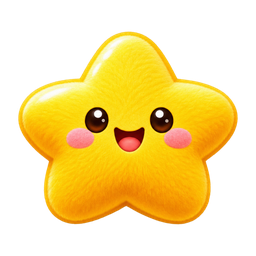 |
| [views/side](masters/views/side.png) | 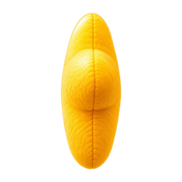 |

### components

| Asset | Preview |
|---|---|
| [components/empty-star](masters/components/empty-star.png) |  |
| [components/rating-star](masters/components/rating-star.png) |  |
| [components/lock](masters/components/lock.png) |  |
| [components/wings](masters/components/wings.png) | 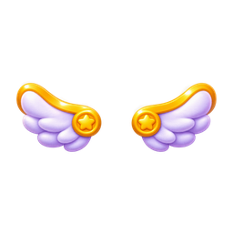 |
| [components/counter](masters/components/counter.png) | 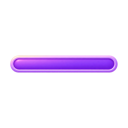 |
| [components/fill](masters/components/fill.png) |  |
| [components/token](masters/components/token.png) |  |

### effects

| Asset | Preview |
|---|---|
| [effects/highlight](masters/effects/highlight.png) |  |
| [effects/sparkles](masters/effects/sparkles.png) |  |

### ratings

| Asset | Preview |
|---|---|
| [ratings/1-stars](masters/ratings/1-stars.png) |  |
| [ratings/2-stars](masters/ratings/2-stars.png) |  |
| [ratings/3-stars](masters/ratings/3-stars.png) |  |

### states

| Asset | Preview |
|---|---|
| [states/earned](masters/states/earned.png) | 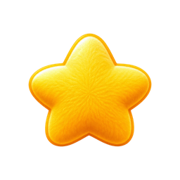 |
| [states/highlighted](masters/states/highlighted.png) | 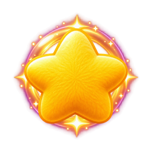 |
| [states/locked](masters/states/locked.png) |  |
| [states/empty](masters/states/empty.png) |  |
| [states/empty-highlighted](masters/states/empty-highlighted.png) | 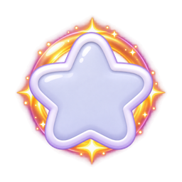 |

### ui

| Asset | Preview |
|---|---|
| [ui/counter](masters/ui/counter.png) |  |
| [ui/progress-bar](masters/ui/progress-bar.png) |  |
| [ui/achievement-badge](masters/ui/achievement-badge.png) |  |
| [ui/star-token](masters/ui/star-token.png) |  |

