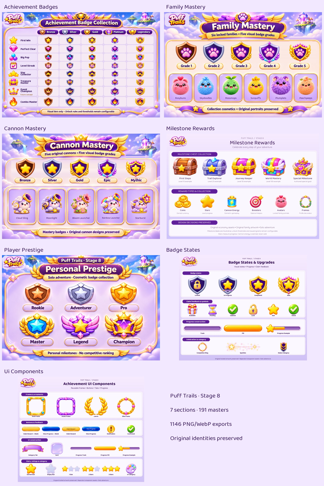

# Puff Trails · Achievements, Badges & Mastery

Seven section boards created first, followed by **191 individual masters** and **1146 PNG/WebP exports**.

## Browse every section

| Section | Masters | Exports |
|---|---:|---:|
| [Achievement Badges](achievement-badges/README.md) | 55 | 330 |
| [Family Mastery](family-mastery/README.md) | 43 | 258 |
| [Cannon Mastery](cannon-mastery/README.md) | 37 | 222 |
| [Milestone Rewards](milestone-rewards/README.md) | 12 | 72 |
| [Player Prestige](player-prestige/README.md) | 7 | 42 |
| [Badge States](badge-states/README.md) | 16 | 96 |
| [Ui Components](ui-components/README.md) | 21 | 126 |

## Preserved design decisions

- Original six family portraits and five cannon identities are reused; no character redesigns.
- Canonical family names: Rosybuns, Skydoodles, Mossmops, Sunpuffs, Plumplets, Peachpeeps. Storage aliases do not rename them.
- Personal Prestige is cosmetic solo progression, not an online leaderboard. Event Champion remains future-only.
- Five badge grades are visual options, separate from proposed mastery stage counts, cannon upgrade tiers and in-level evolution.
- Milestone levels and badge conditions are illustrative, not approved economy grants or unlock thresholds.
- Existing coins, nonspendable stars, earned cannon energy and optional booster designs are retained. No new purchase or retry gates.
- Completed and Claimed remain distinct states; Pending does not imply a reward has been granted.

## Delivery and integration

Each section includes its board, every individual preview, transparent master PNGs, lossless PNG/WebP exports at 128/256/512, manifest and prompt/source provenance. Reused masters retain original bytes; composites resize and layer exact source artwork. New ornaments are AI-generated interpretations, not pixel-perfect extraction from the original board.

Blank button surfaces support localized runtime labels; labelled samples are previews. These are static asset candidates, not a tested UI implementation, gameplay entitlement system, 9-slice specification or animation rig. Check readability, padding, hit areas and animation in the game before release.

[Original supplied board](references/original-achievement-mastery-board.png) · [Collection manifest](manifest.json) · [Locked decision register](../../../docs/gdd/DECISIONS.md)
