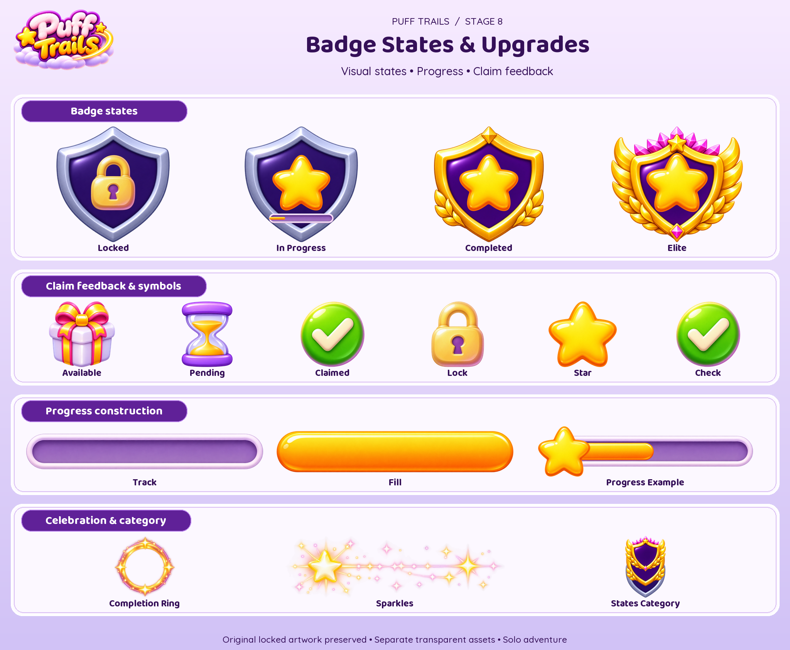
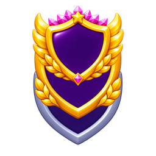
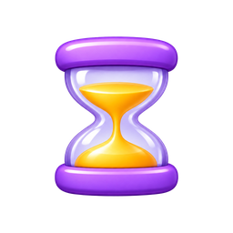
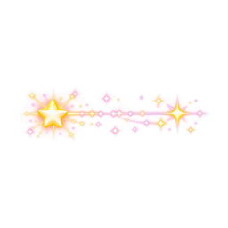

# Badge States

16 individual masters · 96 PNG/WebP exports (128, 256, 512).

Visual asset library only. Tier labels, progress quantities and milestone thresholds are illustrative; no gameplay rules or entitlement changes. Solo-first launch: personal prestige is cosmetic; Event Champion is future-only. Mastery badges do not alter family evolution, cannon upgrades or collision sizes. New ornaments are AI generated; approved portraits and economy art are reused. Runtime labels should remain localized text. PNG/WebP exports are not a tested game integration or animation rig.

[Manifest](manifest.json) · [Provenance](PROVENANCE.md) · [All sections](../README.md)

## Every individual asset

### category/layers

[Master PNG](masters/category/layers.png) · [512px WebP](gameplay/category/layers-512.webp)

### claim/available

[Master PNG](masters/claim/available.png) · [512px WebP](gameplay/claim/available-512.webp)

### claim/claimed

[Master PNG](masters/claim/claimed.png) · [512px WebP](gameplay/claim/claimed-512.webp)

### claim/pending

[Master PNG](masters/claim/pending.png) · [512px WebP](gameplay/claim/pending-512.webp)

### components/fill

[Master PNG](masters/components/fill.png) · [512px WebP](gameplay/components/fill-512.webp)

### components/lock

[Master PNG](masters/components/lock.png) · [512px WebP](gameplay/components/lock-512.webp)

### components/star

[Master PNG](masters/components/star.png) · [512px WebP](gameplay/components/star-512.webp)

### components/track

[Master PNG](masters/components/track.png) · [512px WebP](gameplay/components/track-512.webp)

### effects/completion-ring

[Master PNG](masters/effects/completion-ring.png) · [512px WebP](gameplay/effects/completion-ring-512.webp)

### effects/sparkles

[Master PNG](masters/effects/sparkles.png) · [512px WebP](gameplay/effects/sparkles-512.webp)

### icons/check

[Master PNG](masters/icons/check.png) · [512px WebP](gameplay/icons/check-512.webp)

### progress/example-half

[Master PNG](masters/progress/example-half.png) · [512px WebP](gameplay/progress/example-half-512.webp)

### states/completed

[Master PNG](masters/states/completed.png) · [512px WebP](gameplay/states/completed-512.webp)

### states/elite

[Master PNG](masters/states/elite.png) · [512px WebP](gameplay/states/elite-512.webp)

### states/in-progress

[Master PNG](masters/states/in-progress.png) · [512px WebP](gameplay/states/in-progress-512.webp)

### states/locked

[Master PNG](masters/states/locked.png) · [512px WebP](gameplay/states/locked-512.webp)

