# Cannon Mastery

37 individual masters · 222 PNG/WebP exports (128, 256, 512).

Visual asset library only. Tier labels, progress quantities and milestone thresholds are illustrative; no gameplay rules or entitlement changes. Solo-first launch: personal prestige is cosmetic; Event Champion is future-only. Mastery badges do not alter family evolution, cannon upgrades or collision sizes. New ornaments are AI generated; approved portraits and economy art are reused. Runtime labels should remain localized text. PNG/WebP exports are not a tested game integration or animation rig.

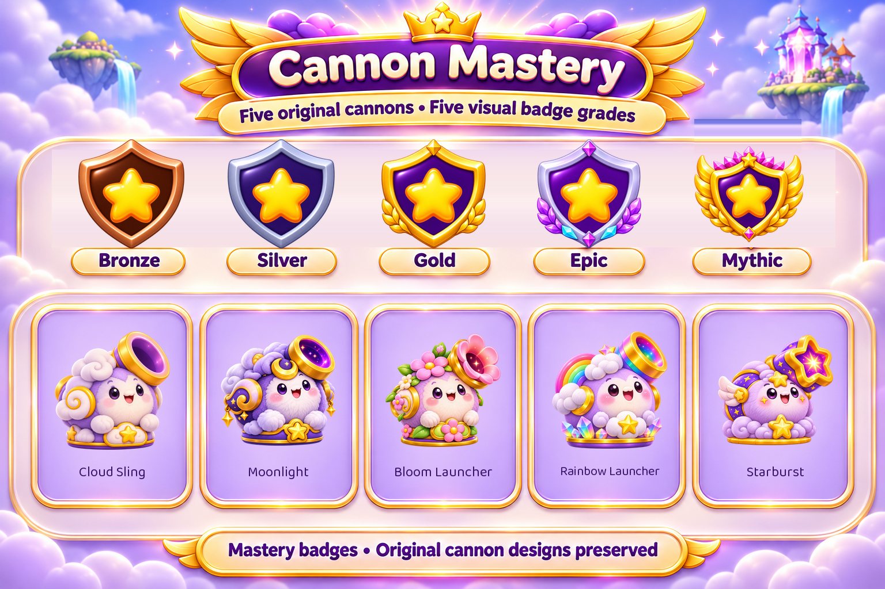

[Manifest](manifest.json) · [Provenance](PROVENANCE.md) · [All sections](../README.md)

## Every individual asset

### badges/bloom-launcher/grade-01

[Master PNG](masters/badges/bloom-launcher/grade-01.png) · [512px WebP](gameplay/badges/bloom-launcher/grade-01-512.webp)

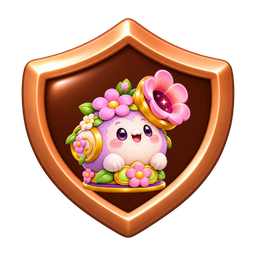

### badges/bloom-launcher/grade-02

[Master PNG](masters/badges/bloom-launcher/grade-02.png) · [512px WebP](gameplay/badges/bloom-launcher/grade-02-512.webp)

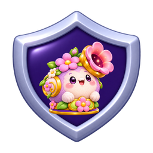

### badges/bloom-launcher/grade-03

[Master PNG](masters/badges/bloom-launcher/grade-03.png) · [512px WebP](gameplay/badges/bloom-launcher/grade-03-512.webp)

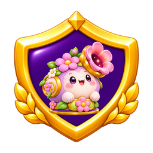

### badges/bloom-launcher/grade-04

[Master PNG](masters/badges/bloom-launcher/grade-04.png) · [512px WebP](gameplay/badges/bloom-launcher/grade-04-512.webp)

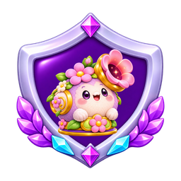

### badges/bloom-launcher/grade-05

[Master PNG](masters/badges/bloom-launcher/grade-05.png) · [512px WebP](gameplay/badges/bloom-launcher/grade-05-512.webp)

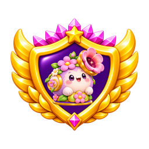

### badges/cloud-sling/grade-01

[Master PNG](masters/badges/cloud-sling/grade-01.png) · [512px WebP](gameplay/badges/cloud-sling/grade-01-512.webp)

### badges/cloud-sling/grade-02

[Master PNG](masters/badges/cloud-sling/grade-02.png) · [512px WebP](gameplay/badges/cloud-sling/grade-02-512.webp)

### badges/cloud-sling/grade-03

[Master PNG](masters/badges/cloud-sling/grade-03.png) · [512px WebP](gameplay/badges/cloud-sling/grade-03-512.webp)

### badges/cloud-sling/grade-04

[Master PNG](masters/badges/cloud-sling/grade-04.png) · [512px WebP](gameplay/badges/cloud-sling/grade-04-512.webp)

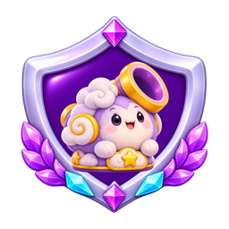

### badges/cloud-sling/grade-05

[Master PNG](masters/badges/cloud-sling/grade-05.png) · [512px WebP](gameplay/badges/cloud-sling/grade-05-512.webp)

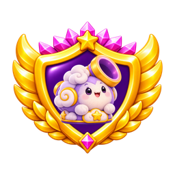

### badges/moonlight-cannon/grade-01

[Master PNG](masters/badges/moonlight-cannon/grade-01.png) · [512px WebP](gameplay/badges/moonlight-cannon/grade-01-512.webp)

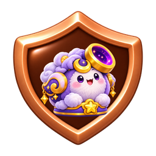

### badges/moonlight-cannon/grade-02

[Master PNG](masters/badges/moonlight-cannon/grade-02.png) · [512px WebP](gameplay/badges/moonlight-cannon/grade-02-512.webp)

### badges/moonlight-cannon/grade-03

[Master PNG](masters/badges/moonlight-cannon/grade-03.png) · [512px WebP](gameplay/badges/moonlight-cannon/grade-03-512.webp)

### badges/moonlight-cannon/grade-04

[Master PNG](masters/badges/moonlight-cannon/grade-04.png) · [512px WebP](gameplay/badges/moonlight-cannon/grade-04-512.webp)

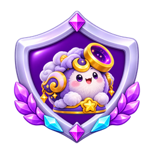

### badges/moonlight-cannon/grade-05

[Master PNG](masters/badges/moonlight-cannon/grade-05.png) · [512px WebP](gameplay/badges/moonlight-cannon/grade-05-512.webp)

### badges/rainbow-launcher/grade-01

[Master PNG](masters/badges/rainbow-launcher/grade-01.png) · [512px WebP](gameplay/badges/rainbow-launcher/grade-01-512.webp)

### badges/rainbow-launcher/grade-02

[Master PNG](masters/badges/rainbow-launcher/grade-02.png) · [512px WebP](gameplay/badges/rainbow-launcher/grade-02-512.webp)

### badges/rainbow-launcher/grade-03

[Master PNG](masters/badges/rainbow-launcher/grade-03.png) · [512px WebP](gameplay/badges/rainbow-launcher/grade-03-512.webp)

### badges/rainbow-launcher/grade-04

[Master PNG](masters/badges/rainbow-launcher/grade-04.png) · [512px WebP](gameplay/badges/rainbow-launcher/grade-04-512.webp)

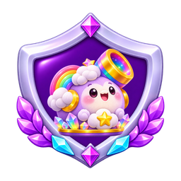

### badges/rainbow-launcher/grade-05

[Master PNG](masters/badges/rainbow-launcher/grade-05.png) · [512px WebP](gameplay/badges/rainbow-launcher/grade-05-512.webp)

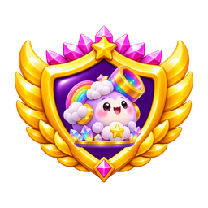

### badges/starburst-cannon/grade-01

[Master PNG](masters/badges/starburst-cannon/grade-01.png) · [512px WebP](gameplay/badges/starburst-cannon/grade-01-512.webp)

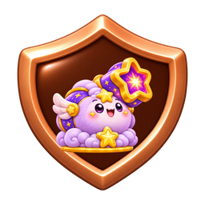

### badges/starburst-cannon/grade-02

[Master PNG](masters/badges/starburst-cannon/grade-02.png) · [512px WebP](gameplay/badges/starburst-cannon/grade-02-512.webp)

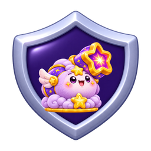

### badges/starburst-cannon/grade-03

[Master PNG](masters/badges/starburst-cannon/grade-03.png) · [512px WebP](gameplay/badges/starburst-cannon/grade-03-512.webp)

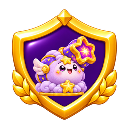

### badges/starburst-cannon/grade-04

[Master PNG](masters/badges/starburst-cannon/grade-04.png) · [512px WebP](gameplay/badges/starburst-cannon/grade-04-512.webp)

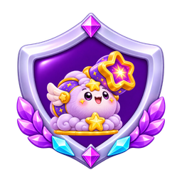

### badges/starburst-cannon/grade-05

[Master PNG](masters/badges/starburst-cannon/grade-05.png) · [512px WebP](gameplay/badges/starburst-cannon/grade-05-512.webp)

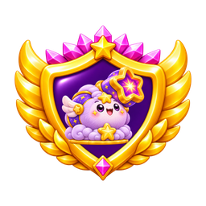

### category/cannon-mastery

[Master PNG](masters/category/cannon-mastery.png) · [512px WebP](gameplay/category/cannon-mastery-512.webp)

### components/star-emblem

[Master PNG](masters/components/star-emblem.png) · [512px WebP](gameplay/components/star-emblem-512.webp)

### grades/grade-01

[Master PNG](masters/grades/grade-01.png) · [512px WebP](gameplay/grades/grade-01-512.webp)

### grades/grade-02

[Master PNG](masters/grades/grade-02.png) · [512px WebP](gameplay/grades/grade-02-512.webp)

### grades/grade-03

[Master PNG](masters/grades/grade-03.png) · [512px WebP](gameplay/grades/grade-03-512.webp)

### grades/grade-04

[Master PNG](masters/grades/grade-04.png) · [512px WebP](gameplay/grades/grade-04-512.webp)

### grades/grade-05

[Master PNG](masters/grades/grade-05.png) · [512px WebP](gameplay/grades/grade-05-512.webp)

### portraits/bloom-launcher

[Master PNG](masters/portraits/bloom-launcher.png) · [512px WebP](gameplay/portraits/bloom-launcher-512.webp)

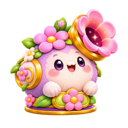

### portraits/cloud-sling

[Master PNG](masters/portraits/cloud-sling.png) · [512px WebP](gameplay/portraits/cloud-sling-512.webp)

### portraits/moonlight-cannon

[Master PNG](masters/portraits/moonlight-cannon.png) · [512px WebP](gameplay/portraits/moonlight-cannon-512.webp)

### portraits/rainbow-launcher

[Master PNG](masters/portraits/rainbow-launcher.png) · [512px WebP](gameplay/portraits/rainbow-launcher-512.webp)

### portraits/starburst-cannon

[Master PNG](masters/portraits/starburst-cannon.png) · [512px WebP](gameplay/portraits/starburst-cannon-512.webp)

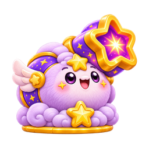

