# Family Mastery

43 individual masters · 258 PNG/WebP exports (128, 256, 512).

Visual asset library only. Tier labels, progress quantities and milestone thresholds are illustrative; no gameplay rules or entitlement changes. Solo-first launch: personal prestige is cosmetic; Event Champion is future-only. Mastery badges do not alter family evolution, cannon upgrades or collision sizes. New ornaments are AI generated; approved portraits and economy art are reused. Runtime labels should remain localized text. PNG/WebP exports are not a tested game integration or animation rig.

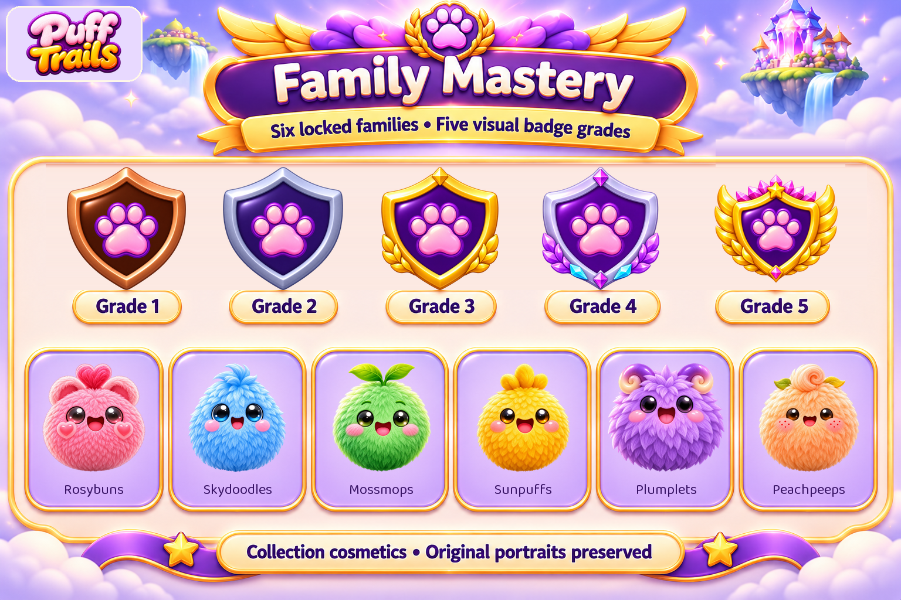

[Manifest](manifest.json) · [Provenance](PROVENANCE.md) · [All sections](../README.md)

## Every individual asset

### badges/mossmops/grade-01

[Master PNG](masters/badges/mossmops/grade-01.png) · [512px WebP](gameplay/badges/mossmops/grade-01-512.webp)

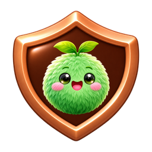

### badges/mossmops/grade-02

[Master PNG](masters/badges/mossmops/grade-02.png) · [512px WebP](gameplay/badges/mossmops/grade-02-512.webp)

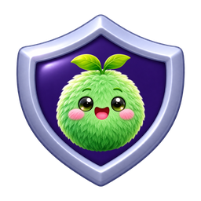

### badges/mossmops/grade-03

[Master PNG](masters/badges/mossmops/grade-03.png) · [512px WebP](gameplay/badges/mossmops/grade-03-512.webp)

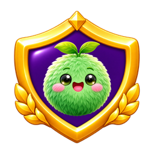

### badges/mossmops/grade-04

[Master PNG](masters/badges/mossmops/grade-04.png) · [512px WebP](gameplay/badges/mossmops/grade-04-512.webp)

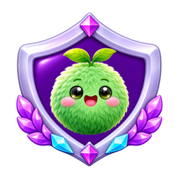

### badges/mossmops/grade-05

[Master PNG](masters/badges/mossmops/grade-05.png) · [512px WebP](gameplay/badges/mossmops/grade-05-512.webp)

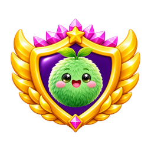

### badges/peachpeeps/grade-01

[Master PNG](masters/badges/peachpeeps/grade-01.png) · [512px WebP](gameplay/badges/peachpeeps/grade-01-512.webp)

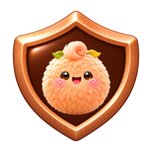

### badges/peachpeeps/grade-02

[Master PNG](masters/badges/peachpeeps/grade-02.png) · [512px WebP](gameplay/badges/peachpeeps/grade-02-512.webp)

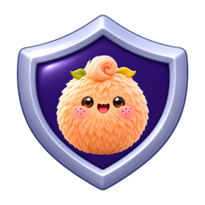

### badges/peachpeeps/grade-03

[Master PNG](masters/badges/peachpeeps/grade-03.png) · [512px WebP](gameplay/badges/peachpeeps/grade-03-512.webp)

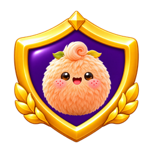

### badges/peachpeeps/grade-04

[Master PNG](masters/badges/peachpeeps/grade-04.png) · [512px WebP](gameplay/badges/peachpeeps/grade-04-512.webp)

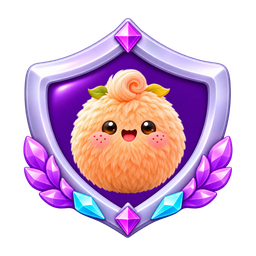

### badges/peachpeeps/grade-05

[Master PNG](masters/badges/peachpeeps/grade-05.png) · [512px WebP](gameplay/badges/peachpeeps/grade-05-512.webp)

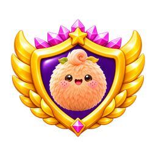

### badges/plumplets/grade-01

[Master PNG](masters/badges/plumplets/grade-01.png) · [512px WebP](gameplay/badges/plumplets/grade-01-512.webp)

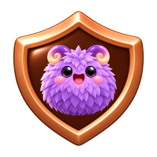

### badges/plumplets/grade-02

[Master PNG](masters/badges/plumplets/grade-02.png) · [512px WebP](gameplay/badges/plumplets/grade-02-512.webp)

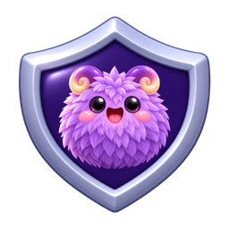

### badges/plumplets/grade-03

[Master PNG](masters/badges/plumplets/grade-03.png) · [512px WebP](gameplay/badges/plumplets/grade-03-512.webp)

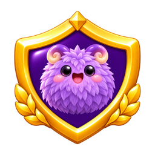

### badges/plumplets/grade-04

[Master PNG](masters/badges/plumplets/grade-04.png) · [512px WebP](gameplay/badges/plumplets/grade-04-512.webp)

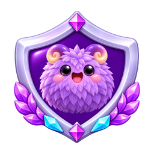

### badges/plumplets/grade-05

[Master PNG](masters/badges/plumplets/grade-05.png) · [512px WebP](gameplay/badges/plumplets/grade-05-512.webp)

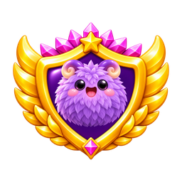

### badges/rosybuns/grade-01

[Master PNG](masters/badges/rosybuns/grade-01.png) · [512px WebP](gameplay/badges/rosybuns/grade-01-512.webp)

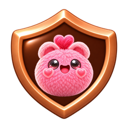

### badges/rosybuns/grade-02

[Master PNG](masters/badges/rosybuns/grade-02.png) · [512px WebP](gameplay/badges/rosybuns/grade-02-512.webp)

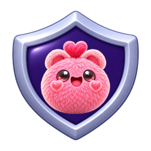

### badges/rosybuns/grade-03

[Master PNG](masters/badges/rosybuns/grade-03.png) · [512px WebP](gameplay/badges/rosybuns/grade-03-512.webp)

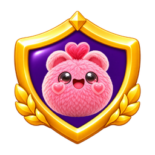

### badges/rosybuns/grade-04

[Master PNG](masters/badges/rosybuns/grade-04.png) · [512px WebP](gameplay/badges/rosybuns/grade-04-512.webp)

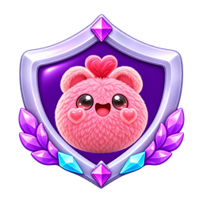

### badges/rosybuns/grade-05

[Master PNG](masters/badges/rosybuns/grade-05.png) · [512px WebP](gameplay/badges/rosybuns/grade-05-512.webp)

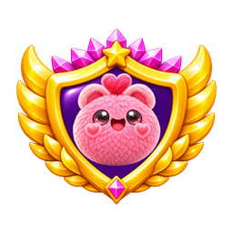

### badges/skydoodles/grade-01

[Master PNG](masters/badges/skydoodles/grade-01.png) · [512px WebP](gameplay/badges/skydoodles/grade-01-512.webp)

### badges/skydoodles/grade-02

[Master PNG](masters/badges/skydoodles/grade-02.png) · [512px WebP](gameplay/badges/skydoodles/grade-02-512.webp)

### badges/skydoodles/grade-03

[Master PNG](masters/badges/skydoodles/grade-03.png) · [512px WebP](gameplay/badges/skydoodles/grade-03-512.webp)

### badges/skydoodles/grade-04

[Master PNG](masters/badges/skydoodles/grade-04.png) · [512px WebP](gameplay/badges/skydoodles/grade-04-512.webp)

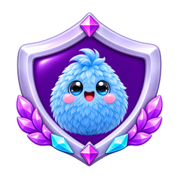

### badges/skydoodles/grade-05

[Master PNG](masters/badges/skydoodles/grade-05.png) · [512px WebP](gameplay/badges/skydoodles/grade-05-512.webp)

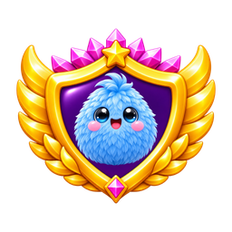

### badges/sunpuffs/grade-01

[Master PNG](masters/badges/sunpuffs/grade-01.png) · [512px WebP](gameplay/badges/sunpuffs/grade-01-512.webp)

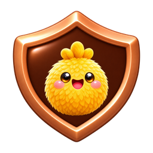

### badges/sunpuffs/grade-02

[Master PNG](masters/badges/sunpuffs/grade-02.png) · [512px WebP](gameplay/badges/sunpuffs/grade-02-512.webp)

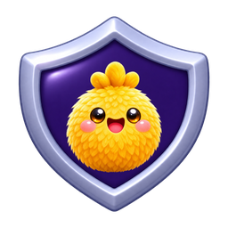

### badges/sunpuffs/grade-03

[Master PNG](masters/badges/sunpuffs/grade-03.png) · [512px WebP](gameplay/badges/sunpuffs/grade-03-512.webp)

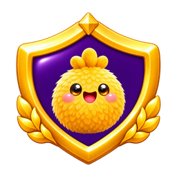

### badges/sunpuffs/grade-04

[Master PNG](masters/badges/sunpuffs/grade-04.png) · [512px WebP](gameplay/badges/sunpuffs/grade-04-512.webp)

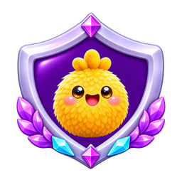

### badges/sunpuffs/grade-05

[Master PNG](masters/badges/sunpuffs/grade-05.png) · [512px WebP](gameplay/badges/sunpuffs/grade-05-512.webp)

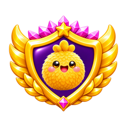

### category/family-mastery

[Master PNG](masters/category/family-mastery.png) · [512px WebP](gameplay/category/family-mastery-512.webp)

### components/paw-emblem

[Master PNG](masters/components/paw-emblem.png) · [512px WebP](gameplay/components/paw-emblem-512.webp)

### grades/grade-01

[Master PNG](masters/grades/grade-01.png) · [512px WebP](gameplay/grades/grade-01-512.webp)

### grades/grade-02

[Master PNG](masters/grades/grade-02.png) · [512px WebP](gameplay/grades/grade-02-512.webp)

### grades/grade-03

[Master PNG](masters/grades/grade-03.png) · [512px WebP](gameplay/grades/grade-03-512.webp)

### grades/grade-04

[Master PNG](masters/grades/grade-04.png) · [512px WebP](gameplay/grades/grade-04-512.webp)

### grades/grade-05

[Master PNG](masters/grades/grade-05.png) · [512px WebP](gameplay/grades/grade-05-512.webp)

### portraits/mossmops

[Master PNG](masters/portraits/mossmops.png) · [512px WebP](gameplay/portraits/mossmops-512.webp)

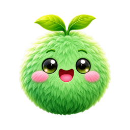

### portraits/peachpeeps

[Master PNG](masters/portraits/peachpeeps.png) · [512px WebP](gameplay/portraits/peachpeeps-512.webp)

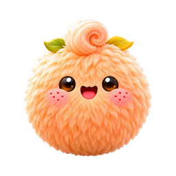

### portraits/plumplets

[Master PNG](masters/portraits/plumplets.png) · [512px WebP](gameplay/portraits/plumplets-512.webp)

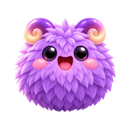

### portraits/rosybuns

[Master PNG](masters/portraits/rosybuns.png) · [512px WebP](gameplay/portraits/rosybuns-512.webp)

### portraits/skydoodles

[Master PNG](masters/portraits/skydoodles.png) · [512px WebP](gameplay/portraits/skydoodles-512.webp)

### portraits/sunpuffs

[Master PNG](masters/portraits/sunpuffs.png) · [512px WebP](gameplay/portraits/sunpuffs-512.webp)

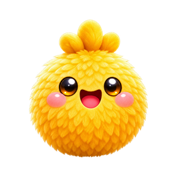

