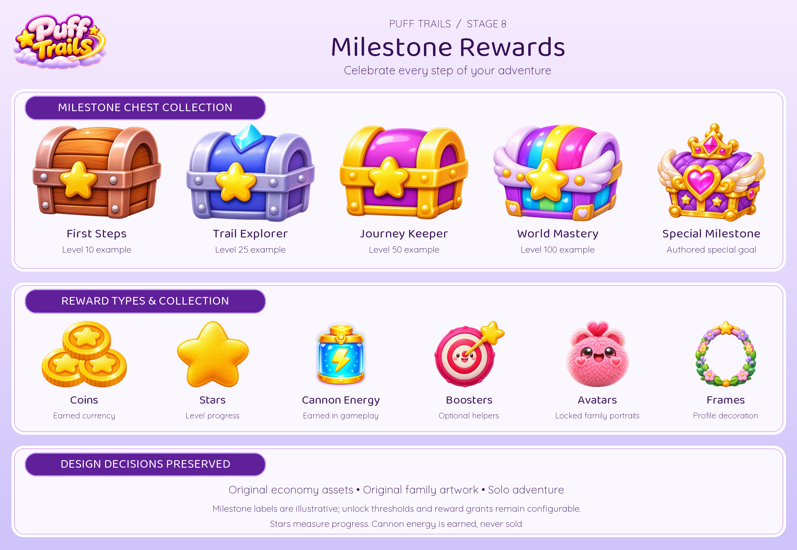
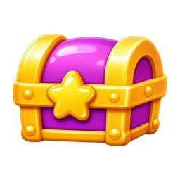
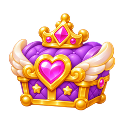
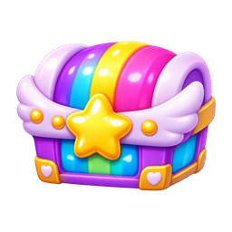
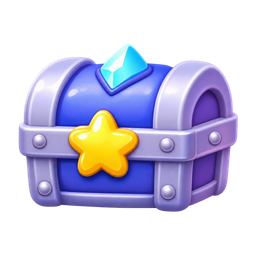
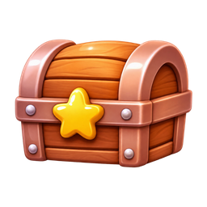
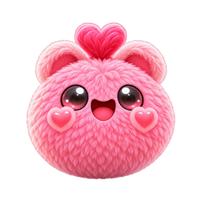
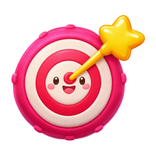
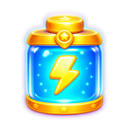
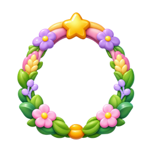

# Milestone Rewards

12 individual masters · 72 PNG/WebP exports (128, 256, 512).

Visual asset library only. Tier labels, progress quantities and milestone thresholds are illustrative; no gameplay rules or entitlement changes. Solo-first launch: personal prestige is cosmetic; Event Champion is future-only. Mastery badges do not alter family evolution, cannon upgrades or collision sizes. New ornaments are AI generated; approved portraits and economy art are reused. Runtime labels should remain localized text. PNG/WebP exports are not a tested game integration or animation rig.

[Manifest](manifest.json) · [Provenance](PROVENANCE.md) · [All sections](../README.md)

## Every individual asset

### chests/golden

[Master PNG](masters/chests/golden.png) · [512px WebP](gameplay/chests/golden-512.webp)

### chests/premium

[Master PNG](masters/chests/premium.png) · [512px WebP](gameplay/chests/premium-512.webp)

### chests/rainbow

[Master PNG](masters/chests/rainbow.png) · [512px WebP](gameplay/chests/rainbow-512.webp)

### chests/silver

[Master PNG](masters/chests/silver.png) · [512px WebP](gameplay/chests/silver-512.webp)

### chests/wooden

[Master PNG](masters/chests/wooden.png) · [512px WebP](gameplay/chests/wooden-512.webp)

### emblems/milestones

[Master PNG](masters/emblems/milestones.png) · [512px WebP](gameplay/emblems/milestones-512.webp)

### rewards/avatar

[Master PNG](masters/rewards/avatar.png) · [512px WebP](gameplay/rewards/avatar-512.webp)

### rewards/boosters

[Master PNG](masters/rewards/boosters.png) · [512px WebP](gameplay/rewards/boosters-512.webp)

### rewards/cannon-energy

[Master PNG](masters/rewards/cannon-energy.png) · [512px WebP](gameplay/rewards/cannon-energy-512.webp)

### rewards/coins

[Master PNG](masters/rewards/coins.png) · [512px WebP](gameplay/rewards/coins-512.webp)

### rewards/frame

[Master PNG](masters/rewards/frame.png) · [512px WebP](gameplay/rewards/frame-512.webp)

### rewards/stars

[Master PNG](masters/rewards/stars.png) · [512px WebP](gameplay/rewards/stars-512.webp)

