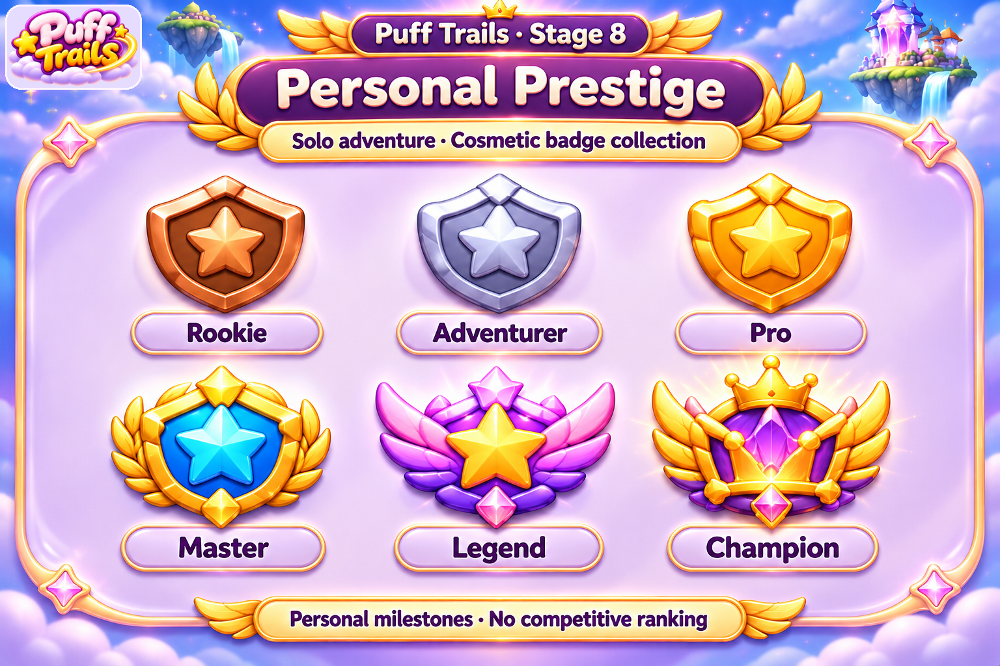
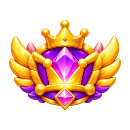
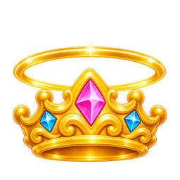

# Player Prestige

7 individual masters · 42 PNG/WebP exports (128, 256, 512).

Visual asset library only. Tier labels, progress quantities and milestone thresholds are illustrative; no gameplay rules or entitlement changes. Solo-first launch: personal prestige is cosmetic; Event Champion is future-only. Mastery badges do not alter family evolution, cannon upgrades or collision sizes. New ornaments are AI generated; approved portraits and economy art are reused. Runtime labels should remain localized text. PNG/WebP exports are not a tested game integration or animation rig.

[Manifest](manifest.json) · [Provenance](PROVENANCE.md) · [All sections](../README.md)

## Every individual asset

### badges/rookie

[Master PNG](masters/badges/rookie.png) · [512px WebP](gameplay/badges/rookie-512.webp)

### badges/adventurer

[Master PNG](masters/badges/adventurer.png) · [512px WebP](gameplay/badges/adventurer-512.webp)

### badges/pro

[Master PNG](masters/badges/pro.png) · [512px WebP](gameplay/badges/pro-512.webp)

### badges/master

[Master PNG](masters/badges/master.png) · [512px WebP](gameplay/badges/master-512.webp)

### badges/legend

[Master PNG](masters/badges/legend.png) · [512px WebP](gameplay/badges/legend-512.webp)

### badges/champion

[Master PNG](masters/badges/champion.png) · [512px WebP](gameplay/badges/champion-512.webp)

### emblems/personal-prestige

[Master PNG](masters/emblems/personal-prestige.png) · [512px WebP](gameplay/emblems/personal-prestige-512.webp)

