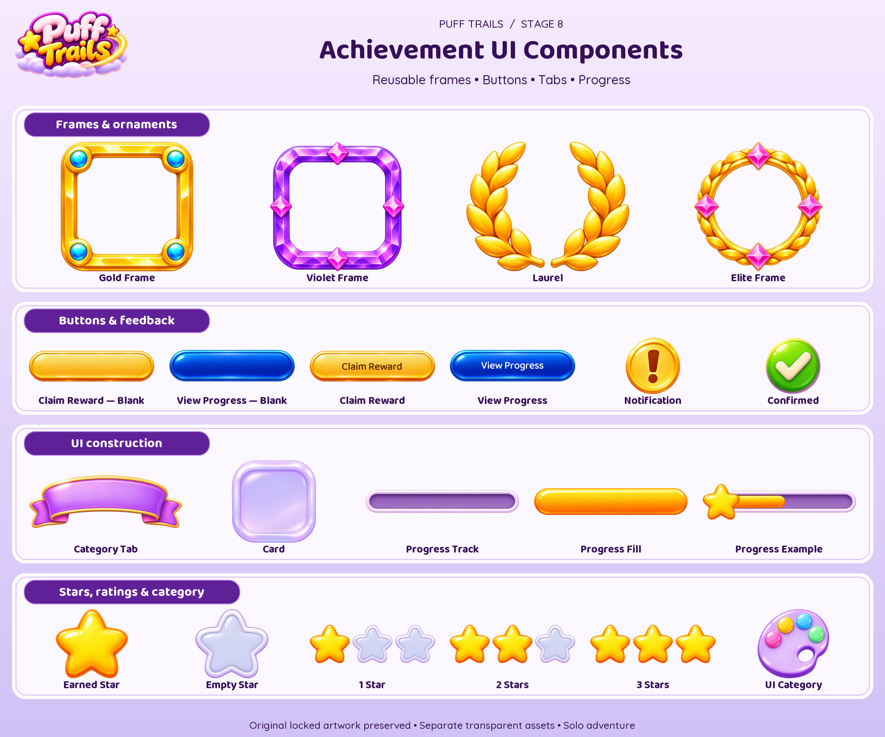
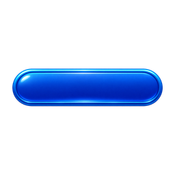
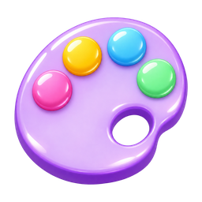
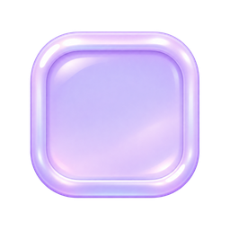
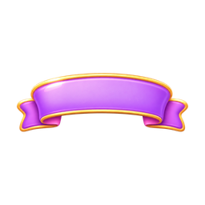
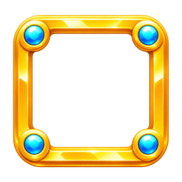
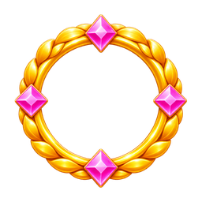
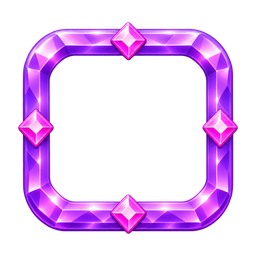

# Ui Components

21 individual masters · 126 PNG/WebP exports (128, 256, 512).

Visual asset library only. Tier labels, progress quantities and milestone thresholds are illustrative; no gameplay rules or entitlement changes. Solo-first launch: personal prestige is cosmetic; Event Champion is future-only. Mastery badges do not alter family evolution, cannon upgrades or collision sizes. New ornaments are AI generated; approved portraits and economy art are reused. Runtime labels should remain localized text. PNG/WebP exports are not a tested game integration or animation rig.

[Manifest](manifest.json) · [Provenance](PROVENANCE.md) · [All sections](../README.md)

## Every individual asset

### buttons/claim-reward-blank

[Master PNG](masters/buttons/claim-reward-blank.png) · [512px WebP](gameplay/buttons/claim-reward-blank-512.webp)

### buttons/claim-reward-labelled

[Master PNG](masters/buttons/claim-reward-labelled.png) · [512px WebP](gameplay/buttons/claim-reward-labelled-512.webp)

### buttons/view-progress-blank

[Master PNG](masters/buttons/view-progress-blank.png) · [512px WebP](gameplay/buttons/view-progress-blank-512.webp)

### buttons/view-progress-labelled

[Master PNG](masters/buttons/view-progress-labelled.png) · [512px WebP](gameplay/buttons/view-progress-labelled-512.webp)

### category/palette

[Master PNG](masters/category/palette.png) · [512px WebP](gameplay/category/palette-512.webp)

### components/card

[Master PNG](masters/components/card.png) · [512px WebP](gameplay/components/card-512.webp)

### components/category-tab

[Master PNG](masters/components/category-tab.png) · [512px WebP](gameplay/components/category-tab-512.webp)

### components/fill

[Master PNG](masters/components/fill.png) · [512px WebP](gameplay/components/fill-512.webp)

### components/star

[Master PNG](masters/components/star.png) · [512px WebP](gameplay/components/star-512.webp)

### components/track

[Master PNG](masters/components/track.png) · [512px WebP](gameplay/components/track-512.webp)

### frames/gold

[Master PNG](masters/frames/gold.png) · [512px WebP](gameplay/frames/gold-512.webp)

### frames/elite

[Master PNG](masters/frames/elite.png) · [512px WebP](gameplay/frames/elite-512.webp)

### frames/laurel

[Master PNG](masters/frames/laurel.png) · [512px WebP](gameplay/frames/laurel-512.webp)

### frames/violet

[Master PNG](masters/frames/violet.png) · [512px WebP](gameplay/frames/violet-512.webp)

### icons/check

[Master PNG](masters/icons/check.png) · [512px WebP](gameplay/icons/check-512.webp)

### icons/empty-star

[Master PNG](masters/icons/empty-star.png) · [512px WebP](gameplay/icons/empty-star-512.webp)

### icons/notification

[Master PNG](masters/icons/notification.png) · [512px WebP](gameplay/icons/notification-512.webp)

### progress/example-half

[Master PNG](masters/progress/example-half.png) · [512px WebP](gameplay/progress/example-half-512.webp)

### ratings/one

[Master PNG](masters/ratings/one.png) · [512px WebP](gameplay/ratings/one-512.webp)

### ratings/three

[Master PNG](masters/ratings/three.png) · [512px WebP](gameplay/ratings/three-512.webp)

### ratings/two

[Master PNG](masters/ratings/two.png) · [512px WebP](gameplay/ratings/two-512.webp)

