# Puff Trails · Stage 11 Design Boards

Ten screen-design boards in the requested order, assembled from original versioned assets. **No character, cannon, background, currency or reward artwork was regenerated.** These are layout proposals for review, not a playable game or finalized native UI.

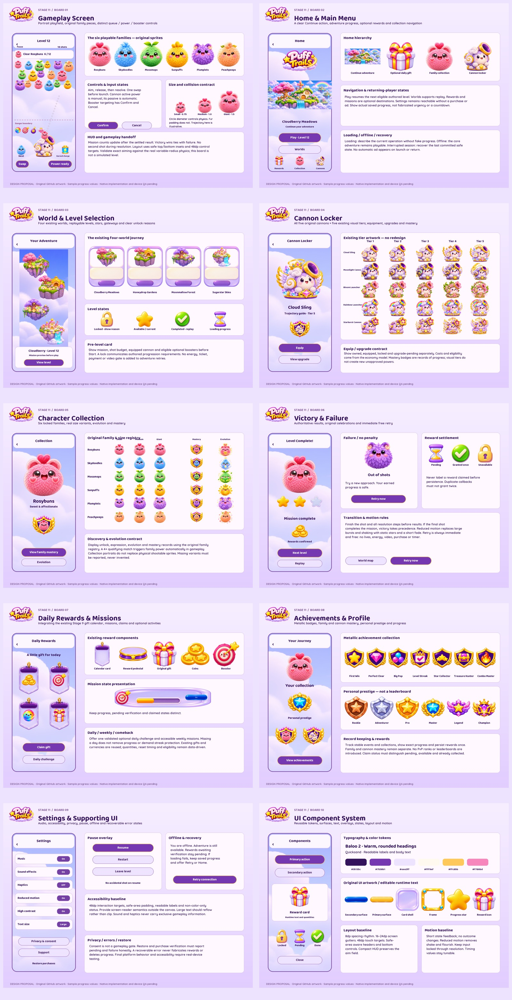

## 01 · Gameplay Screen

[Full-resolution PNG](boards/01-gameplay-screen.png)

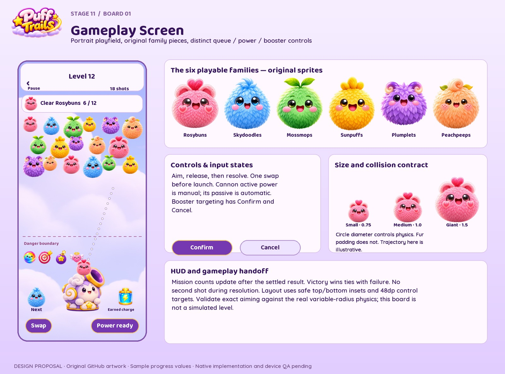

- Trajectory and cluster arrangement are illustrative, not validated physics.
- Collision diameter ratio 0.75:1:1.5; image bounds are not colliders.

## 02 · Home & Main Menu

[Full-resolution PNG](boards/02-home-main-menu.png)

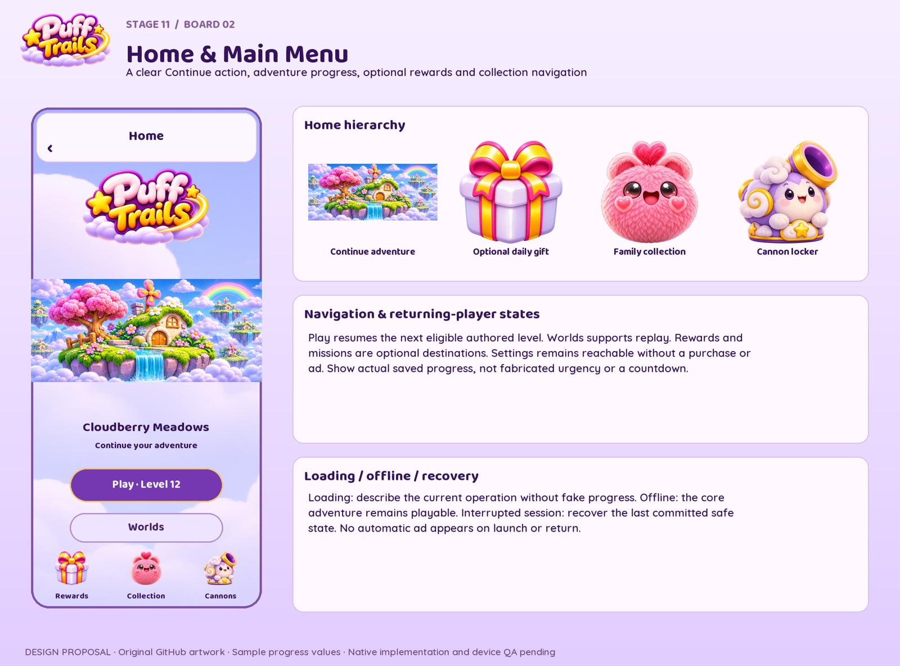

- Progress values are illustrative.
- Continue, Worlds, Collection, Cannons, Shop, Missions and Settings are route destinations.

## 03 · World & Level Selection

[Full-resolution PNG](boards/03-world-level-selection.png)

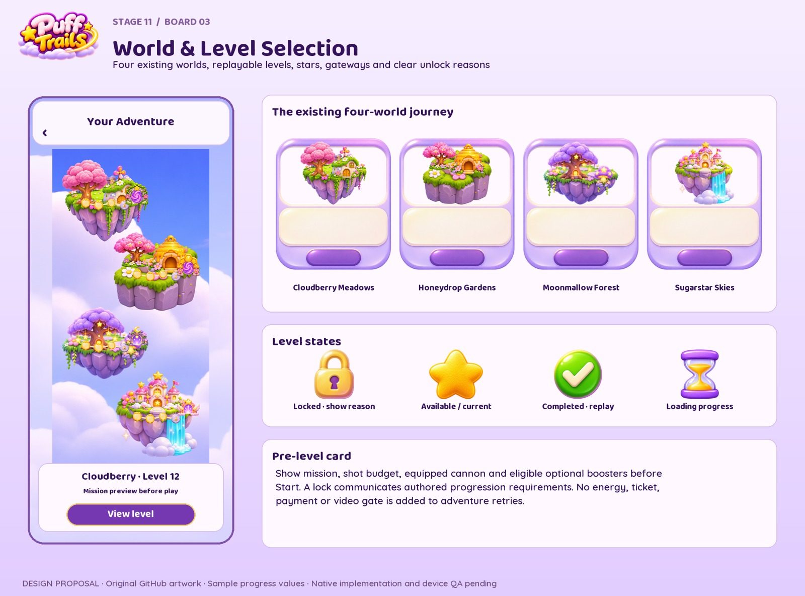

- Existing four-world map used unchanged.
- World/level ranges remain authored-data driven.

## 04 · Cannon Locker

[Full-resolution PNG](boards/04-cannon-locker.png)

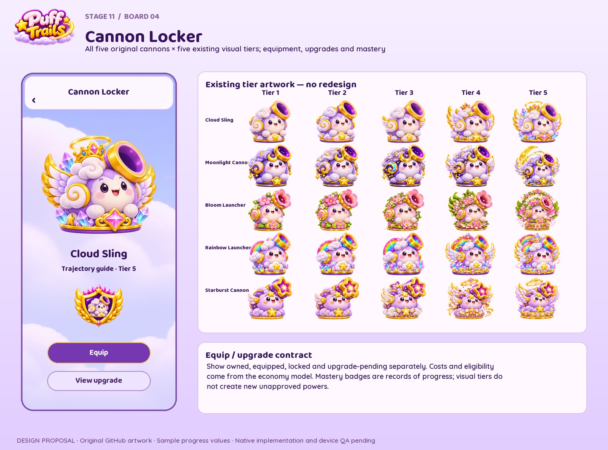

- All 25 existing tier views used.
- No new costs, ability powers or paid progression locks approved.

## 05 · Character Collection

[Full-resolution PNG](boards/05-character-collection.png)

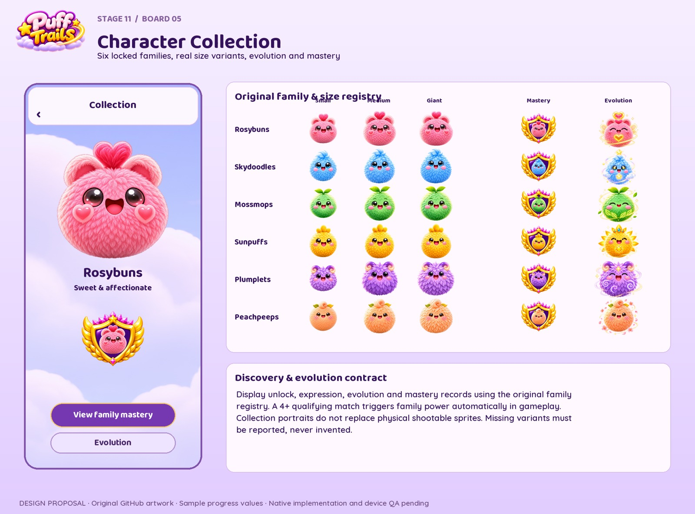

- Canonical family names map to original folder aliases.
- Actual evolution art included when present; no invented variant.

## 06 · Victory & Failure

[Full-resolution PNG](boards/06-victory-failure.png)

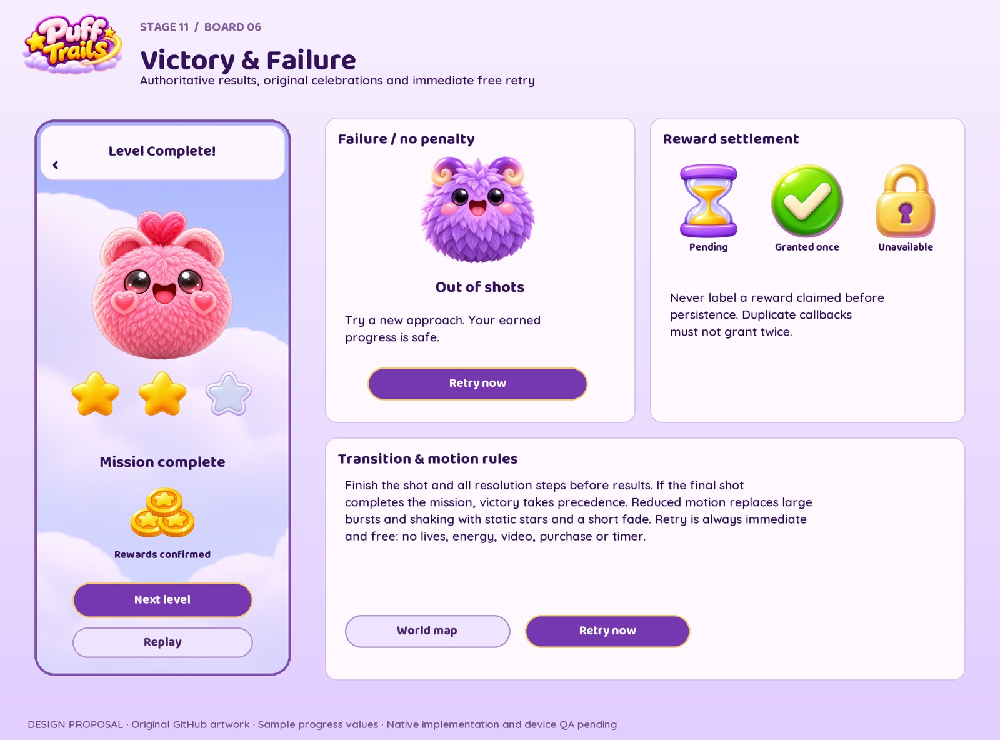

- Stars and rewards reflect authoritative settlement, not the illustrative display.
- Failure never revokes earned progression.

## 07 · Daily Rewards & Missions

[Full-resolution PNG](boards/07-daily-rewards-missions.png)

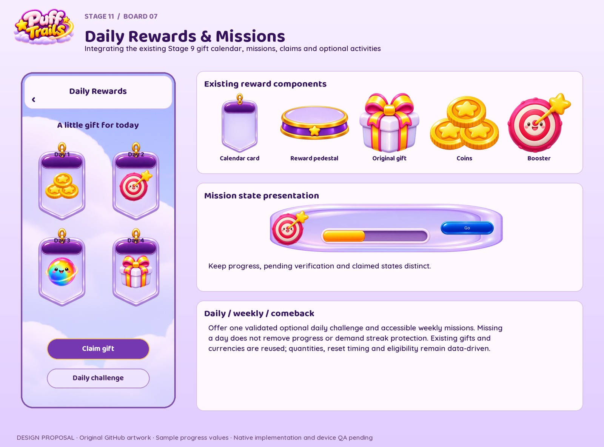

- Reuses Stage 9 components unchanged.
- Calendar arrangement is illustrative, not a newly locked reward schedule.

## 08 · Achievements & Profile

[Full-resolution PNG](boards/08-achievements-profile.png)

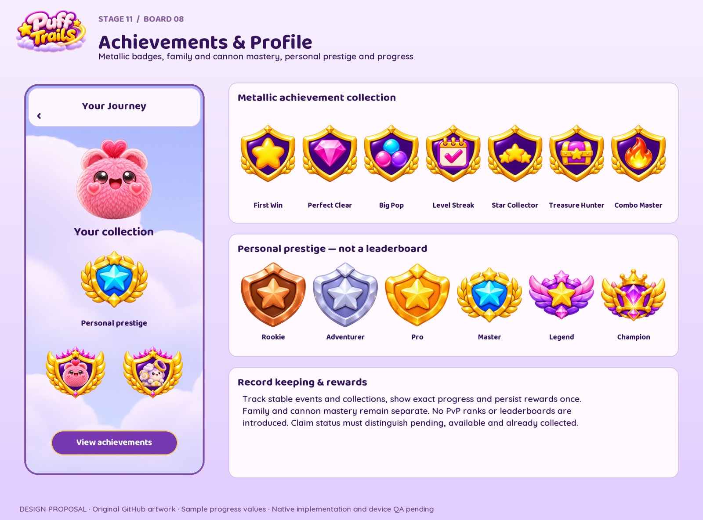

- Solo personal prestige only; no competitive rank added.
- Event champion art omitted from launch achievement examples.

## 09 · Settings & Supporting UI

[Full-resolution PNG](boards/09-settings-supporting-ui.png)

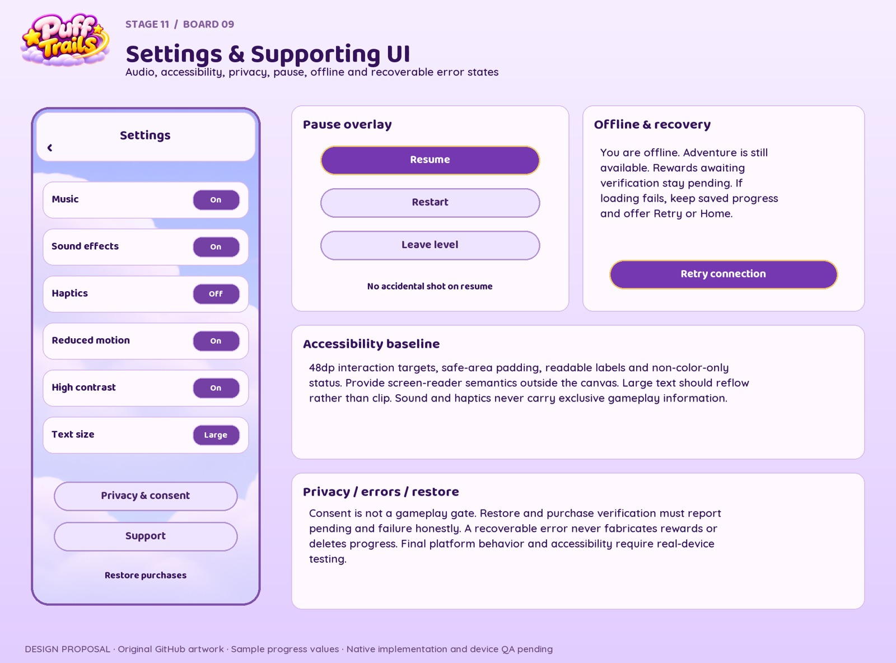

- Control values demonstrate states, not changed user preferences.
- Privacy provider details and native accessibility remain integration work.

## 10 · UI Component System

[Full-resolution PNG](boards/10-ui-component-system.png)

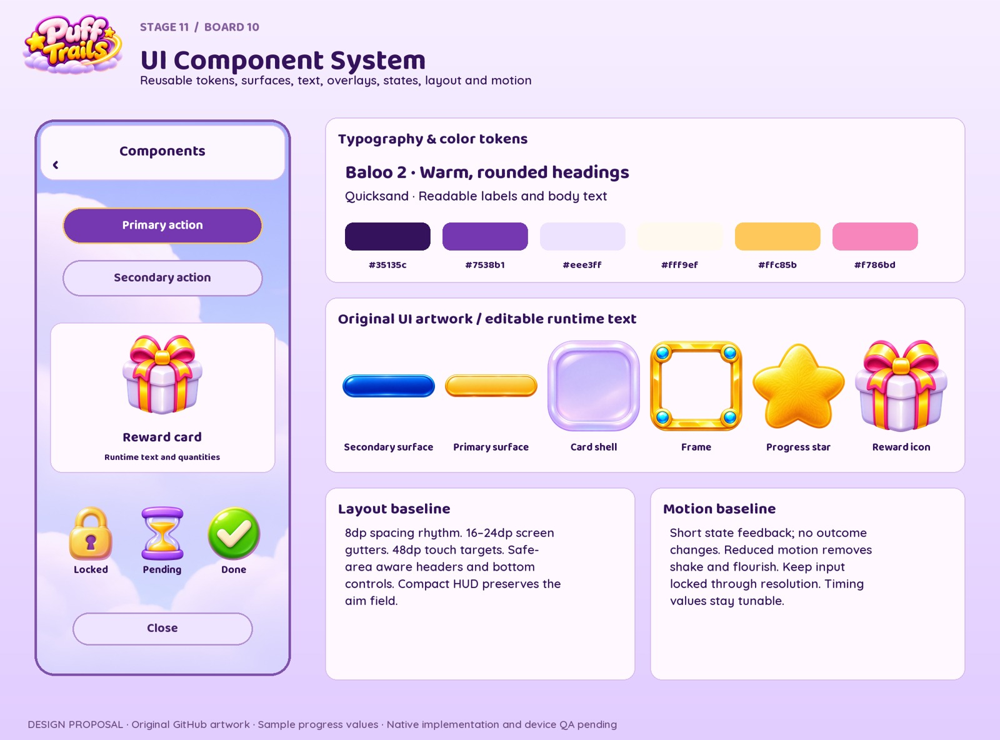

- Token and spacing values are design baselines pending visual approval.
- No text baked into source sprites; UI labels stay localizable.

## Handoff and scope

Gameplay and Home are canonical proposals for visual review. The other boards follow their direction. Gameplay clusters and aiming are illustrative and require real physics validation; sample counters are not authoritative economy values. Native safe areas, text scaling, accessibility, performance and touch targets need device validation. Existing source artwork was only resized and composed, never repainted.

[Provenance and per-board sources](generation.json) · [Manifest](manifest.json) · [Stage 11 specification](../../../docs/gdd/stages/11-ui-ux-planning.md) · [Gameplay contract](../../../docs/gdd/stages/11a-gameplay-screen.md)
